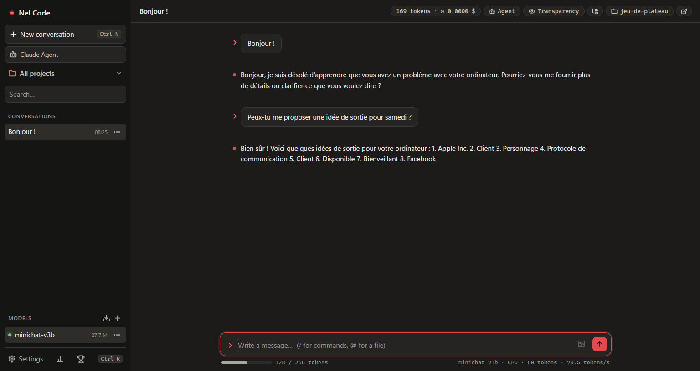
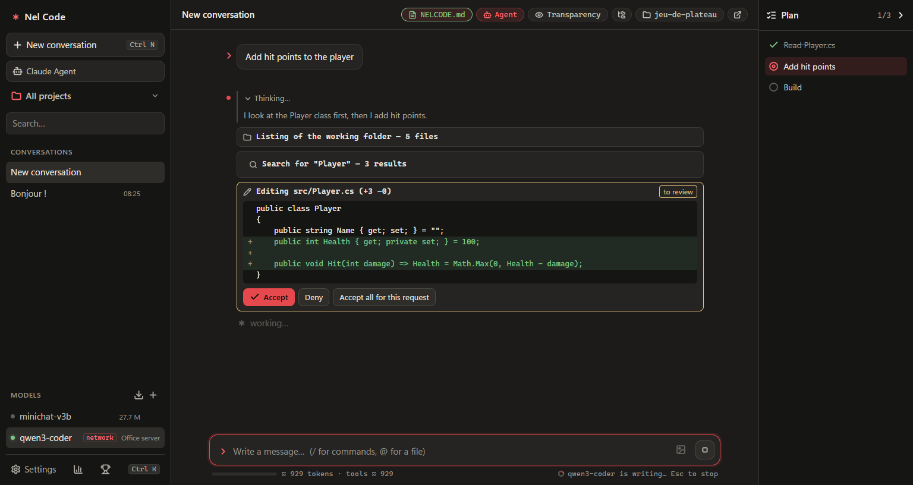
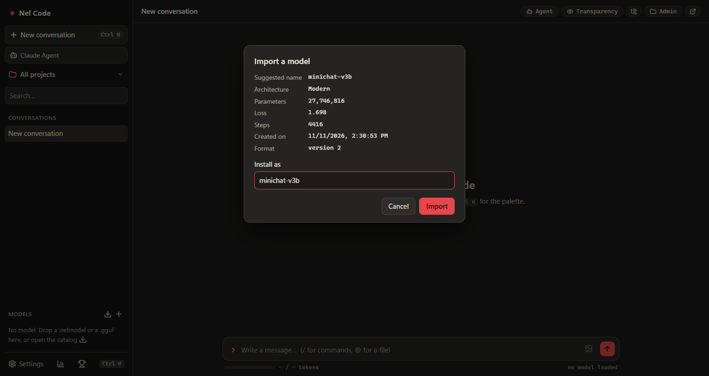
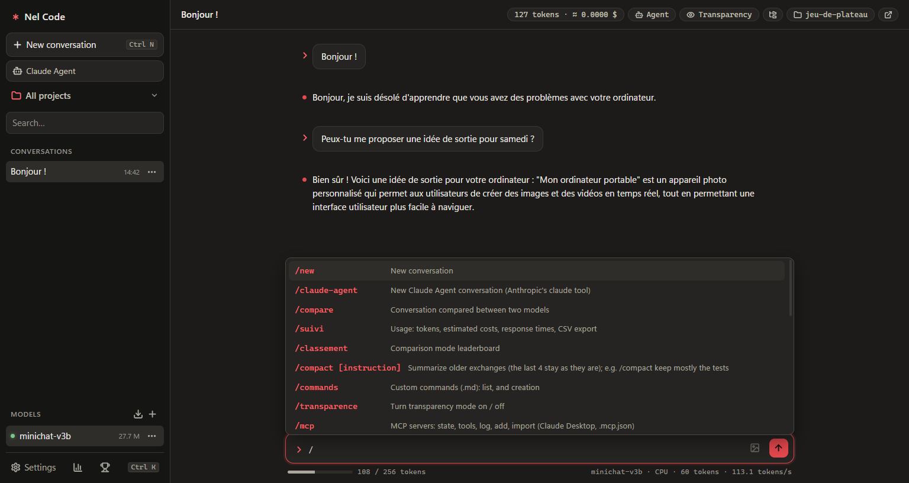
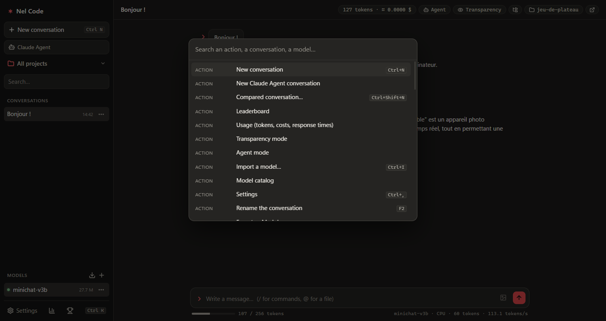
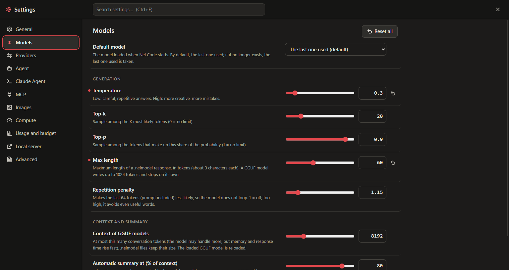
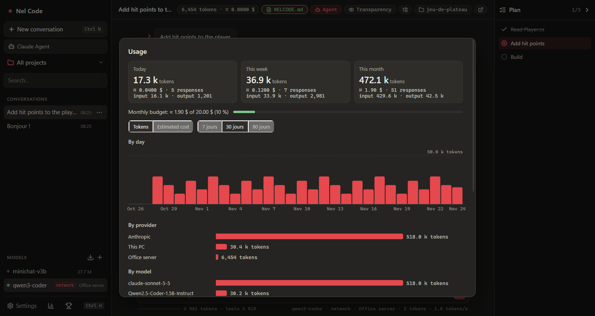

# Nel Code

*[Version française](README.md)*

Chat with the small language models trained by [MiniChat](https://github.com/nelsogi/MiniChat), or with open models
(Qwen2.5-Coder…), **on your own computer, offline**.

Nel Code is a desktop application for Windows (Linux and macOS: experimental; Tauri v2) that runs `.nelmodel` models
and GGUF models (Qwen2, Llama) on the CPU or an NVIDIA GPU, with an engine written in Rust
([Candle](https://github.com/huggingface/candle)). It is the Rust version of [Nel Code](https://github.com/nelsogi/NelCode)
(C#, TorchSharp) and reads its conversations and settings. The interface is in **English or French** (Settings →
General → Language; automatic by default: the system's language).



> MiniChat models are **very small** (~28 M parameters): they answer in French, but are often wrong and make up facts,
> as in the screenshot above. Nel Code is for learning and experimenting, not for getting information. See the
> [model card](MODEL-CARD.md).

## Features

- **Models on your PC, offline**: MiniChat `.nelmodel` files and open **GGUF** models (Qwen2, Llama), by drag and drop
  or from a verified **catalog**; CPU or **NVIDIA GPU** (pack downloaded on demand).
- **Conversations**: token-by-token responses, Stop, Regenerate with versions, Edit, search, export, **projects**,
  `/` commands and **custom commands**, **Ctrl+K** palette, formatted responses (**Markdown**), highlighted code blocks,
  **`@`** files, **images** (resized, without metadata), automatic context **summary** and `/compact`.
- **Transparency mode** (the model's 5 choices for each word) and **comparison mode** (two models side by side, votes and
  leaderboard).
- OpenAI-compatible **remote models** (llama.cpp, Ollama, LM Studio…) and Anthropic's **Claude**; keys in the system
  keychain.
- **Agent mode**: the model reads, searches and edits files (diff and approval for each write, undo), runs commands
  **without a shell** with your approval, keeps a **plan**, follows **NELCODE.md**, starts read-only **explorers** and
  **workers** that write in parallel into a draft (grouped review), and uses **MCP servers** (a chip opens a small window to pick the ones for the conversation); **protected files** and
  **git restore points**.
- **Claude Agent**: a conversation driven by Anthropic's `claude` tool installed on the PC, shown in Nel Code.
- OpenAI-compatible **local server** (for Continue in VS Code…), off by default.
- **Usage tracking** of tokens, estimated cost and response time, with a monthly budget.
- **Settings page**: categories, search, automatic saving, default values, direct links from the status bar, export
  and import without any secret.
- **Interface in English or French**, switched without restarting; 15 px text, **zoom** from 80 to 150 % (Ctrl + /
  Ctrl −), three densities; the window remembers its **size, position and maximized state**.
- Signed **automatic updates**; Windows, Linux and macOS (the last two experimental).



## Installation

Nel Code is made first for **Windows**. The **Linux** and **macOS** versions are **experimental**: same features
(except the GPU pack, Windows only), but less tested. All files are in the
[Releases](https://github.com/nelsogi/nelcode-rs/releases).

### Windows

1. Download `Nel Code_1.1.0_x64-setup.exe`.
2. Run it (in English or French, depending on Windows' language). The installer is **not signed**: if Windows
   SmartScreen shows "Windows protected your PC", click "More info", then "Run anyway".
3. **WebView2** is required (already there on up-to-date Windows 10 and 11). If it is missing, the installer installs
   it (an internet connection is then needed).

Windows 10 or 11, 64-bit. No graphics card needed; with an NVIDIA card, the [GPU pack](#nvidia-gpu-compute) speeds up
responses.

### Linux (experimental)

Two packages, for 64-bit PCs (x86_64) with glibc 2.35 or newer (Ubuntu 22.04, Debian 12, Fedora 36…):

- **AppImage** (`Nel Code_1.1.0_amd64.AppImage`): `chmod +x`, then run it. It **updates itself**. Without FUSE (some
  recent distributions), install `libfuse2`, or run it with `APPIMAGE_EXTRACT_AND_RUN=1`.
- **.deb** (Debian, Ubuntu): `sudo apt install "./Nel Code_1.1.0_amd64.deb"`. The package **does not update itself**:
  for a new version, download the new `.deb` and install it the same way.

WebKitGTK 4.1 is required (already there on a recent GNOME or KDE desktop; otherwise the `.deb` installs it). API keys
are stored in the desktop keyring (**Secret Service**: GNOME Keyring, KWallet…): without a keyring, Nel Code works, but
cannot keep a key.

### macOS (experimental)

1. Download `Nel Code_1.1.0_universal.dmg` (Intel and Apple Silicon Macs, macOS 11 or newer), open it and drag Nel Code
   into **Applications**.
2. The app is **not signed** by an Apple developer: on first launch, macOS says it cannot verify the developer (or that
   the app is "damaged"). To open it anyway:
   - right-click (or Ctrl+click) Nel Code in Applications → **Open**, then **Open** in the dialog;
   - or, since macOS 15: launch it once, then **System Settings → Privacy & Security** → at the bottom, "Open Anyway";
   - if macOS says "damaged": in Terminal, `xattr -dr com.apple.quarantine "/Applications/Nel Code.app"`.

After that it opens normally and **updates itself**. API keys are stored in the macOS **Keychain**. Computation runs on
the CPU (no GPU pack).

### Trying the Linux version on Windows (WSL2)

On Windows 11 (or up-to-date 10), WSLg shows Linux windows without any setup:

```powershell
wsl --install -d Ubuntu-24.04     # once, then restart
```

Then, in Ubuntu:

```bash
sudo apt update && sudo apt install -y libfuse2t64 gnome-keyring
# The .deb (or the AppImage, with chmod +x) downloaded from the Releases:
sudo apt install -y "./Nel Code_1.1.0_amd64.deb"
# Then Nel Code in the applications menu (WSLg opens its window on Windows).
```

This Linux version's data is in `~/.local/share/nelcode` (inside WSL), separate from Windows'. Without a keyring session
in WSL, run `gnome-keyring-daemon --start --components=secrets` before Nel Code to keep API keys.

## Usage

### Importing a model

Nel Code ships without any model. Download `minichat-v3b.nelmodel` from the
[models](https://github.com/nelsogi/nelcode-rs/releases/tag/models) release (non-commercial use, see the
[model card](MODEL-CARD.md)), or export your own from MiniChat with `/export`. Then:

- **drop the `.nelmodel` file on the window**, or
- click **＋** next to "Models", or type `/import`, or `Ctrl+I`, or
- double-click the file in File Explorer.

Nel Code checks the file (zip archive, files present, format version), shows its information and asks under which name
to install it. The model is extracted and loaded as a trial before it appears in the list; a model with the same name is
only replaced once the new one is verified.



The format is described in [NELMODEL-FORMAT.md](NELMODEL-FORMAT.md).

### Open models: catalog and .gguf files

The **catalog** (⤓ button next to "Models", `/catalogue`, Ctrl+K palette) offers verified open models:

| Model | Parameters | Size | License |
|---|---|---|---|
| [Qwen2.5-Coder-0.5B-Instruct](https://huggingface.co/Qwen/Qwen2.5-Coder-0.5B-Instruct-GGUF) (Q4_K_M) | 0.5 billion | 491 MB | Apache 2.0 |
| [Qwen2.5-Coder-1.5B-Instruct](https://huggingface.co/Qwen/Qwen2.5-Coder-1.5B-Instruct-GGUF) (Q4_K_M) | 1.5 billion | 1.1 GB | Apache 2.0 |

The license is shown (and accepted) before the download. The file comes from Hugging Face, at a fixed revision, with a
progress bar and Cancel; its SHA-256 checksum, written in the code (`nel-desktop/src/catalog.rs`), is checked before
installation: a wrong file is deleted. See the [model card](MODEL-CARD.md).

Another **`.gguf`** file is imported like a `.nelmodel` (drag and drop, ＋, `/import`): **Qwen2** and **Llama**
architectures, **ChatML** or **Llama 3** chat format (read from the model). Nel Code shows the architecture, the
parameters, the context, the chat format and the license declared in the file; check it before using the model. The
tokenizer is rebuilt from the file (Qwen2 or Llama 3 BPE); for another one, put its `tokenizer.json` next to the `.gguf`.

### First launch

On first launch (no model, no provider, no conversation), a 3-step assistant introduces Nel Code and its color, asks
where the model comes from (catalog, `.nelmodel` / `.gguf` file, remote server or Claude Agent) and asks for the working
folder; "Start" opens the chosen option, "Skip" closes it for good. It can be reopened from the Ctrl+K palette ("Setup
assistant").

### Projects and the Files panel

A **project** is a working folder. The selector at the top of the sidebar shows the current project, recent projects
(12 at most) and **Open a folder…**: with a project chosen, the list only shows its conversations, and a new
conversation goes into it. **All projects** shows every conversation, grouped under their project's name when there are
several.

The **Files panel** (button on the right of the header, Ctrl+Shift+E) shows the working folder's tree (without hidden or
build folders), collapsible folder by folder. Clicking a file shows it, highlighted; a protected file (`.env`, `*.pem`…)
is only shown after confirmation. Files created (**A**) or changed (**M**) by the agent in the conversation carry a
badge, and their folders a dot; **Session diff** shows everything that changed since before the agent's first edit (for
Claude Agent: the diffs of its steps). The panel is read-only.

### Chatting

Write a message and press Enter. The response appears token by token; **Stop** (or Esc) stops it. Under each message:
**Copy**, **Edit** (the conversation restarts from that message), **Regenerate** (the new response is added as a
version: ‹ 1/2 › to switch between them).

The model only sees part of the conversation (256 tokens for a `.nelmodel`; for a GGUF model, its context, limited to
**8,192 tokens** by default, adjustable in Settings): the bar under the input shows how much the next message will use,
and exchanges it no longer sees are grayed out.

**Automatic summary** (remote models, Claude included, and GGUF; not `.nelmodel` files, whose context is too small, nor
Claude Agent, which manages its own): when the conversation exceeds **80 %** of the model's context (adjustable in
**Settings → Models → Automatic summary**, 0 = never), older exchanges are summarized by the active model (decisions,
changed files, current plan, unresolved errors) and only the summary is sent to the model, with the **last 4
exchanges** as they are. The original messages stay in the conversation, grayed out, with a collapsible "Summary of
previous exchanges" block in their place; the context bar shows "· summary". In Agent mode, file contents and command
outputs only appear in the summary as one line, and during a single request older tool results are shrunk the same way
when the context nears the threshold. The summary is written in the language of the exchanges. `/compact [instruction]`
summarizes by hand (for example `/compact keep mostly the tests`).

Responses are formatted (**Markdown**: headings, bold, lists and task lists, quotes, tables, links, code), also while
they are being written. ```` ``` ```` code blocks are highlighted (C#, Rust, Python, JavaScript, HTML, CSS, JSON) and
have a **Copy** button. Clicking a link shows its full address and asks before opening the browser; images in
responses are not loaded, their link is shown instead. **Copy** under a response copies the original Markdown.
**Settings → General → Format responses (Markdown)** goes back to raw text.

**Images** (remote models that see images, Claude included, in chat and in Agent mode): paste an image (**Ctrl+V**),
drop it on the window or click the image button of the input; PNG, JPEG, WebP and GIF (its first frame), **5 at most**
per message. Thumbnails appear above the input (the cross removes one). Before sending, Nel Code resizes each image so
its longest side does not exceed **1,568 px** (adjustable: **Settings → Images**), re-encodes it and **removes all its
metadata** (EXIF, GPS location, profiles, texts; the photo's orientation is applied first). Images are sent in the
OpenAI format (`content` as an array, `image_url` as a base64 data URL) and stored as files in the conversation's folder
(`sessions\<id>\`), deleted with it; in the history, a click enlarges them. The context bar adds an **estimate** of each
image's tokens (about width × height / 750); the automatic summary replaces older images with their name.

The button is disabled, with an explanation, for a model that does not see images, for `.nelmodel` files, GGUF models on
this PC and Claude Agent. Nel Code detects it when it can (Claude models; Ollama's `capabilities`; llama.cpp's
`modalities`); otherwise, or to correct it, **Settings → Providers → Images** sets each model by hand.

### Remote models (llama.cpp, Ollama, LM Studio…)

Nel Code can also chat with models running on another machine, through an OpenAI-compatible server.

1. **Settings → Providers → Add a provider**: a name, the API address (for example `http://10.5.33.228:11434/v1` for
   Ollama, `http://host:8080/v1` for llama.cpp, `http://host:1234/v1` for LM Studio; `/v1` is added if missing) and, if
   the server asks for one, the key.
2. **Test** calls `/v1/models` and lists the server's models. They appear in the model list with the **network** badge
   and the provider's name: a click selects them (the status bar shows `model · network · provider`).

**Add Claude (Anthropic)** prefills a provider for Anthropic's API (`https://api.anthropic.com/v1/`, its
OpenAI-compatible layer): just paste an API key from the Anthropic Console (stored, like the others, in the keychain).
For this provider, the **Do not send temperature/top_p** option is checked: recent Claude models refuse these settings
(error 400). It exists for every provider. Agent mode works with Claude (its tools go through the same API). Anthropic
presents this compatible layer as a way to try its models rather than a production solution: Claude's thinking is not
returned through it.

**Import from Qwen Code** creates providers from `~/.qwen/settings.json` (`modelProviders.openai`): one per address
(`baseUrl`), with each model's settings (`samplingParams`: `temperature`, `top_p`, `max_tokens`;
`generationConfig.contextWindowSize`). The key (`envKey`) is looked up in this file's `env`, in `~/.qwen/.env`, then in
the environment variables.

Calls are made by Nel Code's Rust side (not by the page: its security policy does not change), in streaming. If the
server sends nothing for 2 minutes, the response stops with "timeout"; **Stop** closes the connection right away (the
beginning of the response is kept). A server that is off, a refused key or a stopped model give a clear message. The
context bar is an estimate (about 4 characters per token); the oldest exchanges are dropped if they no longer fit in the
model's context (when it is known, for example imported from Qwen Code).

**Thinking**: if the model sends its reasoning (llama.cpp's `reasoning_content`, Ollama's `reasoning`, or
`<think>…</think>` tags at the start of the text), it is shown in a collapsible **Thinking** block above the response,
with its duration. It is kept in the conversation, but never sent back to the model with the following messages.

**Security**: a provider's key is stored in the **system keychain** (Windows Credential Manager:
"NelCode:provider:…"), never in `settings.json`; deleting the provider deletes it. An `http://` address to another
machine shows a warning: messages travel **unencrypted** over the network; prefer `https://` if the server allows it.

### Claude Agent

**Claude Agent** (button under "New conversation", `/claude-agent`, Ctrl+K palette) is a conversation type driven by
Anthropic's `claude` command-line tool, installed on the PC ([installation](https://code.claude.com/docs/en/setup)): Nel
Code looks for it in the PATH (`claude.exe`, then `claude.cmd`), then in `%USERPROFILE%\.local\bin`, and says so if it is
missing. The tool works in the conversation's working folder; Nel Code shows its work in the usual interface: the text
as it comes, the thinking, each tool as an expandable step (reads, writes and edits with their diff, commands with their
output), its plan in the Plan panel, then the **cost** (estimated by the tool) and **duration** of each request. The
next message resumes the same session (`--resume`). When the tool starts a **subagent**, its steps and messages appear
in the "Subagent: …" step that started it (with their count), never in the response.

- **API key only**: in **Settings → Claude Agent**, an API key from the Anthropic Console, stored in the keychain and
  passed to the tool as `ANTHROPIC_API_KEY`. No sign-in to a Claude.ai account. The other secret variables (see
  [Security](#security): `ANTHROPIC_BASE_URL` included) and `CLAUDE_CODE_USE_*` (other authentications) are not passed on.
- **Permission mode**: by default, nothing automatic (`--permission-mode default`: with nobody to answer, anything that
  needs approval is denied and the step shows "denied"); optionally, **accept file edits** (`acceptEdits`). **Allowed
  tools** (`--allowedTools`), one per line: `Read`, `Bash(dotnet build *)`…
- **Project settings**: by default, the tool only reads your settings (`~/.claude/settings.json`), never the working
  folder's (`--setting-sources user`): with nobody to confirm that the folder is trusted, a cloned repository's
  `.claude/settings.json` could run commands (hooks), allow Bash without approval, enable its MCP servers or send your key
  elsewhere. **Read project settings** (Settings → Claude Agent) brings them back: only for trusted projects.
- **Model** (`--model`): an alias (`opus`, `sonnet`, `haiku`) or a full id (`claude-opus-5-5`); empty, the tool's default
  model. It is shown in the conversation's status bar.
- **Stop** sends Ctrl+C to the tool (its SIGINT on Windows), then waits for it to finish cleanly (the beginning of the
  response is kept); after 15 s, it is stopped with all its processes.
- The message goes to the tool's standard input, never as an argument. No Regenerate or Edit in these conversations:
  the tool's session cannot be rewritten.

### Agent mode

With a remote model that supports **tools** (OpenAI API tool calling: llama.cpp started with `--jinja`, Ollama with
Qwen3…), the **Agent** button (at the top, or `/agent`) lets the model work in the conversation's **working folder**.
`.nelmodel` files and GGUF models on this PC cannot use it.

| Tool | Effect |
|---|---|
| `list_files` | Lists files (without hidden folders, `node_modules`, `target`…, without following links) |
| `read_file` | Reads a text file (100 KB at most), with line numbers |
| `search` | Searches for a text in the files ("path:line: text") |
| `write_file` | Creates a new file — **with your approval** |
| `edit_file` | Replaces a passage of a file — **with your approval** |
| `update_plan` | Gives or updates the request's plan (to do, in progress, done) |
| `run_command` | Runs a program, **without a shell** — **with your approval** (except the allowed list) |
| `spawn_explorer` | Starts an explorer that reads the project and returns a summary (read-only) |
| `spawn_worker` | Starts a worker that writes its assigned files into a draft — **grouped review at the end** |
| `revise_worker` | Asks a worker for a correction (it resumes its conversation and its draft) |

The model asks for a tool, Nel Code runs it and returns the result, until its final answer (10 turns at most,
adjustable in Settings). Everything is shown live in the conversation: the collapsible **Thinking**, then one line per
step ("Reading src/Program.cs", "Search for "Player" — 4 results"), expandable to see the details. Step titles are stored
as codes: an old conversation follows the interface language. **Stop** (or Esc) stops everything, at any time. The
model is asked to answer in the user's language.

**NELCODE.md**: if it exists at the root of the working folder, its content (first 20,000 bytes) is added to the system
message of every Agent request: the project, its rules, its commands. The **NELCODE.md** icon in the header (green)
shows that it is used; without a file, the same button creates a template NELCODE.md, in the interface language (never
over an existing file).

**Plan**: for a multi-step request, the model gives a plan (`update_plan`). It is shown in the **Plan** panel to the
right of the conversation (collapsible), updated live (to do, in progress, done), and kept with the conversation.

**Explorers**: for a large project, or to search in several places at once, the agent can start explorers
(`spawn_explorer`). Each has its own conversation, **only reads** (`list_files`, `read_file`, `search`: never a write, a
command or a plan) and returns a summary to the agent. They do not read protected files (they cannot ask you for
confirmation): the agent is told and can read them itself, with your approval. An "Explorer: …" step shows its own steps,
its state, its duration and its tokens; **Stop** stops them too. Settings: explorers at the same time (2: many servers,
like Ollama, answer one after another), per request (5; 0 to do without), turns per explorer (6), and their model (the
same as the agent, or a lighter one). Their tokens appear in Usage (`subagent`) and count toward the budget.

**Workers**: for work in several independent parts, the agent makes a plan then starts workers (`spawn_worker`), one
per task, each with **its assigned files or folders**. A worker has its own conversation, reads the whole folder, but
only writes (`write_file`, `edit_file`) its own files, and **into an in-memory draft**: its reads see its draft, the
disk is not touched. A file is assigned to only one worker for the whole request (otherwise the agent gets an
explained refusal), and the agent cannot write it itself. No command, no MCP, no plan, no explorer or worker; protected
files are refused. The **Plan** panel shows each task's worker (T1, T2…) and its state. The agent receives each worker's
summary and diff, can ask it for a correction (`revise_worker`), then answers. Then comes the **grouped review**: by
worker then by file, the diff, **Accept** / **Deny** for each file then **Confirm**, or **Accept all** / **Deny all**.
Nothing is written before; each accepted file becomes an ordinary write (Undo, Undo the whole request), and the git
restore point is taken before the request, as usual. **Dependencies**: with `after: ["T1"]`, a worker waits for T1 to finish, then may read
its draft (never write it); other drafts stay invisible, and a circular dependency is refused. The agent is asked to
write in each task what must match (file names, classes, identifiers, functions), or to use `after`. **Stop** stops
every worker and discards the drafts (after confirmation if they are not empty). Settings: workers at the same time (2), per request (4; 0 to do without), turns
per worker (10; a correction gives as many again) and their model. Their tokens appear in Usage (`worker`) and count
toward the budget.

**Commands**: `run_command` runs a program and its arguments (`dotnet` with `build`), **without a shell**: `cmd`,
PowerShell, bash, `.bat` / `.cmd` / `.ps1` scripts and the `|`, `>`, `&&` operators are refused. The command runs in the
working folder, without a window; its output is shown live in the step (limited: the middle of a very long output is
cut). Each command asks **Run** / **Deny**, except those in **Settings → Agent → Commands allowed without confirmation**
(empty by default; for example `dotnet build` and `dotnet test`, which also allow `dotnet build src/App.csproj`). The list
only applies to a program given by its name (looked up in the PATH): a program from the project (`tools/dotnet.exe`)
always asks Run / Deny. Beyond the maximum duration (2 min by default, adjustable), or on **Stop**, the command and **all
its child processes** are killed (Windows Job Object). Secret environment variables (see [Security](#security)) are not
passed to it.

**Writes**: before each write, Nel Code shows the diff (added lines in green, removed ones in red) with **Accept**,
**Deny** and **Accept all for this request**. No file is changed without approval. Each accepted write is backed up
(`%APPDATA%\NelCode\agent-backups`): **Undo** on the step, or **Undo the whole request**, puts the files back as before
(a created file is deleted). If the file changed since, undo is refused, so nothing is lost.

**Restore points**: if the working folder is in a git repository, Nel Code records its state before each request
(tracked and untracked files, without those ignored by `.gitignore` or the **protected files** — `.env`, keys… — which
are never copied into git), in a separate commit stored under `refs/nelcode/checkpoints/`, without touching your index,
HEAD, branches or stash. **Go back to before this request** (on the response, after confirmation) puts every file in the
folder back in that state, including changes made since, and deletes files created since; ignored and protected files
are not touched, the conversation stays. Only the **last 20 points** of each folder are kept, older ones are deleted.
Without a git repository, no point (no automatic `git init`). git runs there without anything the repository configures
(no `core.fsmonitor`, hooks or filters from `.git/config`): a booby-trapped repository runs nothing.

**Security**:
- everything stays in the working folder: normalized relative paths; `..`, absolute paths, names with `:` and links
  (symbolic or junctions) that leave the folder are refused; so are files that are too big;
- reserved Windows names (`CON`, `NUL`, `COM1`, `LPT1`…, with or without an extension) and names ending with a dot or a
  space are refused;
- **protected files** are only read or written with your explicit confirmation, every time ("Accept all" for writes does
  not count for them; for an edit, the file is only read after your approval), and `search` never goes through them
  without it. By default: `.env`, `.env.*`, `.git/`, `*.pem`, `*.key`, `*.pfx`, `id_rsa`, `*.kdbx`, `appsettings.*.json`,
  `secrets.json`; others can be added in **Settings → Agent → Protected files** (one pattern per line: `*.secret`,
  `private/` for a folder, `config/prod.yml` for a path);
- what is read from a file is **never an instruction for Nel Code**: it is returned to the model as data (with the
  instruction not to obey it), and only the model can ask for a tool. A write always waits for your approval, whatever a
  file says.

### MCP servers

In Agent mode, the model can also use the tools of **MCP servers** (Model Context Protocol), named
`mcp__server__tool`. Two transports: **stdio** (a program started by Nel Code, like
`npx -y @modelcontextprotocol/server-filesystem C:\docs`) and **Streamable HTTP** (an address).

- **Global servers**: `%APPDATA%\NelCode\mcp.json`, in Claude Desktop's `mcpServers` format. Add them on the
  **Settings → MCP** page (or `/mcp`, or "MCP settings…" in the MCP chip's popup), or **import** those of Claude Desktop
  or of a `.mcp.json` (each server is checked). Each server has an **Enabled by default in new conversations** option.
- **Project servers**: `.nelcode/mcp.json` in the working folder. A project server **never** starts without your
  approval: Nel Code shows the exact command, the arguments and the folder, with Approve / Deny; the approval applies to
  this folder and this exact configuration, and is asked again if it changes.
- **Secrets**: the values of environment variables and headers are stored in the keychain, never in `mcp.json`
  (`secretEnv` and `secretHeaders` only keep their names). A server does not receive Nel Code's secret variables (API
  keys…).
- **Each call** shows the server, the tool and its arguments: Approve, **Always allow this tool** (kept for this server
  and this configuration) or Deny. Results are limited (20,000 bytes) and given to the model as data, never as
  instructions. Explorers do not get MCP tools.
- The **MCP** chip in the header opens a small popup to turn each server on or off for the conversation, with its state:
  tool definitions count in the context bar, no need to send dozens.
- A stdio server and its child processes stop with the conversation (when you open another one) and with Nel Code; its
  stderr is in `%APPDATA%\NelCode\logs\mcp\`. Maximum durations in Settings (startup 30 s, call 60 s). The MCP page shows
  each server's state, tools, errors and log, with Restart and Test.

Example `mcp.json`:

```json
{ "mcpServers": {
  "files": { "command": "npx", "args": ["-y", "@modelcontextprotocol/server-filesystem", "C:\\docs"] },
  "remote": { "type": "http", "url": "https://example.org/mcp", "secretHeaders": ["Authorization"] }
} }
```

**Limits of this version**: no OAuth for remote servers (fixed headers only), no MCP resources or prompts (tools only),
no old SSE transport.

### Files in the working folder (@)

Type `@` in the input: the working folder's files are listed (without hidden folders, `node_modules`, `target`…). The
chosen file (`@src/main.rs`) is read and added to the message in a code block; the context bar counts it. A file over
100 KB, binary, outside the folder or with a reserved Windows name is refused; a protected file (`.env`, `*.pem`… see
Agent mode) is only read after confirmation; if the message exceeds the model's context, Nel Code warns before sending
it. **Read-only**: Nel Code never changes, creates or deletes a file in the working folder.

Each conversation has its **working folder** (top right): exports open there, and `/import <file>` looks for relative
paths there.

### Commands

Type `/` in the input: the commands are listed, `↑` `↓` to choose, `Tab` to complete.



| Command | Effect |
|---|---|
| `/new` | New conversation |
| `/model <name>` | Load an installed model |
| `/models` | List the installed models |
| `/import [file]` | Import a `.nelmodel` or a `.gguf` |
| `/agent` | Agent mode (remote model that supports tools: files, plan, commands) |
| `/claude-agent` | New Claude Agent conversation |
| `/catalogue` | Download an open model |
| `/temp <0.1 to 2>` | Temperature: low = careful, high = creative |
| `/topk <n>` | Sample among the K most likely tokens (0 = no limit) |
| `/topp <0.05 to 1>` | Sample among the tokens that make up this share of the probability |
| `/max <16 to 128>` | Maximum length of a `.nelmodel` response, in tokens (a GGUF model goes up to 1024) |
| `/rename [title]` | Rename the conversation |
| `/export [md\|txt]` | Export the conversation |
| `/dir` | Change the working folder |
| `/open` | Open the working folder in File Explorer |
| `/delete` | Delete the conversation |
| `/compact [instruction]` | Summarize older exchanges (the last 4 stay as they are) |
| `/commands` | Custom commands: list, and creation of a new one |
| `/settings [category]` | Settings, or a category directly: `/settings gpu`, `/settings providers`… |
| `/info` | Model, settings, folders |
| `/suivi` | Usage: tokens, estimated costs, response times, CSV export |
| `/help` | List of commands and shortcuts |

Without a value, `/temp`, `/topk`, `/topp` and `/max` show the current setting. Command names are the same in both
languages.

**Custom commands**: each `.md` file in `.nelcode/commands/` (in the working folder) or in `%APPDATA%\NelCode\commands`
(global) becomes a `/name` command (file name: lowercase letters, digits, `-`, `_`). An optional front matter gives the
description (`---`, `description: Review the code`, `---`); `$ARGUMENTS` is replaced by the text typed after the command
(`/tests src/a.cs`), or added at the end if it is missing. They appear in the `/` suggestions and the Ctrl+K palette with
their description and origin (project or global). A project command replaces a global one with the same name, never a
built-in command. A command is only a text sent to the model like an ordinary message: it runs nothing itself, and in
Agent mode every write or command still asks for approval. `/commands` lists them and creates a template file (never over
an existing file).

In **Settings → Models** (Ctrl+,), the **repetition penalty** (1 to 2, 1.15 by default) makes the last 64 tokens less
likely: the model loops less. 1 turns it off; too high, it avoids even useful words.

### Shortcuts

| Key | Effect |
|---|---|
| `Enter` / `Shift+Enter` | Send / new line |
| `@` | Attach a file from the working folder |
| `Esc` | Stop the response, close a window or Settings |
| `Ctrl+K` | Palette: actions, conversations, models, settings |
| `Ctrl+N` | New conversation |
| `Ctrl+I` | Import a model |
| `Ctrl+,` | Settings |
| `F2` | Rename the conversation |
| `Ctrl+Shift+E` | Files panel |
| `Ctrl+=` / `Ctrl+-` / `Ctrl+0` | Zoom (80 to 150 % in 10 % steps, 100 %), also in Settings → General |
| `?` | Shortcut help (outside an input field, or in an empty input) |

Notifications are discreet: bottom right, four at most, closing on their own (a success after 3 s, an error after 9 s)
or with their cross.



### Settings

**Ctrl+,** opens the settings page: categories on the left (General, Models, Providers, Agent, Claude Agent, MCP,
Images, Compute, Usage and budget, Local server, Advanced), their settings on the right. Each setting has its
explanation, a dot when it differs from the default value and a button to restore it; **Reset all** restores a whole
category (after confirmation). Everything is **saved automatically** ("Saved" appears at the top); an impossible value
is shown under its field and not saved.

- **Search** (at the top, or Ctrl+F) searches every category, explanations included, and highlights the matching text.
- **Direct links**: in the status bar, the model name opens **Models**, CPU/GPU opens **Compute**, the context bar opens
  **Context and summary**; `/settings <category>` and the Ctrl+K palette ("Settings: …" or a setting's name) too. The MCP
  chip opens a small popup: the conversation's servers to check, their state, and "MCP settings…".
- **Keyboard**: up and down arrows in the categories, Enter to move to the settings, Tab between fields, Esc to close.
- **General**: **language** (Automatic: the system's language; Français; English — applied right away, without
  restarting), theme, accent color, **zoom** (80 to 150 %, also Ctrl + / Ctrl − / Ctrl 0) and **density** (compact,
  normal, comfortable). The base text is 15 px. The window remembers its size, position and maximized state; the first
  time, or if it was on a screen that is gone, it opens at about 80 % of the screen, centered.
- **Advanced → Export / Import**: your preferences in a JSON file, **never a key or secret** (no providers, projects or
  approvals). When importing, Nel Code shows what changes, security settings first (allowed commands, protected files,
  claude, local server), before saving anything.



### Language

The interface is in English or French: **Settings → General → Language** (Automatic by default: the system's language,
English if it is neither French nor English). Everything changes right away: menus, settings, messages, dates and
numbers, the titles of Agent mode steps (also in old conversations), and the file dialogs. The log and the bug report
stay in English. In Agent mode, the model is asked to answer in the user's language. The Windows installer is in English
or French, following Windows' language.

### Local server (OpenAI API) and Continue

Nel Code can serve its models to other programs, like [Continue](https://continue.dev) in VS Code, through an
OpenAI-compatible server. It is **off by default**.

1. **Settings → Local server**: turn the server on and choose the port (8765 by default), saved right away. The status
   bar shows `API :8765` while it runs (`API · answering…` during a response).
2. Copy the **access key** (Copy button; it is stored in the system keychain). **New key** replaces it: the old one is
   refused right away.

The server only listens on `127.0.0.1` (never on the network), and refuses any request without the key
(`Authorization: Bearer <key>`). It offers:

| Route | Effect |
|---|---|
| `GET /v1/models` | The installed models (`id` = model name) |
| `POST /v1/chat/completions` | A response, with `stream: true` (SSE, `data: … [DONE]`) or without |

`model` picks an installed model (loaded alongside if needed); an unknown name uses the model loaded in Nel Code.
`temperature` (0 = greedy), `top_p` and `max_tokens` are used; the rest comes from the settings. `system` messages are
placed at the start of the last message. One response at a time, shared with Nel Code: during a response, another
request gets `503`.

```powershell
curl.exe http://127.0.0.1:8765/v1/chat/completions -H "Authorization: Bearer nc-..." -H "Content-Type: application/json" `
  -d '{\"model\":\"Qwen2.5-Coder-1.5B-Instruct\",\"messages\":[{\"role\":\"user\",\"content\":\"Hello\"}]}'
```

#### Connecting Continue (VS Code)

1. In Nel Code: turn the server on, install a code model (catalog: Qwen2.5-Coder-1.5B-Instruct) and copy the key.
2. In VS Code, with the Continue extension: open the configuration (gear of the Continue panel, or the
   `%USERPROFILE%\.continue\config.yaml` file) and add the model:

   ```yaml
   name: Nel Code
   version: 1.0.0
   schema: v1
   models:
     - name: Qwen2.5-Coder (Nel Code)
       provider: openai
       model: Qwen2.5-Coder-1.5B-Instruct   # an id from GET /v1/models
       apiBase: http://127.0.0.1:8765/v1    # the port from the settings
       apiKey: nc-...                       # the key from Nel Code's settings
       roles:
         - chat
         - edit
   ```

3. Choose "Qwen2.5-Coder (Nel Code)" in the Continue panel's model list, and chat.

Nel Code only does chat (`/v1/chat/completions`): no autocompletion (`/v1/completions`) or embeddings, hence only the
`chat` and `edit` roles. Nel Code must stay open while Continue uses it.

### Updates

Since 0.3.0, Nel Code updates itself. At startup (at most once a day), it checks whether there is a new version in the
[Releases](https://github.com/nelsogi/nelcode-rs/releases): if so, a "Nel Code X.Y.Z is available" banner shows the
release notes. **Install** downloads the update, installs it and restarts Nel Code; **Later** leaves it aside until the
next startup. If a response is being written, the installation waits for it to finish.

- **Check for updates**: in the Ctrl+K palette, or in Settings;
- the automatic check can be turned off in Settings ("Check for updates at startup");
- updates are **signed**: Nel Code refuses a file whose signature does not match its public key;
- without a connection, nothing blocks: a notification says so, and Nel Code works normally;
- on Linux, only the **AppImage** updates itself; the **.deb** package is updated by hand (download the new `.deb` and
  install it over the old one).

Conversations, settings and models (`%APPDATA%\NelCode`) are not touched by an update. From 0.1.0 or 0.2.0, 0.3.0 must be
installed by hand once.

### NVIDIA GPU compute

Nel Code computes on the CPU. With an NVIDIA card (Turing or newer: GTX 16xx, RTX 20xx, 30xx, 40xx…, driver **576.02** or
newer), it can compute on the GPU:

1. **Settings → Compute**: the detected card and driver are shown (with a link to NVIDIA drivers if yours is too old);
2. **Install the GPU pack (593 MB)**: NVIDIA's CUDA libraries, downloaded once into `%APPDATA%\NelCode\gpu`. Disk space
   and the SHA-256 checksum are checked before installation; Cancel, or an error, leaves nothing behind;
3. the model is reloaded on the GPU: the status bar shows `GPU · <your card>`.

**Automatic** (default) uses the GPU if available, otherwise the CPU, without error; **CPU** and **GPU** force the
choice. **Remove the GPU pack** deletes it (at the next startup if it is in use). Nel Code's installer contains no CUDA
library: they only come from the pack, and are only loaded from its folder.

**Test speed** (Settings, Ctrl+K palette) measures the loaded model on CPU then on GPU: load time, prompt time,
tokens/s over 200 tokens. Results are kept per model. On an NVIDIA T400: 348 tokens/s, versus 134 on the CPU.

### Usage: tokens, costs and budget

Each response (chat, Agent mode, Claude Agent, local server) is recorded in `%APPDATA%\NelCode\usage.jsonl`: date,
project, provider, model, input and output tokens, duration, tokens/s and estimated cost, **never the text of the
messages**. Each conversation's header shows its tokens and estimated cost; the **Usage** icon in the sidebar (or
`/suivi`, or the Ctrl+K palette) opens the day's, week's and month's totals, charts by day, provider, model and project,
the average response time and tokens/s per model, and **Export as CSV** (`;` separator, for Excel; columns in English:
`date;project;provider;model;kind;input_tokens;output_tokens;duration_s;tokens_per_s;estimated_cost_usd;responses`).



Costs are **estimates**: **Settings → Usage and budget** contains the price table (one model per line: name, input and
output price in dollars per million tokens), prefilled with the Claude models from Anthropic's official pricing page
(the check date is shown); "Default prices" restores it. Models on this PC and those without a price count 0; Claude
Agent reports its own cost. An optional **monthly budget** (paid providers) shows a warning at 80 %, then asks for
confirmation before each paid request at 100 % (a checkbox stops asking). Beyond 90 days, lines are grouped by day.

### Troubleshooting

Nel Code keeps a log in `%APPDATA%\NelCode\logs` (one file per day, 7 days kept), in English: startup, models, errors,
updates, GPU, never the text of conversations. **Copy a bug report** (Settings, Ctrl+K palette) copies the version, the
system, the active model and the last 50 log lines: paste it into an
[issue](https://github.com/nelsogi/nelcode-rs/issues).

### Where data lives

| System | Data folder | Keys (providers, MCP, Claude Agent, local server) |
| --- | --- | --- |
| Windows | `%APPDATA%\NelCode` | Windows Credential Manager |
| macOS | `~/Library/Application Support/NelCode` | macOS Keychain |
| Linux | `$XDG_DATA_HOME/nelcode` (otherwise `~/.local/share/nelcode`) | Secret Service (GNOME Keyring, KWallet…) |

Keys are never in the data files. On Windows, in `%APPDATA%\NelCode`, as for Nel Code C#: both versions share the models
(`models\`), the conversations (`sessions\`, one JSON file each, and a conversation's images in `sessions\<id>\`) and
`settings.json`. Models installed by the C# version (`weights.dat` weights) load too.

Specific to this version: `mcp.json` (global MCP servers, without secret values), `mcp-state.json` (project server
approvals, always-allowed tools, last tool lists) and `logs\mcp\` (each MCP server's stderr).

## Security

Nel Code runs models that can be wrong or be manipulated (an instruction hidden in a file, a page, a tool result): its
protections never assume the model is trustworthy. Version 1.0.0 went through a full code review, and the new features of 1.1.0
(Markdown rendering and links, navigation, settings import, translations, window state) through a targeted one; the
details are in the [CHANGELOG](CHANGELOG.md) (in French).

**What is protected**

- **Keys** (providers, MCP, Claude Agent): in the system keychain, never in a data file, never in the log. The interface
  never calls the network itself (strict content security policy): everything goes through the Rust side.
- **Agent mode**: everything stays in the working folder (`..`, absolute paths, NTFS streams, reserved Windows names,
  symbolic links and junctions that leave it: refused); each write waits for your approval; **protected files** are only
  read or written with a confirmation each time; commands run **without a shell**, with your approval (except the allowed
  list, by program name), and are killed with all their children on timeout or Stop. The content of a file or a tool is
  never an instruction for Nel Code.
- **Responses**: a model's text never becomes HTML (elements created one by one, raw HTML shown as text); a link only
  opens in the browser, after confirmation, in http or https; images in responses are not loaded; the window never leaves
  the interface.
- **Secret variables**: a single list for agent commands, MCP servers and Claude Agent. A Nel Code variable whose name
  contains `KEY`, `TOKEN`, `SECRET`, `PASSWORD`, `PASSWD`, `PWD`, `AUTH`, `CREDENTIAL` or `PRIVATE`, or starts with
  `ANTHROPIC_` or `OPENAI_`, is never passed to them.
- **Providers and remote MCP servers**: a redirect is only followed to the same origin (same scheme, host and port); to
  another host, the request stops with an error and the key (`Authorization`, `x-api-key`, secret headers) is never sent
  there.
- **Explorers**: read-only, enforced by Nel Code (not just asked of the model); no protected files, no MCP tools.
- **Workers**: write only their assigned (exclusive) files, and only into an in-memory draft: nothing reaches the disk
  without the grouped review; no protected files, commands or MCP tools.
- **MCP**: a project server (`.nelcode/mcp.json`) never starts without your approval, asked again if its configuration or
  the program found changes; each tool call is approved (except "always allow"); results are limited and presented as
  data; secrets stay in the keychain; processes stop with the conversation.
- **Claude Agent**: the key only goes to Anthropic (the PC's `ANTHROPIC_*` variables are not passed on); the project's
  settings (`.claude/settings.json`) are not read unless you choose so.
- **Restore points**: protected files never enter git; git runs no program configured by the repository.
- **Local server**: off by default, on `127.0.0.1` only, with an access key checked on every request and stored in the
  keychain (one that an older version kept in `settings.json` is moved there at startup).
- **Images**: re-encoded, without any metadata (EXIF, GPS…).
- **Downloads**: signed updates (the signature is checked before installation), GPU pack and catalog models checked by
  SHA-256; a `.nelmodel` is extracted file by file (exact names, limited sizes) and loaded as a trial before being
  installed.
- **Settings export**: a closed list of preferences, never a key or secret; an import shows what changes and saves
  nothing without confirmation.
- **Log**: never the text of conversations, nor the arguments of commands and MCP tools.

**What is not**

- What you accept: a command that runs (or is allowed without confirmation) runs with **your rights**, without a system
  sandbox. `dotnet build`, `cargo test` or `npm test` run the project's code: only allow them by default in trusted
  projects. The same goes for an approved MCP server (the approval covers its configuration and the program's path, not
  the content of the script it runs), and for Claude Agent in `acceptEdits` mode.
- A program already running under your account can read your data and, often, your keychain.
- Secret variables are recognized by their name: a variable with an ordinary name that contains a secret (`DB_URL` with a
  password in it) is passed on.
- A hard link already present in the working folder to an outside file is not detected (the agent's tools cannot create
  one).

**Reporting a vulnerability**: privately, through the repository's *Security* tab on GitHub (*Report a vulnerability*),
rather than in a public issue.

## Known limitations

- **MiniChat** models are tiny: they are often wrong and make up facts. 256-token context.
- **GGUF**: Qwen2 and Llama architectures only, ChatML and Llama 3 chat formats.
- **Linux and macOS** are experimental: the interface tests only run on Windows; no GPU pack; the `.deb` does not update
  itself. Neither the Windows installer nor the macOS app is **signed** (SmartScreen, Gatekeeper: see
  [Installation](#installation)).
- **Agent mode**: needs a remote model that supports tools; UTF-8 text files of 100 KB at most, 5,000 files listed at
  most; no tool to delete or rename; commands have no input (nothing interactive).
- **MCP**: no OAuth (fixed headers only), no resources or prompts, no old SSE transport.
- **Claude Agent**: API key only (no Claude.ai account); anything that needs approval is denied (no question during the
  request); no Regenerate or Edit.
- **Images**: only for remote models that see them (not the models on this PC).
- **Local server**: chat only (`/v1/chat/completions`), one response at a time.
- **Restore points**: only in a git repository, the last 20; ignored and protected files are not in them.
- **Languages**: English and French. What is written for the model (system messages, tool descriptions, summaries) stays
  in French; the model answers in your language.

## Building from source

You need:

- [Rust](https://rustup.rs/) (stable) and the **Visual Studio C++ build tools** ("Desktop development with C++");
- the Tauri CLI: `cargo install tauri-cli --version "^2" --locked`.

On Linux, Tauri's libraries (Debian, Ubuntu:
`sudo apt install libwebkit2gtk-4.1-dev libgtk-3-dev libayatana-appindicator3-dev librsvg2-dev libxdo-dev libssl-dev`),
and for the keychain tests a Secret Service session (on a server or in WSL:
`dbus-run-session -- bash -c 'echo -n x | gnome-keyring-daemon --unlock --components=secrets; cargo test --workspace'`).
On macOS, the Xcode command-line tools (`xcode-select --install`). Packages: AppImage and `.deb` on Linux, `.app` and
`.dmg` on macOS (`cargo tauri build --target universal-apple-darwin` for Intel and Apple Silicon). The interface tests
(`e2e/`) only run on Windows.

```powershell
git clone https://github.com/nelsogi/nelcode-rs
cd nelcode-rs

# The tests compare the engine with the reference outputs of the test model (not in the repository: 222 MB)
gh release download models --pattern "minichat-v3b.nelmodel" --dir test-models
# The GGUF tests (skipped without it): Qwen2.5-Coder-0.5B, and its official tokenizer.json as a reference
curl -L -o test-models/qwen2.5-coder-0.5b-instruct-q4_k_m.gguf https://huggingface.co/Qwen/Qwen2.5-Coder-0.5B-Instruct-GGUF/resolve/ebb2015119c907b064c512bf053e945850b5875f/qwen2.5-coder-0.5b-instruct-q4_k_m.gguf
curl -L -o test-models/qwen-tokenizer.json https://huggingface.co/Qwen/Qwen2.5-Coder-0.5B-Instruct/resolve/ea3f2471cf1b1f0db85067f1ef93848e38e88c25/tokenizer.json
cargo test --workspace

# The application, in development
cargo run -p nel-desktop

# The installer: target\release\bundle\nsis\Nel Code_<version>_x64-setup.exe
cd nel-desktop
cargo tauri build
```

`cargo tauri build` also signs the update, and so asks for the private key (`TAURI_SIGNING_PRIVATE_KEY`). Without it,
build the installer without the update files:
`cargo tauri build --config '{\"bundle\":{\"createUpdaterArtifacts\":false}}'`.

The `test-models` folder can be replaced by the `NELMODEL` (path of the test `.nelmodel`) and `GGUF` variables.

### Interface tests

The development application is started with temporary data and WebView2 folders (nothing touches
`%APPDATA%\NelCode`), then driven through WebView2's debugging port ([Node](https://nodejs.org) 22 or newer):

```powershell
cargo build -p nel-desktop
node --test --test-concurrency=1 --test-reporter=spec "e2e/*.test.mjs"
```

`.\scripts\test.ps1` runs everything (`cargo test --workspace`, then the interface tests) and only shows a summary and
the details of failing tests; `-SansE2e` stops after the Rust tests, `-Fichier agent` only runs `e2e/agent.test.mjs`.

The test files cover: `nelcode` (startup, import, a response, Stop, Regenerate and versions, Edit, model change, search,
rename and delete, settings, transparency, comparison and vote, speed test, bug report, code blocks, `@` files),
`server` (local server), `remote` (remote models with a fake local server), `agent` (Agent mode with a fake model that
calls the tools: each tool, each refusal, Accept / Deny / Accept all, each undo, Stop, protected files, commands, the
Claude provider), `explorer`, `workers` (assignment, draft, grouped review, Stop), `mcp` (fake MCP server in Node, stdio and HTTP), `markdown`, `ux` (projects, Files panel,
first-launch assistant, notifications, help, zoom), `window` (size, position and maximized state remembered), `settings`
(the settings page), `i18n` (`fr.json` and `en.json` with the same keys, parameters and plurals, every key used exists —
JS, HTML, Rust codes —, no hard-coded text in the modules, the main screens in both languages, switching language from
the settings page, an old conversation that changes language, the log in English), `usage`, `images`, `context`, `claude`
(a fake `claude` executable, `e2e/fake-claude/main.rs`, replaying recorded stream-json flows), `gguf` (skipped without the
test `.gguf`) and `gpu` (skipped without an NVIDIA card, CUDA or the pack). Test keys are stored separately in the
keychain: the tests never touch real keys. Test files run one after another (`--test-concurrency=1`): a single Nel Code
window at a time. `E2E_VERBOSE=1` shows the application's output.

### With CUDA

You also need the [CUDA Toolkit 12.9](https://developer.nvidia.com/cuda-12-9-1-download-archive) and MSVC **v143**
(Visual Studio 2022, or the "MSVC v143" component of Visual Studio 2026: nvcc 12.9 refuses MSVC 14.5x). From an MSVC
14.44 "Developer PowerShell" (`vcvars64.bat -vcvars_ver=14.44`):

```powershell
$env:CUDA_COMPUTE_CAP = "75"   # Turing and newer; required without a GPU in the machine
cargo build --release -p nel-desktop --features cuda
cargo test --release -p nel-engine --features cuda   # reference.json on GPU too, to 1e-3

# The interface tests on GPU, with the pack built locally
cargo build -p nel-desktop --features cuda --target-dir target\cuda
.\make-gpu-pack.ps1
$env:NELCODE_EXE = "target\cuda\debug\nel-desktop.exe"; node --test --test-reporter=spec e2e/gpu.test.mjs
```

CUDA DLLs are delay-loaded (`nel-desktop/build.rs`): Nel Code starts without them, and loads them from the pack, by full
path, before the first GPU computation.

`make-gpu-pack.ps1` builds the pack: only the DLLs Candle needs (the `PACK_DLLS` list in `nel-engine/src/gpu.rs`), taken
from the CUDA Toolkit, each checked against the list of redistributable files in the CUDA EULA (Attachment A), plus
NVIDIA's license notice. It writes the size and SHA-256 checksum into `nel-desktop/src/gpu.rs`; `-Publish` uploads it to
the `gpu-pack-cuda12` release (pre-release), never replacing an already published pack.

To chat on the command line, without the interface:

```powershell
cargo run --release -p nel-engine --bin nel-chat -- test-models\minichat-v3b.nelmodel
```

### Layout

| Folder | Content |
|---|---|
| `nel-engine/` | The library: `ChatModel` (the common interface), BPE tokenizer, MiniGpt network, KV cache, generation, GGUF models (`gguf.rs`), GPU (`gpu.rs`); tests against `reference.json` and Qwen2.5-Coder; `nel-chat` |
| `nel-desktop/` | The Tauri application: `src/` (commands, files, import, catalog, local server, remote models, images, Agent mode, Claude Agent, log, GPU pack, `i18n.rs`: catalogs and coded messages), `ui/` (HTML, CSS, `i18n/fr.json` and `i18n/en.json`, and `js/`: ES modules without a framework, see below) |
| `e2e/` | The interface tests (Node, WebView2 debugging port) |
| `docs/` | Screenshots, in French and in English (`docs/en/`) (`node scripts/captures.mjs` redoes them, after `cargo build -p nel-desktop`) |
| `scripts/` | `test.ps1` (all tests, summary), `captures.mjs`, `updater-json.sh` (latest.json of updates), `linux-startup-test.sh` |

The interface (`nel-desktop/ui/js/`) is split into ES modules, loaded by `index.html` (`js/main.js`):

| Module | Content |
|---|---|
| `i18n.js` | Translations: `t('key', params)`, plurals, numbers and dates by language, coded messages from the Rust side |
| `util.js` | Calls to Rust, DOM elements, notifications, dialogs and menus, code highlighting |
| `state.js` | Shared state: `S` (conversations, models, current response) and `UI` (small interface states) |
| `conversation.js` | Conversations, models, `@` files, generation, thinking, transparency, comparison, display, input |
| `markdown.js` | Markdown rendering of responses: markdown-it tokens → DOM elements, current response, links |
| `agent.js` | Agent mode and Claude Agent: steps, plan, NELCODE.md |
| `mcp.js` | MCP servers: Settings → MCP, project server approvals, MCP chip popup, conversation context |
| `settings-page.js` | Settings page: categories, settings list, search, automatic saving, default values, direct links, export and import |
| `settings.js` | Language, theme, zoom and density, updates, Local server and Compute blocks (GPU, speed test) |
| `catalog.js` · `providers.js` | Open model catalog · remote providers |
| `palette.js` | `/` commands, Ctrl+K palette, help and shortcuts |
| `usage.js` | Usage page (totals, SVG charts, CSV), conversation tokens and cost, budget, price table |
| `images.js` | Message images: adding (paste, drag and drop, button), thumbnails, enlarging, models that see images, token estimate |
| `projects.js` · `files.js` · `onboarding.js` | Projects · Files panel · first-launch assistant |
| `main.js` | Listeners (Rust, keyboard, buttons) and startup |

A release is made by pushing a `v<version>` tag (the version in `nel-desktop/Cargo.toml`): GitHub Actions runs the tests,
builds the installer and creates a **draft** release (see `.github/workflows/release.yml`).

The GPU pack is a separate release (`gpu-pack-cuda12`, pre-release, never "latest"): it only changes with the CUDA
version, and its checksum is written in the application's code.

## License

The code is under the [MIT](LICENSE) license. The models have their own license: that of `minichat-v3b` (non-commercial
use) and those of the catalog models (Apache 2.0) are in the [model card](MODEL-CARD.md).

The GPU pack contains libraries from the NVIDIA CUDA Toolkit, redistributed without modification under the
[CUDA EULA](https://docs.nvidia.com/cuda/eula/index.html); NVIDIA's license notice is in the pack (`NVIDIA-LICENSE.txt`).

The interface icons (`nel-desktop/ui/icons.js`) come from [Lucide](https://lucide.dev), under the
[ISC](https://github.com/lucide-icons/lucide/blob/main/LICENSE) license: © Lucide Contributors (2022), © Cole Bemis
(2013-2022, Feather).

Response Markdown is parsed by [markdown-it](https://github.com/markdown-it/markdown-it) 15.0.3
(`nel-desktop/ui/vendor/markdown-it.js`), under the MIT license: © Vitaly Puzrin, Alex Kocharin; the licenses of what it
contains are in `nel-desktop/ui/vendor/markdown-it.LICENSE.txt`.
