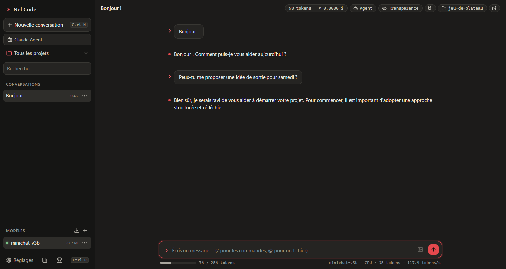
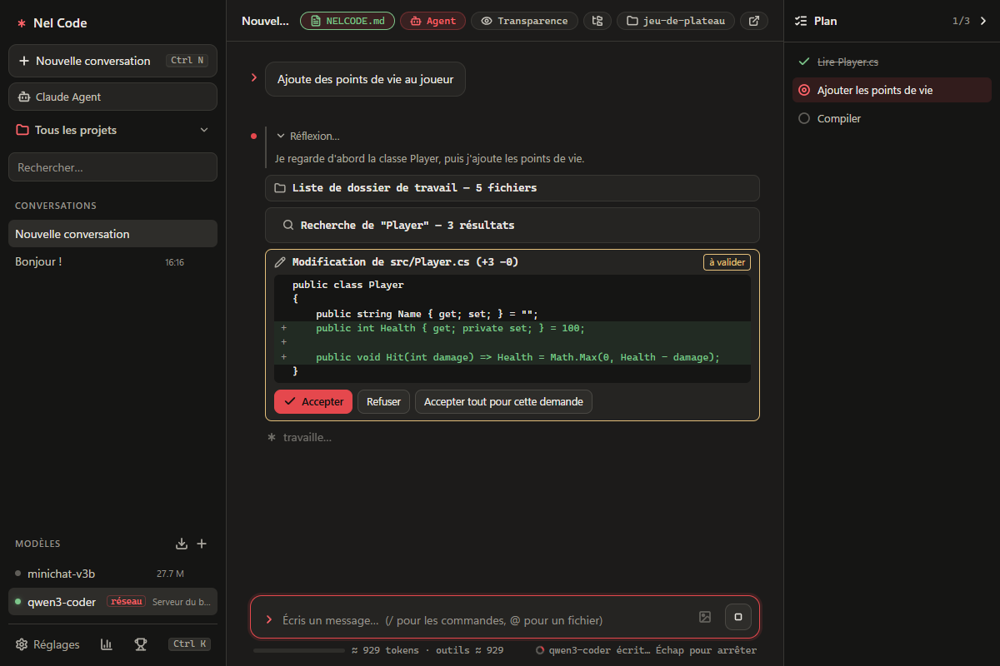
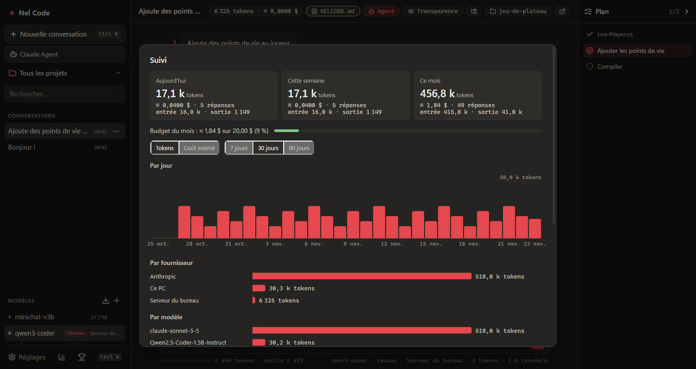

# Nel Code

*[Version française](README.md)*

Chat with the small language models trained by [MiniChat](https://github.com/nelsogi/MiniChat), or with open models
(Qwen2.5-Coder…), **on your own computer, offline**.

Nel Code is a desktop application for Windows (Linux and macOS: experimental; Tauri v2) that runs `.nelmodel` models
and GGUF models (Qwen2, Llama) on the CPU or an NVIDIA GPU, with an engine written in Rust
([Candle](https://github.com/huggingface/candle)). It is the Rust version of [Nel Code](https://github.com/nelsogi/NelCode)
(C#, TorchSharp) and reads its conversations and settings. The interface is in French.



> MiniChat models are **very small** (~28 M parameters): they answer in French but are often wrong and make up facts.
> Nel Code is for learning and experimenting, not for getting information. See the [model card](MODEL-CARD.md).

## Features

- **Models on your PC, offline**: MiniChat `.nelmodel` files and open **GGUF** models (Qwen2, Llama), by drag and drop
  or from a verified **catalog**; CPU or **NVIDIA GPU** (pack downloaded on demand).
- **Conversations**: token-by-token streaming, Stop, Regenerate with versions, Edit, search, export, **projects**, `/`
  commands and **custom commands**, **Ctrl+K** palette, **Markdown** replies, highlighted code blocks, **`@` files**, **images** (resized,
  metadata stripped), **automatic context summary** and `/compact`.
- **Transparency mode** (the model's top 5 choices for each word) and **comparison mode** (two models side by side,
  votes and leaderboard).
- **Remote models** through OpenAI-compatible servers (llama.cpp, Ollama, LM Studio…) and Anthropic's **Claude**; keys
  in the system keychain.
- **Agent mode**: the model reads, searches and edits files (diff and approval for every write, undo), runs commands
  **without a shell** with your approval, keeps a **plan**, follows **NELCODE.md**, spawns read-only **explorers** and
  uses **MCP servers**; **protected files** and **git restore points**.
- **Claude Agent**: a conversation driven by Anthropic's `claude` command-line tool installed on your PC, shown in Nel
  Code.
- **Local server** compatible with the OpenAI API (for Continue in VS Code…), off by default.
- **Usage tracking**: tokens, estimated cost and response time, with a monthly budget.
- **Signed automatic updates**; Windows, Linux and macOS (the last two are experimental).



## Installation

Everything is in the [Releases](https://github.com/nelsogi/nelcode-rs/releases). Nel Code is built first for
**Windows**; the **Linux** and **macOS** versions are **experimental** (same features except the GPU pack, less tested).

### Windows

1. Download `Nel Code_1.0.1_x64-setup.exe` and run it. The installer is **not signed**: if Windows SmartScreen shows
   "Windows protected your PC", click "More info", then "Run anyway".
2. **WebView2** is needed (already present on up-to-date Windows 10 and 11); the installer installs it if missing.

Windows 10 or 11, 64-bit. No graphics card needed; with an NVIDIA card, the [GPU pack](#nvidia-gpu) speeds things up.

### Linux (experimental)

For 64-bit PCs (x86_64) with glibc 2.35 or newer (Ubuntu 22.04, Debian 12, Fedora 36…):

- **AppImage** (`Nel Code_1.0.1_amd64.AppImage`): `chmod +x`, then run it. It **updates itself**. Without FUSE,
  install `libfuse2` or run it with `APPIMAGE_EXTRACT_AND_RUN=1`.
- **.deb** (Debian, Ubuntu): `sudo apt install "./Nel Code_1.0.1_amd64.deb"`. It does **not** update itself: install the
  new `.deb` the same way.

WebKitGTK 4.1 is needed. API keys go to the desktop keychain (**Secret Service**: GNOME Keyring, KWallet…); without
one, Nel Code works but cannot keep keys.

### macOS (experimental)

1. Download `Nel Code_1.0.1_universal.dmg` (Intel and Apple Silicon, macOS 11 or later), open it and drag Nel Code to
   **Applications**.
2. The app is **not signed** by an Apple developer. To open it the first time: right-click Nel Code → **Open**; or,
   since macOS 15, **System Settings → Privacy & Security** → "Open Anyway"; if macOS says the app is "damaged":
   `xattr -dr com.apple.quarantine "/Applications/Nel Code.app"`.

It then **updates itself**. API keys go to the macOS **keychain**. Computation runs on the CPU.

## Usage

### Models

Nel Code ships without a model. Download `minichat-v3b.nelmodel` from the
[models](https://github.com/nelsogi/nelcode-rs/releases/tag/models) release (non-commercial use), then **drag it into
the window** (or **＋** next to "Modèles", `/import`, `Ctrl+I`, or double-click the file). Nel Code checks the file,
shows its details, and test-loads it before adding it. The format is described in [NELMODEL-FORMAT.md](NELMODEL-FORMAT.md).

The **catalog** (`/catalogue`, Ctrl+K) offers Qwen2.5-Coder-0.5B and 1.5B-Instruct (GGUF Q4_K_M, Apache 2.0),
downloaded from Hugging Face at a fixed revision and checked against a SHA-256 written in the code. Other **`.gguf`**
files import like a `.nelmodel` (Qwen2 and Llama architectures, ChatML or Llama 3 chat format).

### Remote models

**Settings → Providers → Add a provider**: a name, the API address (`http://host:11434/v1` for Ollama,
`http://host:8080/v1` for llama.cpp…) and, if needed, a key. **Test** lists the server's models. **Add Claude
(Anthropic)** prefills Anthropic's OpenAI-compatible API: paste an API key from the Anthropic Console. **Import from
Qwen Code** reads `~/.qwen/settings.json`. Keys are stored in the system keychain, never in `settings.json`; an
`http://` address to another machine shows a warning.

### Agent mode

With a remote model that supports **tools** (OpenAI tool calling), the **Agent** button lets the model work in the
conversation's **working folder**:

| Tool | Effect |
|---|---|
| `list_files`, `read_file`, `search` | List, read (100 KB max) and search files |
| `write_file`, `edit_file` | Create a file, replace a passage — **with your approval** (diff shown) |
| `update_plan` | The request's plan, shown in the Plan panel |
| `run_command` | Run a program **without a shell** — **with your approval** (unless allow-listed) |
| `spawn_explorer` | An explorer that reads the project and returns a summary (read-only) |
| `mcp__server__tool` | Tools of configured MCP servers — **with your approval** (unless "always allow") |

Every accepted write is backed up and can be **undone** (one step, or the whole request). If the folder is in a git
repository, a **restore point** is taken before each request (in a separate ref, without touching your index, HEAD,
branches or stash); **Revert to before this request** restores it. **NELCODE.md** at the root of the folder is added
to the system prompt. **Protected files** (`.env`, `.env.*`, `.git/`, `*.pem`, `*.key`, `*.pfx`, `id_rsa`, `*.kdbx`,
`appsettings.*.json`, `secrets.json`, plus your own patterns) are only read or written after an explicit confirmation,
every time.

**MCP servers**: global ones in the data folder's `mcp.json`, project ones in `.nelcode/mcp.json` (never started
without your approval, asked again when their configuration changes); stdio and Streamable HTTP; secrets in the
keychain. Manage them on the **MCP page** (`/mcp`), or import those of Claude Desktop.

### Claude Agent

A conversation type driven by Anthropic's `claude` command-line tool installed on your PC
([setup](https://code.claude.com/docs/en/setup)), shown in Nel Code's interface (text, steps with diffs, plan, cost).
**API key only** (Settings → Claude Agent, stored in the keychain and passed as `ANTHROPIC_API_KEY`). Permission mode
"default" (nothing automatic) or `acceptEdits`, allowed tools, model. By default the tool reads **only your own
settings**, never the working folder's `.claude/settings.json` (`--setting-sources user`): a cloned repository could
otherwise run hooks, allow Bash, enable its MCP servers or send your key elsewhere. **Read project settings** turns
them back on, for trusted projects only.

### Local server

**Settings → Local server** (off by default): an OpenAI-compatible API on `127.0.0.1` only (`GET /v1/models`,
`POST /v1/chat/completions`, streaming or not), every request needing the access key (`Authorization: Bearer …`).
Use it from [Continue](https://continue.dev) in VS Code with `provider: openai` and `apiBase: http://127.0.0.1:8765/v1`.

### Updates

Nel Code checks the Releases at startup (at most once a day) and offers to **install** new versions. Updates are
**signed**: a file whose signature does not match Nel Code's public key is refused. On Linux, only the AppImage
updates itself.

### NVIDIA GPU

**Settings → Compute** shows your card and driver; **Install the GPU pack (593 MB)** downloads NVIDIA's CUDA libraries
once (size and SHA-256 checked) and Nel Code reloads the model on the GPU (Turing or newer, driver 576.02 or newer;
Windows only).

### Usage tracking

Each response is recorded in `usage.jsonl` (date, project, provider, model, tokens, duration, estimated cost — **never
the text**). The **Usage** page (`/suivi`) shows totals, charts, response times, a CSV export and an optional monthly
budget.



### Where data lives

| System | Data folder | Keys (providers, MCP, Claude Agent, local server) |
| --- | --- | --- |
| Windows | `%APPDATA%\NelCode` | Windows Credential Manager |
| macOS | `~/Library/Application Support/NelCode` | macOS keychain |
| Linux | `$XDG_DATA_HOME/nelcode` (else `~/.local/share/nelcode`) | Secret Service |

The log (`logs/`, 7 days) never contains conversation text. **Copy a bug report** (Settings, Ctrl+K) copies the
version, system, active model and the last 50 log lines.

## Security

Nel Code runs models that can be wrong or manipulated (an instruction hidden in a file, a web page, a tool result): its
protections never assume the model is trustworthy. Version 1.0.0 went through a full code review; details are in the
[CHANGELOG](CHANGELOG.md) (in French).

**What is protected**

- **Keys** (providers, MCP, Claude Agent): in the system keychain, never in a data file or the log. The web interface
  never calls the network itself (strict content security policy); everything goes through the Rust side.
- **Agent mode**: everything stays inside the working folder (`..`, absolute paths, NTFS streams, Windows reserved
  names, symbolic links and junctions that leave the folder are refused); every write waits for your approval;
  **protected files** are read or written only after a confirmation each time; commands run **without a shell**, with
  your approval (except the allow list, by program name), and are killed with all their children on timeout or Stop.
  File and tool contents are never instructions for Nel Code.
- **Replies**: model text never becomes HTML (elements are created one by one, raw HTML is shown as text); a link only
  opens in the browser, after a confirmation showing the full address, over http or https; images in replies are not
  loaded; the window never leaves the interface.
- **Secret variables**: one list for agent commands, MCP servers and Claude Agent. A Nel Code environment variable
  whose name contains `KEY`, `TOKEN`, `SECRET`, `PASSWORD`, `PASSWD`, `PWD`, `AUTH`, `CREDENTIAL` or `PRIVATE`, or
  starts with `ANTHROPIC_` or `OPENAI_`, is never passed to them.
- **Providers and remote MCP servers**: redirects are only followed to the same origin (same scheme, host and port); to
  another host the request stops with an error and the key (`Authorization`, `x-api-key`, secret headers) never goes
  there.
- **Explorers**: read-only, enforced by Nel Code (not just asked of the model); no protected files, no MCP tools.
- **MCP**: a project server never starts without your approval, asked again if its configuration or resolved program
  changes; each tool call is approved (unless "always allow"); results are size-limited and framed as data; secrets
  stay in the keychain; processes stop with the conversation.
- **Claude Agent**: the key only goes to Anthropic (`ANTHROPIC_*` variables of your PC are not passed); project
  settings (`.claude/settings.json`) are not read unless you choose so.
- **Restore points**: protected files never enter git; git runs nothing configured by the repository (no
  `core.fsmonitor`, hooks or filters from `.git/config`).
- **Local server**: off by default, `127.0.0.1` only, access key checked on every request and stored in the keychain
  (a key that an older version kept in `settings.json` is moved there at startup).
- **Images**: re-encoded without any metadata (EXIF, GPS…).
- **Downloads**: signed updates, GPU pack and catalog models checked by SHA-256; a `.nelmodel` is extracted file by
  file (exact names, size limits) and test-loaded before installation.
- **Log**: never conversation text, nor the arguments of commands and MCP tools.

**What is not**

- What you approve: a command you run (or allow without confirmation) runs **with your rights**, without an OS sandbox.
  `dotnet build`, `cargo test` or `npm test` run project code: only allow them in trusted projects. The same goes for an
  approved MCP server (the approval covers its configuration and program path, not the content of the script it runs)
  and for Claude Agent in `acceptEdits` mode.
- A program already running under your account can read your data and often your keychain.
- Secret variables are recognized by their name: a variable with an ordinary name that holds a secret (`DB_URL`
  with a password inside) is passed.
- A hard link already present in the working folder that points outside is not detected (the agent's tools cannot
  create one).

**Reporting a vulnerability**: privately, through the GitHub repository's *Security* tab (*Report a vulnerability*),
rather than in a public issue.

## Known limitations

- **MiniChat** models are tiny: they are often wrong and make up facts. 256-token context.
- **GGUF**: Qwen2 and Llama architectures only, ChatML and Llama 3 chat formats.
- **Linux and macOS** are experimental: interface tests only run on Windows; no GPU pack; the `.deb` does not update
  itself. Neither the Windows installer nor the macOS app is **signed** (SmartScreen, Gatekeeper: see
  [Installation](#installation)).
- **Agent mode**: needs a remote model with tool calling; UTF-8 text files of 100 KB at most, 5,000 listed files at
  most; no tool to delete or rename; commands get no input (nothing interactive).
- **MCP**: no OAuth (fixed headers only), no resources or prompts, no legacy SSE transport.
- **Claude Agent**: API key only (no Claude.ai account); anything needing approval is refused (no prompt during a
  request); no Regenerate or Edit.
- **Images**: only for remote models that support them (not the models on your PC).
- **Local server**: chat only (`/v1/chat/completions`), one response at a time.
- **Restore points**: only inside a git repository, the last 20; ignored and protected files are not included.
- The interface is in French.

## Building from source

You need [Rust](https://rustup.rs/) (stable), the Visual Studio C++ build tools on Windows, and the Tauri CLI
(`cargo install tauri-cli --version "^2" --locked`). On Linux, Tauri's libraries
(`libwebkit2gtk-4.1-dev libgtk-3-dev libayatana-appindicator3-dev librsvg2-dev libxdo-dev libssl-dev`); on macOS, the
Xcode command-line tools.

```powershell
git clone https://github.com/nelsogi/nelcode-rs
cd nelcode-rs
gh release download models --pattern "minichat-v3b.nelmodel" --dir test-models   # test model (222 MB)
.\scripts\test.ps1          # cargo test --workspace, then the interface tests (Windows), summary only
cargo run -p nel-desktop    # the app, in development
cd nel-desktop; cargo tauri build   # the installer (signing the update needs TAURI_SIGNING_PRIVATE_KEY)
```

Without the signing key: `cargo tauri build --config '{\"bundle\":{\"createUpdaterArtifacts\":false}}'`. The
screenshots in `docs/` are made by `node scripts/captures.mjs` (after `cargo build -p nel-desktop`). The French README
has the full details: CUDA build, interface tests, code organization.

## License

The code is under the [MIT](LICENSE) license. Models have their own licenses (see the [model card](MODEL-CARD.md)):
`minichat-v3b` is non-commercial, the catalog models are Apache 2.0. The GPU pack contains NVIDIA CUDA Toolkit libraries
redistributed unmodified under the [CUDA EULA](https://docs.nvidia.com/cuda/eula/index.html). Interface icons come from
[Lucide](https://lucide.dev) (ISC license). Markdown is tokenized by a bundled copy of
[markdown-it](https://github.com/markdown-it/markdown-it) (MIT license, see `nel-desktop/ui/vendor/`).
