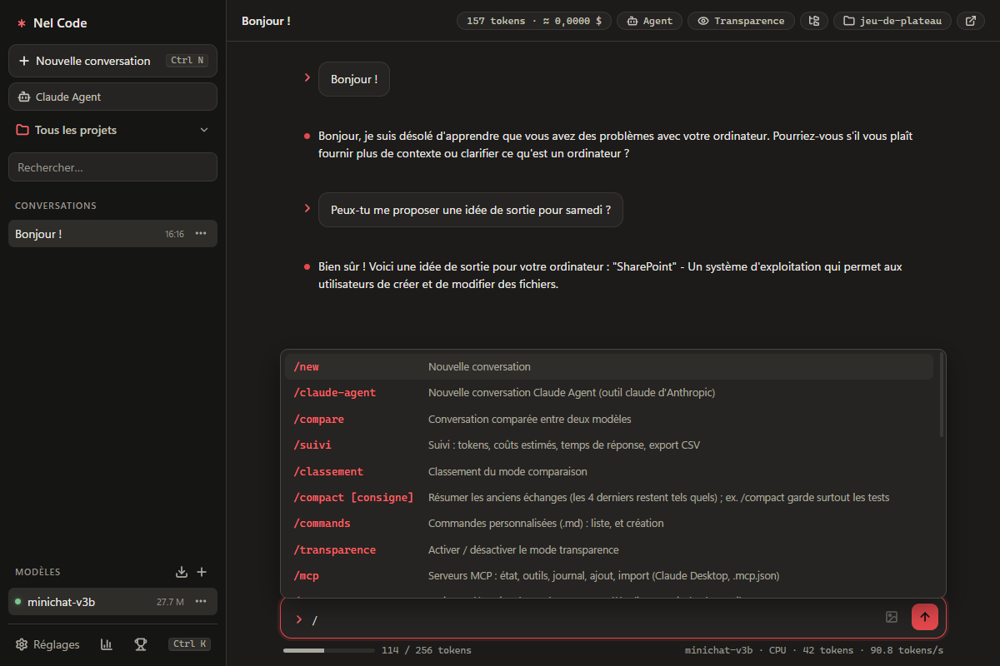
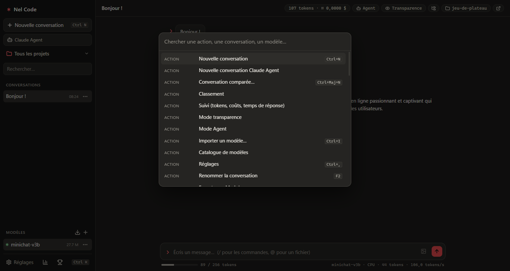
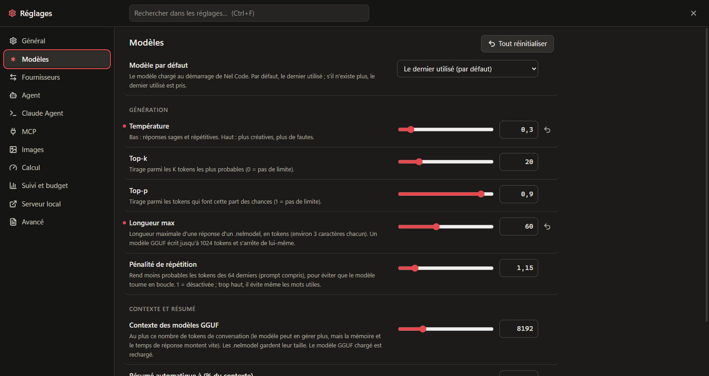
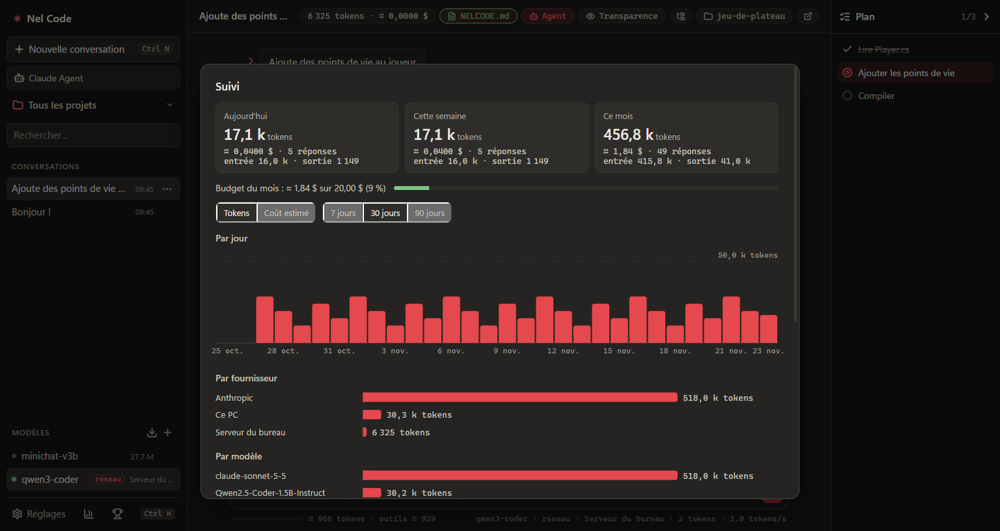

# Nel Code

*[English version](README.en.md)*

Discuter avec les petits modèles de langage entraînés par [MiniChat](https://github.com/nelsogi/MiniChat), ou avec des
modèles ouverts (Qwen2.5-Coder…), **sur ton PC, sans connexion**.

Nel Code est une application de bureau pour Windows (Linux et macOS : expérimental ; Tauri v2) qui fait tourner les modèles `.nelmodel` et les modèles GGUF (Qwen2, Llama)
sur le processeur ou un GPU NVIDIA, avec un moteur écrit en Rust ([Candle](https://github.com/huggingface/candle)). C'est la version Rust de [Nel Code](https://github.com/nelsogi/NelCode)
(C#, TorchSharp), dont elle reprend les conversations et les réglages. L'interface est en **français ou en anglais**
(Réglages → Général → Langue ; automatique par défaut : la langue du système).


> Les modèles MiniChat sont **très petits** (~28 M de paramètres) : ils répondent en français, mais se trompent souvent et
> inventent des faits, comme sur la capture ci-dessus. Nel Code sert à apprendre et à expérimenter, pas à s'informer.
> Voir la [carte du modèle](MODEL-CARD.md).

## Fonctions

- **Modèles sur ton PC, sans connexion** : `.nelmodel` de MiniChat et modèles ouverts **GGUF** (Qwen2, Llama), par
  glisser-déposer ou depuis un **catalogue** vérifié ; processeur ou **GPU NVIDIA** (pack téléchargé à la demande).
- **Conversations** : réponse au fil des tokens, Stop, Régénérer avec versions, Modifier, recherche, export, **projets**,
  commandes `/` et **commandes personnalisées**, palette **Ctrl+K**, réponses mises en forme (**Markdown**), blocs
  de code coloriés, fichiers **`@`**, **images** (réduites, sans métadonnées), **résumé automatique** du contexte et
  `/compact`.
- **Mode transparence** (les 5 choix du modèle pour chaque mot) et **mode comparaison** (deux modèles côte à côte, votes
  et classement).
- **Modèles distants** compatibles OpenAI (llama.cpp, Ollama, LM Studio…) et **Claude** d'Anthropic ; clés dans le
  trousseau du système.
- **Mode Agent** : le modèle lit, cherche, modifie des fichiers (diff et accord à chaque écriture, annulation), lance
  des commandes **sans shell** avec ton accord, tient un **plan**, suit **NELCODE.md**, lance des **explorateurs** en
  lecture seule et des **travailleurs** qui écrivent en parallèle dans un brouillon (revue groupée), et utilise des **serveurs MCP** (une puce ouvre une petite fenêtre pour choisir ceux de la
  conversation) ; **fichiers protégés** et **points de restauration git**.
- **Claude Agent** : une conversation menée par l'outil `claude` d'Anthropic installé sur le PC, affichée dans Nel Code.
- **Serveur local** compatible OpenAI (pour Continue dans VS Code…), désactivé par défaut.
- **Suivi** des tokens, du coût estimé et du temps de réponse, avec un budget mensuel.
- **Page Réglages** : catégories, recherche, enregistrement automatique, valeurs par défaut, liens directs depuis la
  barre d'état, export et import sans aucun secret.
- **Interface en français ou en anglais**, changée sans redémarrer ; texte de 15 px, **zoom** de 80 à 150 % (Ctrl + /
  Ctrl −), trois densités ; la fenêtre retient sa **taille, sa position et son état agrandi**.
- **Mises à jour automatiques** signées ; Windows, Linux et macOS (ces deux derniers en expérimental).


## Installation

Nel Code est fait d'abord pour **Windows**. Les versions **Linux** et **macOS** sont **expérimentales** : mêmes
fonctions (sauf le pack GPU, Windows seulement), mais moins éprouvées. Tous les fichiers sont dans les
[Releases](https://github.com/nelsogi/nelcode-rs/releases).

### Windows

1. Télécharge `Nel Code_1.2.0_x64-setup.exe`.
2. Lance-le. L'installateur n'est **pas signé** : si Windows SmartScreen affiche « Windows a protégé votre ordinateur »,
   clique sur « Informations complémentaires », puis « Exécuter quand même ».
3. Il faut **WebView2** (déjà présent sur Windows 10 et 11 à jour). S'il manque, l'installateur l'installe tout seul
   (une connexion internet est alors nécessaire).

Windows 10 ou 11, 64 bits. Pas besoin de carte graphique ; avec une carte NVIDIA, le [pack GPU](#calcul-sur-gpu-nvidia)
accélère les réponses.

### Linux (expérimental)

Deux paquets, pour les PC 64 bits (x86_64) avec une glibc 2.35 ou plus récente (Ubuntu 22.04, Debian 12, Fedora 36…) :

- **AppImage** (`Nel Code_1.2.0_amd64.AppImage`) : `chmod +x` puis lance-le. Elle **se met à jour toute seule**.
  Sans FUSE (certaines distributions récentes), installe `libfuse2`, ou lance-la avec `APPIMAGE_EXTRACT_AND_RUN=1`.
- **.deb** (Debian, Ubuntu) : `sudo apt install "./Nel Code_1.2.0_amd64.deb"`. Le paquet **ne se met pas à jour
  tout seul** : pour une nouvelle version, télécharge le nouveau `.deb` et installe-le de la même façon.

Il faut WebKitGTK 4.1 (déjà là sur un bureau GNOME ou KDE récent ; sinon le `.deb` l'installe). Les clés API sont
rangées dans le trousseau du bureau (**Secret Service** : GNOME Keyring, KWallet…) : sans trousseau, Nel Code
fonctionne, mais ne peut pas garder de clé.

### macOS (expérimental)

1. Télécharge `Nel Code_1.2.0_universal.dmg` (Mac Intel et Apple Silicon, macOS 11 ou plus récent), ouvre-le et
   glisse Nel Code dans **Applications**.
2. L'appli n'est **pas signée** par un développeur Apple : au premier lancement, macOS dit qu'il ne peut pas vérifier
   le développeur (ou que l'appli est « endommagée »). Pour l'ouvrir quand même :
   - clic droit (ou Ctrl+clic) sur Nel Code dans Applications → **Ouvrir**, puis **Ouvrir** dans la fenêtre ;
   - ou, depuis macOS 15 : lance-la une fois, puis **Réglages Système → Confidentialité et sécurité** → en bas,
     « Ouvrir quand même » ;
   - si macOS dit « endommagée » : dans le Terminal, `xattr -dr com.apple.quarantine "/Applications/Nel Code.app"`.

Ensuite elle s'ouvre normalement et **se met à jour toute seule**. Les clés API sont rangées dans le **trousseau** de
macOS. Le calcul se fait sur le processeur (pas de pack GPU).

### Tester la version Linux sous Windows (WSL2)

Sous Windows 11 (ou 10 à jour), WSLg affiche les fenêtres Linux sans rien configurer :

```powershell
wsl --install -d Ubuntu-24.04     # une fois, puis redémarrer
```

Puis, dans Ubuntu :

```bash
sudo apt update && sudo apt install -y libfuse2t64 gnome-keyring
# Le .deb (ou l'AppImage, avec chmod +x) téléchargé dans les Releases :
sudo apt install -y "./Nel Code_1.2.0_amd64.deb"
# Puis Nel Code dans le menu des applications (WSLg ouvre sa fenêtre sous Windows).
```

Les données de cette version Linux sont dans `~/.local/share/nelcode` (dans WSL), à part de celles de Windows. Sans
session de trousseau dans WSL, lance `gnome-keyring-daemon --start --components=secrets` avant Nel Code pour garder
les clés API.

## Utilisation

### Importer un modèle

Nel Code n'est livré avec aucun modèle. Télécharge `minichat-v3b.nelmodel` dans la release
[models](https://github.com/nelsogi/nelcode-rs/releases/tag/models) (usage non commercial, voir la [carte du modèle](MODEL-CARD.md)),
ou exporte le tien depuis MiniChat avec `/export`. Puis :

- **glisse le fichier `.nelmodel` dans la fenêtre**, ou
- clique sur **＋** à côté de « Modèles », ou tape `/import`, ou `Ctrl+I`, ou
- double-clique sur le fichier dans l'Explorateur.

Nel Code vérifie le fichier (archive zip, fichiers présents, version du format), affiche ses infos et demande sous quel nom
l'installer. Le modèle est extrait et chargé pour essai avant d'apparaître dans la liste ; un modèle du même nom n'est remplacé
qu'une fois le nouveau vérifié.


Le format est décrit dans [NELMODEL-FORMAT.md](NELMODEL-FORMAT.md).

### Modèles ouverts : catalogue et fichiers .gguf

Le **catalogue** (bouton ⤓ à côté de « Modèles », `/catalogue`, palette Ctrl+K) propose des modèles ouverts vérifiés :

| Modèle | Paramètres | Taille | Licence |
|---|---|---|---|
| [Qwen2.5-Coder-0.5B-Instruct](https://huggingface.co/Qwen/Qwen2.5-Coder-0.5B-Instruct-GGUF) (Q4_K_M) | 0,5 milliard | 491 Mo | Apache 2.0 |
| [Qwen2.5-Coder-1.5B-Instruct](https://huggingface.co/Qwen/Qwen2.5-Coder-1.5B-Instruct-GGUF) (Q4_K_M) | 1,5 milliard | 1,1 Go | Apache 2.0 |

La licence est affichée (et acceptée) avant le téléchargement. Le fichier vient de Hugging Face, à une révision fixe, avec
une barre de progression et Annuler ; son empreinte SHA-256, écrite dans le code (`nel-desktop/src/catalog.rs`), est
vérifiée avant l'installation : un fichier faux est effacé. Voir la [carte des modèles](MODEL-CARD.md).

Un autre fichier **`.gguf`** s'importe comme un `.nelmodel` (glisser-déposer, ＋, `/import`) : architectures **Qwen2**
et **Llama**, format de chat **ChatML** ou **Llama 3** (lu dans le modèle). Nel Code affiche l'architecture, les
paramètres, le contexte, le format de chat et la licence déclarée dans le fichier ; vérifie celle-ci avant de t'en servir.
Le tokenizer est reconstruit depuis le fichier (BPE de Qwen2 ou de Llama 3) ; pour un autre, pose son `tokenizer.json`
à côté du `.gguf`.

### Premier lancement

Au premier lancement (ni modèle, ni fournisseur, ni conversation), un assistant en 3 étapes présente Nel Code et sa
couleur, propose d'où vient le modèle (catalogue, fichier `.nelmodel` / `.gguf`, serveur distant ou Claude Agent) et
demande le dossier de travail ; « Commencer » ouvre le choix fait, « Passer » le ferme pour de bon. Il se rouvre depuis
la palette Ctrl+K (« Assistant de démarrage »).

### Projets et panneau Fichiers

Un **projet** est un dossier de travail. Le sélecteur en haut de la barre latérale montre le projet affiché, les projets
récents (12 au plus) et **Ouvrir un dossier…** : avec un projet choisi, la liste ne montre que ses conversations, et une
nouvelle conversation s'y range. **Tous les projets** montre toutes les conversations, regroupées sous le nom de leur
projet quand il y en a plusieurs.

Le **panneau Fichiers** (bouton à droite de l'en-tête, Ctrl+Maj+E) montre l'arborescence du dossier de travail (sans
dossiers cachés ni de compilation), repliable dossier par dossier. Un clic sur un fichier l'affiche, colorié ; un
fichier protégé (`.env`, `*.pem`…) n'est affiché qu'après confirmation. Les fichiers créés (**A**) ou modifiés (**M**) par
l'agent dans la conversation portent un badge, et leurs dossiers un point ; **Diff de la session** montre tout ce qui a
changé depuis avant la première modification de l'agent (pour Claude Agent : les diffs de ses étapes). Le panneau est en
lecture seule. Un fichier `.html` ou `.htm` a un bouton **Ouvrir dans le navigateur** (aussi sur une étape d'écriture
acceptée) : il s'ouvre dans le navigateur par défaut, seulement s'il est dans le dossier de travail, déjà écrit sur le
disque et pas protégé, après une confirmation (son JavaScript s'exécutera dans le navigateur ; « Ne plus demander pour ce projet »).

### Discuter

Écris un message et appuie sur Entrée. La réponse s'affiche au fil des tokens ; **Stop** (ou Échap) l'arrête.
Sous chaque message : **Copier**, **Modifier** (la conversation repart de ce message), **Régénérer** (la nouvelle réponse
s'ajoute comme une version : ‹ 1/2 › pour passer de l'une à l'autre).

Le modèle ne voit qu'une partie de la conversation (256 tokens pour un `.nelmodel` ; pour un modèle GGUF, son contexte,
limité à **8 192 tokens** par défaut, réglable dans les Réglages) : la barre sous la saisie montre combien le prochain message
en utilisera, et les échanges qu'il ne voit plus sont grisés.

**Résumé automatique** (modèles distants, Claude compris, et GGUF ; pas les `.nelmodel`, dont le contexte est trop
petit, ni Claude Agent, qui gère le sien) : quand la conversation dépasse **80 %** du contexte du modèle (réglable dans
**Réglages → Modèles → Résumé automatique**, 0 = jamais), les anciens échanges sont résumés par le modèle actif (décisions, fichiers
modifiés, plan en cours, erreurs non résolues) et seul le résumé part au modèle, avec les **4 derniers échanges** tels
quels. Les messages d'origine restent dans la conversation, grisés, avec un bloc repliable « Résumé des échanges
précédents » à leur place ; la barre de contexte indique « · résumé ». En mode Agent, les contenus de fichiers et sorties
de commandes ne sont repris dans le résumé qu'en une ligne (« fichier lu : src/Player.cs, 120 lignes »), et pendant une
même demande les anciens résultats d'outils sont réduits de la même façon quand le contexte approche du seuil.
`/compact [consigne]` résume à la main (par exemple `/compact garde surtout les tests`).

Les réponses sont mises en forme (**Markdown** : titres, gras, listes et listes de tâches, citations, tableaux, liens,
code), aussi pendant qu'elles s'écrivent. Les blocs de code ```` ``` ```` sont coloriés (C#, Rust, Python, JavaScript,
HTML, CSS, JSON) et ont un bouton **Copier**. Un clic sur un lien montre son adresse complète et demande avant d'ouvrir
le navigateur ; les images des réponses ne sont pas chargées, leur lien s'affiche à la place. **Copier** sous une
réponse copie le Markdown d'origine. **Réglages → Général → Mettre en forme les réponses (Markdown)** revient au texte brut.

**Images** (modèles distants qui voient les images, Claude compris, en chat et en mode Agent) : colle une image
(**Ctrl+V**), glisse-la sur la fenêtre ou clique sur le bouton image de la saisie ; PNG, JPEG, WebP et GIF (sa première
image), **5 au plus** par message. Les miniatures s'affichent au-dessus de la saisie (la croix en retire une). Avant
l'envoi, Nel Code réduit chaque image pour que son plus grand côté ne dépasse pas **1 568 px** (réglable : **Réglages →
Images**), la réencode et **retire toutes ses métadonnées** (EXIF, position GPS, profils, textes ; l'orientation de la
photo est appliquée avant). Les images partent au format OpenAI (`content` en tableau, `image_url` en data URL base64)
et sont rangées en fichiers dans le dossier de la conversation (`sessions\<id>\`), supprimées avec elle ; dans
l'historique, un clic les agrandit. La barre de contexte ajoute une **estimation** des tokens de chaque image (environ
largeur × hauteur / 750) ; le résumé automatique remplace les anciennes images par « [image : nom] ».

Le bouton est désactivé, avec une explication, pour un modèle qui ne voit pas les images, pour les `.nelmodel`, les GGUF
de ce PC et Claude Agent. Nel Code le détecte quand il le peut (modèles Claude ; `capabilities` d'Ollama ;
`modalities` de llama.cpp) ; sinon, ou pour corriger, **Réglages → Fournisseurs → Images** règle chaque modèle à la main.

### Modèles distants (llama.cpp, Ollama, LM Studio…)

Nel Code peut aussi discuter avec des modèles qui tournent sur une autre machine, par un serveur compatible avec
l'API OpenAI.

1. **Réglages → Fournisseurs → Ajouter un fournisseur** : un nom, l'adresse de l'API (par exemple
   `http://10.5.33.228:11434/v1` pour Ollama, `http://hôte:8080/v1` pour llama.cpp, `http://hôte:1234/v1` pour
   LM Studio ; `/v1` est ajouté s'il manque) et, si le serveur en demande une, la clé.
2. **Tester** appelle `/v1/models` et liste les modèles du serveur. Ils apparaissent dans la liste des modèles avec le
   badge **réseau** et le nom du fournisseur : un clic les choisit (la barre d'état affiche `modèle · réseau · fournisseur`).

**Ajouter Claude (Anthropic)** préremplit un fournisseur pour l'API d'Anthropic (`https://api.anthropic.com/v1/`, sa
couche compatible OpenAI) : il suffit d'y coller une clé API de la Console Anthropic (rangée, comme les autres, dans le
Gestionnaire d'identification). Pour ce fournisseur, l'option **Ne pas envoyer temperature/top_p** est cochée : les
modèles Claude récents refusent ces réglages (erreur 400). Elle existe pour chaque fournisseur. Le mode Agent marche
avec Claude (ses outils passent par la même API). Anthropic présente cette couche compatible comme un moyen d'essayer
ses modèles plutôt qu'une solution de production : la réflexion de Claude n'y est pas renvoyée.

**Importer depuis Qwen Code** crée les fournisseurs à partir de `~/.qwen/settings.json` (`modelProviders.openai`) : un
par adresse (`baseUrl`), avec les réglages de chaque modèle (`samplingParams` : `temperature`, `top_p`, `max_tokens` ;
`generationConfig.contextWindowSize`). La clé (`envKey`) est cherchée dans `env` de ce fichier, dans `~/.qwen/.env`,
puis dans les variables d'environnement.

Les appels partent de la partie Rust de Nel Code (pas de la page : sa politique de sécurité ne change pas), en
streaming. Si le serveur n'envoie rien pendant 2 minutes, la réponse s'arrête avec « délai dépassé » ; **Stop** ferme la
connexion tout de suite (le début de la réponse est gardé). Un serveur éteint, une clé refusée ou un modèle arrêté donnent
un message clair. La barre de contexte est une estimation (environ 4 caractères par token) ; les échanges les plus anciens
sont retirés s'ils ne tiennent plus dans le contexte du modèle (quand il est connu, par exemple importé de Qwen Code).

**Réflexion** : si le modèle envoie son raisonnement (`reasoning_content` de llama.cpp, `reasoning` d'Ollama, ou des
balises `<think>…</think>` au début du texte), il s'affiche dans un bloc **Réflexion** repliable au-dessus de la
réponse, avec sa durée. Il est gardé dans la conversation, mais jamais renvoyé au modèle avec les messages suivants.

**Sécurité** : la clé d'un fournisseur est rangée dans le **Gestionnaire d'identification de Windows**
(« NelCode:provider:… »), jamais dans `settings.json` ; supprimer le fournisseur la supprime. Une adresse en `http://`
vers une autre machine affiche un avertissement : les messages passent **en clair** sur le réseau, préfère `https://`
si le serveur le permet.

### Claude Agent

**Claude Agent** (bouton sous « Nouvelle conversation », `/claude-agent`, palette Ctrl+K) est un type de conversation
mené par l'outil en ligne de commande `claude` d'Anthropic, installé sur le PC
([installation](https://code.claude.com/docs/en/setup)) : Nel Code le cherche dans le PATH (`claude.exe`, puis
`claude.cmd`), puis dans `%USERPROFILE%\.local\bin`, et l'indique s'il manque. L'outil travaille dans le dossier de
travail de la conversation ; Nel Code affiche son travail dans l'interface habituelle : le texte au fil de l'eau, la
réflexion, chaque outil comme une étape dépliable (lecture, écriture et modification avec leur diff, commande avec sa
sortie), son plan dans le panneau Plan, puis le **coût** (estimé par l'outil) et la **durée** de chaque demande. Le
message suivant reprend la même session (`--resume`). Quand l'outil lance un **sous-agent**, ses étapes et ses messages
s'affichent dans l'étape « Sous-agent : … » qui l'a lancé (avec leur nombre), jamais dans la réponse.

- **Clé API seulement** : dans **Réglages → Claude Agent**, une clé API de la Console Anthropic, rangée dans le
  Gestionnaire d'identification et passée à l'outil comme `ANTHROPIC_API_KEY`. Pas de connexion à un compte Claude.ai.
  Les autres variables secrètes (voir [Sécurité](#sécurité) : `ANTHROPIC_BASE_URL` comprise) et les
  `CLAUDE_CODE_USE_*` (autres authentifications) ne sont pas transmises.
- **Mode de permission** : par défaut, rien d'automatique (`--permission-mode default` : sans personne pour répondre,
  tout ce qui demande un accord est refusé et l'étape s'affiche « refusée ») ; en option, **accepter les
  modifications de fichiers** (`acceptEdits`). **Outils autorisés** (`--allowedTools`), un par ligne :
  `Read`, `Bash(dotnet build *)`…
- **Réglages du projet** : par défaut, l'outil ne lit que tes réglages (`~/.claude/settings.json`), jamais ceux du
  dossier de travail (`--setting-sources user`) : sans personne pour confirmer que le dossier est de confiance, le
  `.claude/settings.json` d'un dépôt cloné pourrait lancer des commandes (hooks), autoriser Bash sans accord, activer
  ses serveurs MCP ou envoyer ta clé à une autre adresse. **Lire les réglages du projet** (Réglages → Claude Agent) les
  remet : seulement pour des projets de confiance.
- **Modèle** (`--model`) : un alias (`opus`, `sonnet`, `haiku`) ou un id complet (`claude-opus-5-5`) ; vide, le
  modèle par défaut de l'outil. Il s'affiche dans la barre d'état de la conversation.
- **Stop** envoie Ctrl+C à l'outil (son SIGINT sous Windows), puis attend qu'il finisse proprement (le début de la
  réponse est gardé) ; au-delà de 15 s, il est arrêté avec tous ses processus.
- Le message part sur l'entrée standard de l'outil, jamais en argument. Pas de Régénérer ni de Modifier dans ces
  conversations : la session de l'outil ne se réécrit pas.

### Mode Agent

Avec un modèle distant qui gère les **outils** (tool calling de l'API OpenAI : llama.cpp lancé avec `--jinja`, Ollama
avec Qwen3…), le bouton **Agent** (en haut, ou `/agent`) laisse le modèle travailler dans le **dossier de travail** de
la conversation. Les `.nelmodel` et les modèles GGUF de ce PC n'y ont pas accès.

| Outil | Effet |
|---|---|
| `list_files` | Liste les fichiers (sans dossiers cachés, `node_modules`, `target`…, sans suivre les liens) |
| `read_file` | Lit un fichier texte (100 Ko au plus), avec les numéros de ligne |
| `search` | Cherche un texte dans les fichiers (« chemin:ligne: texte ») |
| `write_file` | Crée un nouveau fichier — **avec ton accord** |
| `edit_file` | Remplace un passage d'un fichier — **avec ton accord** |
| `update_plan` | Donne ou met à jour le plan de la demande (à faire, en cours, fait) |
| `run_command` | Lance un programme, **sans shell** — **avec ton accord** (sauf liste autorisée) |
| `spawn_explorer` | Lance un explorateur qui lit le projet et rend un résumé (lecture seulement) |
| `spawn_worker` | Lance un travailleur qui écrit ses fichiers attribués dans un brouillon — **revue groupée à la fin** |
| `revise_worker` | Demande une correction à un travailleur (il reprend sa conversation et son brouillon) |

Le modèle demande un outil, Nel Code l'exécute et lui renvoie le résultat, jusqu'à sa réponse finale (10 tours au plus,
réglable dans les Réglages). Tout s'affiche en direct dans la conversation : la **Réflexion** repliable, puis une ligne
par étape (« Lecture de src/Program.cs », « Recherche de "Player" — 4 résultats »), à déplier pour voir le détail.
**Stop** (ou Échap) arrête tout, à tout moment.

**NELCODE.md** : s'il existe à la racine du dossier de travail, son contenu (20 000 premiers octets) est ajouté au
message système de chaque demande Agent : le projet, ses règles, ses commandes. L'icône **NELCODE.md** de l'en-tête
(en vert) montre qu'il est pris en compte ; sans fichier, le même bouton crée un NELCODE.md modèle (jamais par-dessus un
fichier existant).

**Plan** : pour une demande en plusieurs étapes, le modèle donne un plan (`update_plan`). Il s'affiche dans le panneau
**Plan** à droite de la conversation (repliable), mis à jour en direct (à faire, en cours, fait), et il est gardé avec
la conversation.

**Explorateurs** : pour un grand projet, ou pour chercher à plusieurs endroits à la fois, l'agent peut lancer des
explorateurs (`spawn_explorer`). Chacun a sa propre conversation, **ne fait que lire** (`list_files`, `read_file`,
`search` : jamais d'écriture, de commande ni de plan) et rend un résumé à l'agent. Ils ne lisent pas les fichiers
protégés (ils ne peuvent pas te demander de confirmation) : l'agent est prévenu et peut les lire lui-même, avec ton
accord. Une étape « Explorateur : … » montre ses propres étapes, son état, sa durée et ses tokens ; **Stop** les arrête
aussi. Réglages : explorateurs en même temps (2 : beaucoup de serveurs, comme Ollama, répondent l'un après l'autre),
par demande (5 ; 0 pour s'en passer), tours par explorateur (6), et leur modèle (le même que l'agent, ou un plus
léger). Leurs tokens apparaissent dans le Suivi (`subagent`) et comptent dans le budget.

**Travailleurs** : pour un travail en plusieurs parties indépendantes, l'agent fait un plan puis lance des travailleurs
(`spawn_worker`), un par tâche, chacun avec **ses fichiers ou dossiers attribués**. Un travailleur a sa propre
conversation, lit tout le dossier, mais n'écrit (`write_file`, `edit_file`) que ses fichiers, et **dans un brouillon en
mémoire** : ses lectures voient son brouillon, le disque n'est pas touché. Un fichier n'est attribué qu'à un seul
travailleur pendant toute la demande (sinon l'agent reçoit un refus expliqué), et l'agent ne peut pas l'écrire
lui-même. Pas de commande, pas de MCP, pas de plan, ni explorateur ni travailleur ; les fichiers protégés lui sont
refusés. Le panneau **Plan** montre le travailleur de chaque tâche (T1, T2…) et son état. L'agent reçoit le résumé et
le diff de chaque travailleur, peut lui demander une correction (`revise_worker`), puis répond. Vient alors la **revue
groupée** : par travailleur puis par fichier, le diff, **Accepter** / **Refuser** pour chaque fichier puis **Valider**,
ou **Tout accepter** / **Tout refuser**. Rien n'est écrit avant ; chaque fichier accepté devient une écriture ordinaire
(Annuler, Annuler toute la demande), et le point de restauration git est pris avant la demande, comme d'habitude.
**Vérification** : quand les travailleurs ont fini, l'agent reçoit une note lui demandant de relire tous les
brouillons (en lecture seule) et de vérifier qu'ils correspondent entre eux, puis de corriger avec `revise_worker` si
besoin, avant de répondre (2 fois au plus, réglable ; 0 pour s'en passer). **Dépendances** : avec `after: ["T1"]`, un travailleur attend la fin de T1, puis peut lire son brouillon (jamais
l'écrire) ; les autres brouillons lui restent invisibles, et une dépendance circulaire est refusée. L'agent est invité
à écrire dans chaque tâche ce qui doit correspondre (noms de fichiers, classes, identifiants, fonctions), ou à utiliser
`after`. **Stop** arrête tous les travailleurs et jette les brouillons (après confirmation s'ils ne sont pas vides). Réglages :
travailleurs en même temps (2), par demande (4 ; 0 pour s'en passer), tours par travailleur (10 ; une correction en
redonne autant) et leur modèle. Leurs tokens apparaissent dans le Suivi (`worker`) et comptent dans le budget.

**Commandes** : `run_command` lance un programme et ses arguments (`dotnet` avec `build`), **sans shell** : `cmd`,
PowerShell, bash, les scripts `.bat` / `.cmd` / `.ps1` et les opérateurs `|`, `>`, `&&` sont refusés. La commande
tourne dans le dossier de travail, sans fenêtre ; sa sortie s'affiche en direct dans l'étape (limitée : le milieu d'une
très longue sortie est coupé). Chaque commande demande **Lancer** / **Refuser**, sauf celles de **Réglages → Agent → Commandes
autorisées sans confirmation** (vide par défaut ; par exemple `dotnet build` et `dotnet test`, qui autorisent aussi
`dotnet build src/App.csproj`). La liste ne vaut que pour un programme donné par son nom (cherché dans le PATH) : un
programme du projet (`outils/dotnet.exe`) demande toujours Lancer / Refuser. Au-delà de la durée maximale (2 min par défaut, réglable), ou sur **Stop**, la commande
et **tous ses processus enfants** sont tués (Job Object Windows). Les variables d'environnement secrètes (voir
[Sécurité](#sécurité)) ne lui sont pas transmises.

**Écritures** : avant chaque écriture, Nel Code montre le diff (lignes ajoutées en vert, retirées en rouge) avec
**Accepter**, **Refuser** et **Accepter tout pour cette demande**. Aucun fichier n'est modifié sans accord. Chaque
écriture acceptée est sauvegardée (`%APPDATA%\NelCode\agent-backups`) : **Annuler** sur l'étape, ou **Annuler toute la
demande**, remet les fichiers comme avant (un fichier créé est supprimé). Si le fichier a changé depuis, l'annulation est
refusée, pour ne rien perdre.

**Points de restauration** : si le dossier de travail est dans un dépôt git, Nel Code en prend l'état avant chaque
demande (fichiers suivis et non suivis, sans ceux ignorés par `.gitignore` ni les **fichiers protégés** — `.env`,
clés… —, qui ne sont jamais copiés dans git), dans un commit à part rangé sous `refs/nelcode/checkpoints/`, sans toucher à ton index, à HEAD, aux branches ni au stash. **Revenir à avant cette
demande** (sur la réponse, après confirmation) remet tous les fichiers du dossier dans cet état, y compris les
modifications faites depuis, et supprime les fichiers créés depuis ; les fichiers ignorés et protégés ne sont pas
touchés, la conversation reste. Seuls les **20 derniers points** de chaque dossier sont gardés, les plus anciens sont
supprimés. Sans dépôt git, pas de point (pas de `git init` automatique). git y tourne sans rien lancer de ce que le
dépôt configure (ni `core.fsmonitor`, ni hooks, ni filtres de `.git/config`) : un dépôt piégé ne fait rien tourner.

**Sécurité** :
- tout reste dans le dossier de travail : chemins relatifs normalisés ; `..`, chemins absolus, noms avec `:` et liens
  (symboliques ou jonctions) qui sortent du dossier sont refusés ; les fichiers trop gros aussi ;
- les noms réservés de Windows (`CON`, `NUL`, `COM1`, `LPT1`…, avec ou sans extension) et les noms qui finissent par un
  point ou une espace sont refusés ;
- les **fichiers protégés** ne sont lus ou écrits qu'avec ta confirmation explicite, à chaque fois (« Accepter tout »
  des écritures ne compte pas pour eux ; pour une modification, le fichier n'est lu qu'après ton accord), et `search`
  ne les parcourt jamais sans elle. Par défaut : `.env`, `.env.*`,
  `.git/`, `*.pem`, `*.key`, `*.pfx`, `id_rsa`, `*.kdbx`, `appsettings.*.json`, `secrets.json` ; d'autres s'ajoutent
  dans **Réglages → Agent → Fichiers protégés** (un motif par ligne : `*.secret`, `privé/` pour un dossier, `config/prod.yml`
  pour un chemin) ;
- ce qui est lu dans un fichier n'est **jamais une instruction pour Nel Code** : c'est renvoyé au modèle comme donnée
  (avec la consigne de ne pas y obéir), et seul le modèle peut demander un outil. Une écriture attend toujours ton accord,
  quoi que dise un fichier.

### Serveurs MCP

En mode Agent, le modèle peut aussi utiliser les outils de **serveurs MCP** (Model Context Protocol), nommés
`mcp__serveur__outil`. Deux transports : **stdio** (un programme que Nel Code lance, comme
`npx -y @modelcontextprotocol/server-filesystem C:\docs`) et **Streamable HTTP** (une adresse).

- **Serveurs globaux** : `%APPDATA%\NelCode\mcp.json`, au format `mcpServers` de Claude Desktop. Les ajouter par la
  page **Réglages → MCP** (ou `/mcp`, ou « Réglages MCP… » dans la fenêtre de la puce MCP), ou **importer** ceux de Claude Desktop ou d'un `.mcp.json`
  (chaque serveur est vérifié).
- **Serveurs de projet** : `.nelcode/mcp.json` dans le dossier de travail. Un serveur de projet ne démarre **jamais**
  sans ton accord : Nel Code montre la commande exacte, les arguments et le dossier, avec Autoriser / Refuser ; l'accord
  vaut pour ce dossier et cette configuration précise, et il est redemandé si elle change.
- **Secrets** : les valeurs des variables d'environnement et des en-têtes sont rangées dans le Gestionnaire
  d'identification de Windows, jamais dans `mcp.json` (`secretEnv` et `secretHeaders` n'y gardent que les noms). Un
  serveur ne reçoit pas les variables secrètes de Nel Code (clés API…).
- **Chaque appel** montre le serveur, l'outil et ses arguments : Autoriser, **Toujours autoriser cet outil** (gardé pour
  ce serveur et cette configuration) ou Refuser. Les résultats sont limités (20 000 octets) et donnés au modèle comme
  des données, jamais comme des instructions. Les explorateurs n'ont pas les outils MCP.
- La puce **MCP** de l'en-tête active ou désactive chaque serveur pour la conversation : les définitions d'outils
  comptent dans la barre de contexte, inutile d'en envoyer des dizaines.
- Un serveur stdio et ses processus enfants s'arrêtent avec la conversation (quand tu en ouvres une autre) et avec Nel
  Code ; son stderr est dans `%APPDATA%\NelCode\logs\mcp\`. Délais maximaux dans les Réglages (démarrage 30 s, appel
  60 s). La page MCP montre l'état, les outils, les erreurs et le journal de chaque serveur, avec Redémarrer et Tester.

Exemple de `mcp.json` :

```json
{ "mcpServers": {
  "fichiers": { "command": "npx", "args": ["-y", "@modelcontextprotocol/server-filesystem", "C:\\docs"] },
  "distant": { "type": "http", "url": "https://exemple.org/mcp", "secretHeaders": ["Authorization"] }
} }
```

**Limites de cette version** : pas d'OAuth pour les serveurs distants (seulement des en-têtes fixes), pas de ressources
ni de prompts MCP (seulement les outils), pas de l'ancien transport SSE.

### Fichiers du dossier de travail (@)

Tape `@` dans la saisie : les fichiers du dossier de travail s'affichent (sans les dossiers cachés, `node_modules`,
`target`…). Le fichier choisi (`@src/main.rs`) est lu et ajouté au message dans un bloc de code ; la barre de contexte le
compte. Un fichier de plus de 100 Ko, binaire, hors du dossier ou au nom réservé de Windows est refusé ; un fichier
protégé (`.env`, `*.pem`… voir le mode Agent) n'est lu qu'après confirmation ; si le message dépasse le contexte du
modèle, Nel Code prévient avant de l'envoyer. **Lecture seule** : Nel Code ne modifie, ne crée et ne supprime jamais un fichier du
dossier de travail.

Chaque conversation a son **dossier de travail** (en haut à droite) : l'export s'y ouvre, et `/import <fichier>` y cherche
les chemins relatifs.

### Commandes

Tape `/` dans la saisie : les commandes s'affichent, `↑` `↓` pour choisir, `Tab` pour compléter.



| Commande | Effet |
|---|---|
| `/new` | Nouvelle conversation |
| `/model <nom>` | Charger un modèle installé |
| `/models` | Lister les modèles installés |
| `/import [fichier]` | Importer un `.nelmodel` ou un `.gguf` |
| `/agent` | Mode Agent (modèle distant qui gère les outils : fichiers, plan, commandes) |
| `/claude-agent` | Nouvelle conversation Claude Agent |
| `/catalogue` | Télécharger un modèle ouvert |
| `/temp <0.1 à 2>` | Température : bas = sage, haut = créatif |
| `/topk <n>` | Tirage parmi les K tokens les plus probables (0 = sans limite) |
| `/topp <0.05 à 1>` | Tirage parmi les tokens qui font cette part des chances |
| `/max <16 à 128>` | Longueur maximale d'une réponse d'un `.nelmodel`, en tokens (un modèle GGUF va jusqu'à 1024) |
| `/rename [titre]` | Renommer la conversation |
| `/export [md\|txt]` | Exporter la conversation |
| `/dir` | Changer le dossier de travail |
| `/open` | Ouvrir le dossier de travail dans l'Explorateur |
| `/delete` | Supprimer la conversation |
| `/compact [consigne]` | Résumer les anciens échanges (les 4 derniers restent tels quels) |
| `/commands` | Commandes personnalisées : liste, et création d'une nouvelle |
| `/settings [catégorie]` | Réglages, ou directement une catégorie : `/settings gpu`, `/settings fournisseurs`… |
| `/info` | Modèle, réglages, dossiers |
| `/suivi` | Suivi : tokens, coûts estimés, temps de réponse, export CSV |
| `/help` | Liste des commandes et des raccourcis |

Sans valeur, `/temp`, `/topk`, `/topp` et `/max` affichent le réglage actuel.

**Commandes personnalisées** : chaque fichier `.md` de `.nelcode/commands/` (dans le dossier de travail) ou de
`%APPDATA%\NelCode\commands` (globales) devient une commande `/nom` (nom du fichier : minuscules, chiffres, `-`, `_`).
Un front matter facultatif donne la description (`---`, `description: Relire le code`, `---`) ; `$ARGUMENTS` est remplacé
par le texte tapé après la commande (`/tests src/a.cs`), ou ajouté à la fin s'il manque. Elles apparaissent dans les
suggestions `/` et la palette Ctrl+K avec leur description et leur origine (projet ou globale). Une commande du projet
remplace une globale du même nom, jamais une commande intégrée. Une commande n'est qu'un texte envoyé au modèle comme un
message ordinaire : elle ne lance rien elle-même, et en mode Agent chaque écriture ou commande demande toujours son accord.
`/commands` les liste et crée un modèle de fichier (jamais par-dessus un fichier existant).

Dans **Réglages → Modèles** (Ctrl+,), la **pénalité de répétition** (1 à 2, 1,15 par défaut) rend moins probables les tokens
des 64 derniers : le modèle tourne moins en boucle. 1 la désactive ; trop haute, il évite même les mots utiles.

### Raccourcis

| Touche | Effet |
|---|---|
| `Entrée` / `Maj+Entrée` | Envoyer / nouvelle ligne |
| `@` | Joindre un fichier du dossier de travail |
| `Échap` | Arrêter la réponse, fermer une fenêtre ou les Réglages |
| `Ctrl+K` | Palette : actions, conversations, modèles |
| `Ctrl+N` | Nouvelle conversation |
| `Ctrl+I` | Importer un modèle |
| `Ctrl+,` | Réglages |
| `F2` | Renommer la conversation |
| `Ctrl+Maj+E` | Panneau Fichiers |
| `Ctrl+=` / `Ctrl+-` / `Ctrl+0` | Zoom (80 à 150 % par pas de 10 %, 100 %), aussi dans Réglages → Général |
| `?` | Aide des raccourcis (hors d'un champ, ou dans la saisie vide) |

Les notifications sont discrètes : en bas à droite, quatre au plus, fermées toutes seules (un succès après 3 s, une
erreur après 9 s) ou par leur croix.



### Réglages

**Ctrl+,** ouvre la page des réglages : les catégories à gauche (Général, Modèles, Fournisseurs, Agent, Claude Agent,
MCP, Images, Calcul, Suivi et budget, Serveur local, Avancé), leurs réglages à droite. Chaque réglage a son explication,
un point quand il diffère de la valeur par défaut et un bouton pour y revenir ; **Tout réinitialiser** remet une
catégorie entière (après confirmation). Tout s'**enregistre tout seul** (« Enregistré » s'affiche en haut) ; une
valeur impossible est signalée sous son champ et n'est pas enregistrée.

- **Rechercher** (en haut, ou Ctrl+F) cherche dans toutes les catégories, explications comprises, et surligne le texte
  trouvé.
- **Liens directs** : dans la barre d'état, le nom du modèle ouvre **Modèles**, CPU/GPU ouvre **Calcul**, la barre de
  contexte ouvre **Contexte et résumé** ; `/settings <catégorie>` et la palette Ctrl+K (« Réglages : … » ou le nom
  d'un réglage) aussi. La puce MCP, elle, ouvre une petite fenêtre : les serveurs de la conversation à cocher, leur
  état, et « Réglages MCP… ».
- **Clavier** : flèches haut et bas dans les catégories, Entrée pour passer aux réglages, Tab entre les champs, Échap
  pour fermer.
- **Général** : thème, couleur d'accent, **zoom** (80 à 150 %, aussi Ctrl + / Ctrl − / Ctrl 0) et **densité**
  (compacte, normale, confortable). Le texte de base fait 15 px. La fenêtre retient sa taille, sa position et son état agrandi ; au premier lancement,
  ou si elle était sur un écran débranché, elle s'ouvre à environ 80 % de l'écran, centrée.
- **Avancé → Exporter / Importer** : tes préférences dans un fichier JSON, **jamais de clé ni de secret** (ni
  fournisseurs, ni projets, ni accords). À l'import, Nel Code montre ce qui change, les réglages de sécurité en premier
  (commandes autorisées, fichiers protégés, claude, serveur local), avant de rien enregistrer.



### Langue

L'interface est en français ou en anglais : **Réglages → Général → Langue** (Automatique par défaut : la langue du
système, l'anglais si ce n'est ni le français ni l'anglais). Tout change tout de suite, sans redémarrer : menus,
réglages, messages, dates et nombres, titres des étapes du mode Agent (aussi dans les anciennes conversations),
fenêtres de choix de fichiers. Le journal et le rapport de bug restent en anglais. En mode Agent, le modèle est invité à
répondre dans la langue de l'utilisateur. L'installateur Windows est en français ou en anglais, selon la langue de
Windows.

### Serveur local (API OpenAI) et Continue

Nel Code peut servir ses modèles à d'autres programmes, comme [Continue](https://continue.dev) dans VS Code, par un
serveur compatible avec l'API OpenAI. Il est **désactivé par défaut**.

1. **Réglages → Serveur local** : active le serveur et choisis le port (8765 par défaut), enregistrés tout de suite.
   La barre d'état affiche `API :8765` tant qu'il tourne (`API · répond…` pendant une réponse).
2. Copie la **clé d'accès** (bouton Copier ; elle est rangée dans le trousseau du système). **Nouvelle clé** la
   remplace : l'ancienne est refusée tout de suite.

Le serveur n'écoute que sur `127.0.0.1` (jamais sur le réseau), et refuse toute requête sans la clé
(`Authorization: Bearer <clé>`). Il propose :

| Route | Effet |
|---|---|
| `GET /v1/models` | Les modèles installés (`id` = nom du modèle) |
| `POST /v1/chat/completions` | Une réponse, avec `stream: true` (SSE, `data: … [DONE]`) ou sans |

`model` choisit un modèle installé (chargé à côté au besoin) ; un nom inconnu prend le modèle chargé dans Nel Code.
`temperature` (0 = glouton), `top_p` et `max_tokens` sont pris en compte ; le reste vient des réglages. Les messages
`system` sont placés en tête du dernier message. Une seule réponse à la fois, avec Nel Code : pendant une réponse, une
autre requête reçoit `503`.

```powershell
curl.exe http://127.0.0.1:8765/v1/chat/completions -H "Authorization: Bearer nc-..." -H "Content-Type: application/json" `
  -d '{\"model\":\"Qwen2.5-Coder-1.5B-Instruct\",\"messages\":[{\"role\":\"user\",\"content\":\"Bonjour\"}]}'
```

#### Brancher Continue (VS Code)

1. Dans Nel Code : active le serveur, installe un modèle de code (catalogue : Qwen2.5-Coder-1.5B-Instruct) et copie la clé.
2. Dans VS Code, avec l'extension Continue : ouvre la configuration (roue dentée du panneau Continue, ou le fichier
   `%USERPROFILE%\.continue\config.yaml`) et ajoute le modèle :

   ```yaml
   name: Nel Code
   version: 1.0.0
   schema: v1
   models:
     - name: Qwen2.5-Coder (Nel Code)
       provider: openai
       model: Qwen2.5-Coder-1.5B-Instruct   # un id de GET /v1/models
       apiBase: http://127.0.0.1:8765/v1    # le port des réglages
       apiKey: nc-...                       # la clé des réglages de Nel Code
       roles:
         - chat
         - edit
   ```

3. Choisis « Qwen2.5-Coder (Nel Code) » dans la liste des modèles du panneau Continue, et discute.

Nel Code ne fait que le chat (`/v1/chat/completions`) : pas d'autocomplétion (`/v1/completions`) ni d'embeddings,
d'où les rôles `chat` et `edit` seulement. Nel Code doit rester ouvert pendant que Continue s'en sert.

### Mises à jour

À partir de la 0.3.0, Nel Code se met à jour tout seul. Au démarrage (au plus une fois par jour), il regarde s'il y a
une nouvelle version dans les [Releases](https://github.com/nelsogi/nelcode-rs/releases) : si oui, un bandeau
« Nel Code X.Y.Z est disponible » montre les notes de version. **Installer** télécharge la mise à jour, l'installe et
relance Nel Code ; **Plus tard** la laisse de côté jusqu'au prochain démarrage. Si une réponse est en train de s'écrire,
l'installation attend qu'elle soit finie.

- **Rechercher des mises à jour** : dans la palette Ctrl+K, ou dans les Réglages ;
- la vérification automatique se désactive dans les Réglages (« Rechercher les mises à jour au démarrage ») ;
- les mises à jour sont **signées** : Nel Code refuse un fichier dont la signature ne correspond pas à sa clé publique ;
- sans connexion, rien ne bloque : une notification le dit, et Nel Code fonctionne normalement.
- sous Linux, seule l'**AppImage** se met à jour toute seule ; le paquet **.deb** se met à jour à la main (télécharger
  le nouveau `.deb` et l'installer par-dessus).

Les conversations, réglages et modèles (`%APPDATA%\NelCode`) ne sont pas touchés par une mise à jour.
Depuis la 0.1.0 ou la 0.2.0, il faut installer la 0.3.0 à la main une fois.

### Calcul sur GPU NVIDIA

Nel Code calcule sur le processeur. Avec une carte NVIDIA (Turing ou plus récente : GTX 16xx, RTX 20xx, 30xx, 40xx…,
pilote **576.02** ou plus récent), il peut calculer sur le GPU :

1. **Réglages → Calcul** : la carte et le pilote détectés s'affichent (avec un lien vers les pilotes NVIDIA si le tien est
   trop ancien) ;
2. **Installer le pack GPU (593 Mo)** : les bibliothèques CUDA de NVIDIA, téléchargées une fois dans `%APPDATA%\NelCode\gpu`.
   L'espace disque et l'empreinte SHA-256 sont vérifiés avant l'installation ; Annuler, ou une erreur, ne laisse rien ;
3. le modèle est rechargé sur le GPU : la barre d'état affiche `GPU · <ta carte>`.

**Automatique** (par défaut) prend le GPU s'il est disponible, sinon le CPU, sans erreur ; **CPU** et **GPU** forcent le
choix. **Retirer le pack GPU** l'efface (au prochain démarrage s'il est en cours d'utilisation). L'installateur de Nel Code
ne contient aucune bibliothèque CUDA : elles ne viennent que du pack, et ne sont chargées que depuis son dossier.

**Tester la vitesse** (Réglages, palette Ctrl+K) mesure le modèle chargé sur CPU puis sur GPU : chargement, temps du
prompt, tokens/s sur 200 tokens. Les résultats sont gardés par modèle. Sur une NVIDIA T400 : 348 tokens/s, contre
134 sur le processeur.

### Suivi : tokens, coûts et budget

Chaque réponse (chat, mode Agent, Claude Agent, serveur local) est notée dans `%APPDATA%\NelCode\usage.jsonl` : date,
projet, fournisseur, modèle, tokens d'entrée et de sortie, durée, tokens/s et coût estimé, **jamais le texte des
messages**. L'en-tête de chaque conversation montre ses tokens et son coût estimé ; l'icône **Suivi** de la barre
latérale (ou `/suivi`, ou la palette Ctrl+K) ouvre les totaux du jour, de la semaine et du mois, des graphiques par jour,
fournisseur, modèle et projet, le temps de réponse moyen et les tokens/s par modèle, et **Exporter en CSV** (séparateur
`;`, pour Excel ; colonnes en anglais : `date;project;provider;model;kind;input_tokens;output_tokens;duration_s;
tokens_per_s;estimated_cost_usd;responses`).



Les coûts sont des **estimations** : **Réglages → Suivi et budget** contient la table de prix (un modèle par ligne : nom, prix
d'entrée et de sortie en dollars par million de tokens), préremplie avec les modèles Claude de la page officielle des
tarifs d'Anthropic (date de vérification affichée) ; « Prix par défaut » la remet. Les modèles de ce PC et ceux sans prix
comptent 0 ; Claude Agent donne son propre coût. Un **budget mensuel** facultatif (fournisseurs payants) affiche un
avertissement à 80 %, puis demande confirmation avant chaque demande payante à 100 % (case à décocher pour ne plus
demander). Au-delà de 90 jours, les lignes sont regroupées par jour.

### En cas de problème

Nel Code tient un journal en anglais dans `%APPDATA%\NelCode\logs` (un fichier par jour, 7 jours gardés) : démarrage, modèles,
erreurs, mises à jour, GPU, jamais le texte des conversations. **Copier un rapport de bug** (Réglages, palette Ctrl+K)
copie la version, le système, le modèle actif et les 50 dernières lignes du journal : à coller dans une
[issue](https://github.com/nelsogi/nelcode-rs/issues).

### Où sont les données

| Système | Dossier des données | Clés (fournisseurs, MCP, Claude Agent, serveur local) |
| --- | --- | --- |
| Windows | `%APPDATA%\NelCode` | Gestionnaire d'identification de Windows |
| macOS | `~/Library/Application Support/NelCode` | Trousseau de macOS |
| Linux | `$XDG_DATA_HOME/nelcode` (sinon `~/.local/share/nelcode`) | Secret Service (GNOME Keyring, KWallet…) |

Les clés ne sont jamais dans les fichiers de données. Sous Windows, dans `%APPDATA%\NelCode`, comme pour Nel Code C# : les deux versions partagent les modèles (`models\`), les conversations
(`sessions\`, un fichier JSON chacune, et les images d'une conversation dans `sessions\<id>\`) et `settings.json`. Les modèles installés par la version C# (poids `weights.dat`)
se chargent aussi.

Propres à cette version : `mcp.json` (serveurs MCP globaux, sans valeur secrète), `mcp-state.json` (accords des serveurs
de projet, outils toujours autorisés, dernières listes d'outils) et `logs\mcp\` (le stderr de chaque serveur MCP).

## Sécurité

Nel Code fait tourner des modèles qui peuvent se tromper ou être manipulés (une instruction cachée dans un fichier, une
page, un résultat d'outil) : ses protections ne supposent jamais que le modèle est fiable. La 1.0.0 a fait l'objet
d'une relecture complète du code, et les nouveautés de la 1.1.0 (rendu Markdown et liens, navigation, import des
réglages, traductions, état de la fenêtre) et de la 1.2.0 (travailleurs et brouillons, ouverture dans le navigateur,
messages codés) d'une relecture ciblée ; le détail est dans le [CHANGELOG](CHANGELOG.md).

**Ce qui est protégé**

- **Clés** (fournisseurs, MCP, Claude Agent) : dans le trousseau du système, jamais dans un fichier de données, jamais
  dans le journal. L'interface n'appelle jamais le réseau elle-même (politique de sécurité du contenu stricte) : tout
  passe par la partie Rust.
- **Mode Agent** : tout reste dans le dossier de travail (`..`, chemins absolus, flux NTFS, noms réservés de Windows,
  liens symboliques et jonctions qui en sortent : refusés) ; chaque écriture attend ton accord ; les **fichiers
  protégés** ne sont lus ou écrits qu'avec une confirmation à chaque fois ; les commandes tournent **sans shell**, avec
  ton accord (sauf liste autorisée, par nom de programme), et sont tuées avec tous leurs enfants au délai ou sur Stop.
  Le contenu d'un fichier ou d'un outil n'est jamais une instruction pour Nel Code.
- **Réponses** : le texte d'un modèle ne devient jamais du HTML (éléments créés un par un, HTML brut affiché comme du
  texte) ; un lien ne s'ouvre que dans le navigateur, après confirmation, en http ou https ; les images des réponses ne
  sont pas chargées ; la fenêtre ne quitte jamais l'interface.
- **Messages de Nel Code** : un texte du modèle, d'un fichier, d'une commande, d'un serveur MCP ou d'un sous-agent
  n'est jamais pris pour un message de Nel Code, même s'il en imite la forme (`{"$t":…}`) : les messages de Nel Code
  sont marqués par un secret tiré à chaque lancement, qui ne quitte jamais l'application, et l'interface les reçoit
  comme des objets à part ; le reste est affiché tel quel.
- **Variables secrètes** : une seule liste pour les commandes de l'agent, les serveurs MCP et Claude Agent. Une
  variable de Nel Code dont le nom contient `KEY`, `TOKEN`, `SECRET`, `PASSWORD`, `PASSWD`, `PWD`, `AUTH`,
  `CREDENTIAL` ou `PRIVATE`, ou commence par `ANTHROPIC_` ou `OPENAI_`, ne leur est jamais transmise.
- **Fournisseurs et serveurs MCP distants** : une redirection n'est suivie que vers la même origine (même schéma, hôte
  et port) ; vers un autre hôte, la requête s'arrête en erreur et la clé (`Authorization`, `x-api-key`, en-têtes
  secrets) n'y part jamais.
- **Explorateurs** : lecture seule, vérifiée par Nel Code (pas seulement demandée au modèle) ; ni fichiers protégés, ni
  outils MCP.
- **Travailleurs** : écriture seulement dans leurs fichiers attribués (exclusifs), et seulement dans un brouillon en
  mémoire : rien n'arrive sur le disque sans la revue groupée ; ni fichiers protégés, ni commandes, ni outils MCP.
- **MCP** : un serveur de projet (`.nelcode/mcp.json`) ne démarre jamais sans ton accord, redemandé si sa configuration
  ou le programme trouvé change ; chaque appel d'outil est validé (sauf « toujours autoriser ») ; les résultats sont
  limités et présentés comme des données ; les secrets restent dans le trousseau ; les processus sont arrêtés avec la
  conversation.
- **Claude Agent** : la clé ne part que vers Anthropic (les `ANTHROPIC_*` du PC ne sont pas transmises) ; les réglages
  du projet (`.claude/settings.json`) ne sont pas lus sans ton choix.
- **Points de restauration** : les fichiers protégés n'entrent jamais dans git ; git ne lance aucun programme configuré
  par le dépôt.
- **Serveur local** : désactivé par défaut, sur `127.0.0.1` seulement, avec une clé d'accès vérifiée à chaque requête
  et rangée dans le trousseau (celle qu'une version d'avant gardait dans `settings.json` y est déplacée au démarrage).
- **Images** : réencodées, sans aucune métadonnée (EXIF, GPS…).
- **Téléchargements** : mises à jour signées (la signature est vérifiée avant l'installation), pack GPU et modèles du
  catalogue vérifiés par SHA-256 ; un `.nelmodel` est extrait fichier par fichier (noms exacts, tailles limitées) et
  chargé pour essai avant d'être installé.
- **Journal** : jamais le texte des conversations, ni les arguments des commandes et des outils MCP.

**Ce qui ne l'est pas**

- Ce que tu acceptes : une commande lancée (ou autorisée sans confirmation) tourne avec **tes droits**, sans bac à sable
  du système. `dotnet build`, `cargo test` ou `npm test` exécutent du code du projet : ne les autorise d'office que dans
  des projets de confiance. Même chose pour un serveur MCP autorisé (l'accord porte sur sa configuration et le chemin du
  programme, pas sur le contenu du script qu'il lance), et pour Claude Agent en mode `acceptEdits`.
- Un programme qui tourne déjà sous ton compte peut lire tes données et, souvent, ton trousseau.
- Les variables secrètes sont reconnues à leur nom : une variable au nom ordinaire qui contient un secret (`DB_URL`
  avec un mot de passe dedans) est transmise.
- Un lien physique (hard link) déjà présent dans le dossier de travail vers un fichier extérieur n'est pas détecté (les
  outils de l'agent ne peuvent pas en créer).

**Signaler une faille** : en privé, par l'onglet *Security* du dépôt GitHub (*Report a vulnerability*), plutôt que dans
une issue publique.

## Limites connues

- Les modèles **MiniChat** sont minuscules : ils se trompent souvent et inventent des faits. Contexte de 256 tokens.
- **GGUF** : architectures Qwen2 et Llama seulement, formats de chat ChatML et Llama 3.
- **Linux et macOS** sont expérimentaux : les tests de l'interface ne tournent que sous Windows ; pas de pack GPU ; le
  `.deb` ne se met pas à jour tout seul. Ni l'installateur Windows ni l'appli macOS ne sont **signés** (SmartScreen,
  Gatekeeper : voir [Installation](#installation)).
- **Mode Agent** : il faut un modèle distant qui gère les outils ; fichiers texte UTF-8 de 100 Ko au plus, 5 000
  fichiers listés au plus ; pas d'outil pour supprimer ou renommer ; les commandes n'ont pas d'entrée (rien
  d'interactif).
- **MCP** : pas d'OAuth (en-têtes fixes seulement), pas de ressources ni de prompts, pas de l'ancien transport SSE.
- **Claude Agent** : clé API seulement (pas de compte Claude.ai) ; ce qui demande un accord est refusé (pas de question
  pendant la demande) ; pas de Régénérer ni de Modifier.
- **Images** : seulement pour les modèles distants qui les voient (pas les modèles de ce PC).
- **Serveur local** : seulement le chat (`/v1/chat/completions`), une réponse à la fois.
- **Points de restauration** : seulement dans un dépôt git, les 20 derniers ; les fichiers ignorés et protégés n'y sont
  pas.

## Compiler depuis les sources

Il faut :

- [Rust](https://rustup.rs/) (stable) et les **outils de build C++ de Visual Studio** (« Développement Desktop en C++ ») ;
- la CLI Tauri : `cargo install tauri-cli --version "^2" --locked`.

Sous Linux, les bibliothèques de Tauri (Debian, Ubuntu :
`sudo apt install libwebkit2gtk-4.1-dev libgtk-3-dev libayatana-appindicator3-dev librsvg2-dev libxdo-dev libssl-dev`),
et pour les tests du trousseau une session Secret Service (sur un serveur ou dans WSL :
`dbus-run-session -- bash -c 'echo -n x | gnome-keyring-daemon --unlock --components=secrets; cargo test --workspace'`).
Sous macOS, les outils en ligne de commande de Xcode (`xcode-select --install`). Les paquets : AppImage et `.deb` sous
Linux, `.app` et `.dmg` sous macOS (`cargo tauri build --target universal-apple-darwin` pour Intel et Apple Silicon).
Les tests de l'interface (`e2e/`) ne tournent que sous Windows.

```powershell
git clone https://github.com/nelsogi/nelcode-rs
cd nelcode-rs

# Les tests comparent le moteur aux sorties de référence du modèle de test (pas dans le dépôt : 222 Mo)
gh release download models --pattern "minichat-v3b.nelmodel" --dir test-models
# Les tests GGUF (ignorés sans lui) : Qwen2.5-Coder-0.5B, et son tokenizer.json officiel comme référence
curl -L -o test-models/qwen2.5-coder-0.5b-instruct-q4_k_m.gguf https://huggingface.co/Qwen/Qwen2.5-Coder-0.5B-Instruct-GGUF/resolve/ebb2015119c907b064c512bf053e945850b5875f/qwen2.5-coder-0.5b-instruct-q4_k_m.gguf
curl -L -o test-models/qwen-tokenizer.json https://huggingface.co/Qwen/Qwen2.5-Coder-0.5B-Instruct/resolve/ea3f2471cf1b1f0db85067f1ef93848e38e88c25/tokenizer.json
cargo test --workspace

# L'application, en développement
cargo run -p nel-desktop

# L'installateur : target\release\bundle\nsis\Nel Code_<version>_x64-setup.exe
cd nel-desktop
cargo tauri build
```

`cargo tauri build` signe aussi la mise à jour, et demande donc la clé privée (`TAURI_SIGNING_PRIVATE_KEY`). Sans elle,
construire l'installateur sans les fichiers de mise à jour :
`cargo tauri build --config '{\"bundle\":{\"createUpdaterArtifacts\":false}}'`.

Le dossier `test-models` peut être remplacé par les variables `NELMODEL` (chemin du `.nelmodel` de test) et `GGUF`.

### Tests de l'interface

L'application de développement est lancée avec des dossiers de données et WebView2 temporaires (rien ne touche à
`%APPDATA%\NelCode`), puis pilotée par le port de débogage de WebView2 ([Node](https://nodejs.org) 22 ou plus récent) :

```powershell
cargo build -p nel-desktop
node --test --test-concurrency=1 --test-reporter=spec "e2e/*.test.mjs"
```

`.\scripts\test.ps1` lance tout (`cargo test --workspace`, puis les tests de l'interface) et n'affiche qu'un résumé et
le détail des tests qui échouent ; `-SansE2e` s'arrête aux tests Rust, `-Fichier agent` ne lance que
`e2e/agent.test.mjs`.

`e2e/nelcode.test.mjs` couvre le démarrage, l'import, une réponse, Stop, Régénérer et les versions, Modifier, le
changement de modèle, la recherche, renommer et supprimer, les réglages, la transparence, la comparaison et le vote, le
test de vitesse, le rapport de bug, les blocs de code et les fichiers `@`. `e2e/server.test.mjs` couvre le serveur
local : désactivé par défaut, activé dans les réglages, clé obligatoire puis renouvelée, `/v1/models`, chat avec et sans
streaming, erreurs, écoute sur 127.0.0.1 seulement, indicateur de la barre d'état. `e2e/remote.test.mjs` couvre les
modèles distants avec un faux serveur local : fournisseurs, avertissement http, clé hors de `settings.json`, Tester,
badge « réseau », streaming, réflexion (trois formats), Stop, délai maximal, erreurs, import depuis Qwen Code.
`e2e/agent.test.mjs` couvre le mode Agent avec un faux modèle qui appelle les outils : chaque outil, chaque refus (bac à
sable, jonction, fichier trop gros, injection dans un fichier, utilisateur), Accepter / Refuser / Accepter tout, chaque
annulation, Stop, nombre de tours, modèle sans outils, modèles locaux tenus à l'écart, fichiers protégés (lecture et
recherche, motifs des réglages), noms réservés de Windows, NELCODE.md, plan et commandes (shells refusés, sortie en
direct, liste autorisée, variables cachées, délai et Stop qui tuent les processus enfants), et le fournisseur Claude.
`e2e/workers.test.mjs` couvre les travailleurs avec le même genre de faux serveur à outils : attribution exclusive,
refus hors des fichiers attribués (et fichiers protégés, commandes, MCP), brouillon jamais écrit sans accord, revue
groupée, correction, plan, Stop qui jette les brouillons après confirmation, limites et suivi.
`e2e/mcp.test.mjs` couvre le client MCP avec un faux serveur MCP en Node (`e2e/fake-mcp/server.mjs`, stdio et HTTP) :
poignée de main, appel validé, refus, « toujours autoriser », liste changée, délai, explorateurs, serveurs désactivés
et contexte, en-têtes et variables secrets, page MCP, arrêt des processus, serveur de projet non autorisé, import.
`e2e/markdown.test.mjs` couvre le rendu Markdown : tests unitaires de `markdown.js` sur un faux DOM (réponses piégées,
textes coupés à chaque caractère), puis l'application (réponse en morceaux, liens, images, réglage, Copier).
`e2e/ux.test.mjs` couvre les projets, le panneau Fichiers (aperçu, fichier protégé, badges et diff de la session avec un
petit faux modèle à outils), l'assistant du premier lancement, les notifications, l'aide « ? » et le zoom. `e2e/i18n.test.mjs` couvre les traductions : `fr.json` et
`en.json` ont les mêmes clés, paramètres et pluriels, toutes les clés utilisées existent (JS, HTML, codes Rust), aucun
texte n'est écrit en dur dans les modules, les écrans principaux dans les deux langues, le changement de langue depuis
les Réglages, une ancienne conversation qui change de langue, le journal en anglais. `e2e/window.test.mjs` couvre la fenêtre (taille,
position et état agrandi retenus, retour à 80 % centrée si la position est hors des écrans). `e2e/settings.test.mjs` couvre la page
Réglages : catégories, enregistrement automatique, erreurs de saisie, valeur par défaut et « Tout réinitialiser »,
recherche, clavier, liens directs (barre d'état, `/settings`, palette), zoom, thème et densité, export et import sans
secret, modèle par défaut, taille du texte et de la fenêtre.
`e2e/usage.test.mjs` couvre le suivi (ligne sans texte, coût, en-tête, mode Agent, budget à 80 et 100 %, page Suivi,
CSV, table de prix, regroupement des lignes de plus de 90 jours) avec un faux serveur qui renvoie `usage`.
`e2e/images.test.mjs` couvre les images (coller, glisser-déposer, 5 au plus, métadonnées retirées, taille réglée, envoi
en chat, en mode Agent et au fournisseur Claude, détection et réglage manuel, résumé, suppression) avec un faux serveur
qui vérifie le contenu reçu.
`e2e/claude.test.mjs` couvre Claude Agent avec un faux exécutable `claude` (`e2e/fake-claude/main.rs`, compilé par le
test avec `rustc`) qui rejoue des flux stream-json enregistrés (`e2e/fake-claude/*.jsonl`). Les clés des tests sont
rangées à part dans le Gestionnaire d'identification : les tests ne touchent jamais aux vraies clés. Les fichiers de test se lancent
l'un après l'autre (`--test-concurrency=1`) : une seule fenêtre de Nel Code à la fois. `e2e/gguf.test.mjs` couvre le catalogue
(servi en local : licence, empreinte refusée, téléchargement), une réponse de Qwen2.5-Coder, le contexte réglable et
l'import d'un `.gguf` par glisser-déposer ; il est ignoré sans le `.gguf` de test. `e2e/gpu.test.mjs` (pack GPU, calcul sur GPU) est ignoré sans carte NVIDIA, sans
CUDA ou sans pack. `E2E_VERBOSE=1` affiche la sortie de l'application.

### Avec CUDA

Il faut en plus le [CUDA Toolkit 12.9](https://developer.nvidia.com/cuda-12-9-1-download-archive) et MSVC **v143**
(Visual Studio 2022, ou le composant « MSVC v143 » de Visual Studio 2026 : nvcc 12.9 refuse MSVC 14.5x). Depuis une
« Developer PowerShell » MSVC 14.44 (`vcvars64.bat -vcvars_ver=14.44`) :

```powershell
$env:CUDA_COMPUTE_CAP = "75"   # Turing et plus récent ; sans GPU dans la machine, obligatoire
cargo build --release -p nel-desktop --features cuda
cargo test --release -p nel-engine --features cuda   # reference.json aussi sur GPU, à 1e-3

# Les tests de l'interface sur GPU, avec le pack construit en local
cargo build -p nel-desktop --features cuda --target-dir target\cuda
.\make-gpu-pack.ps1
$env:NELCODE_EXE = "target\cuda\debug\nel-desktop.exe"; node --test --test-reporter=spec e2e/gpu.test.mjs
```

Les DLL CUDA sont chargées en différé (`nel-desktop/build.rs`) : Nel Code démarre sans elles, et les charge depuis le
pack, par chemin complet, avant le premier calcul sur GPU.

`make-gpu-pack.ps1` construit le pack : uniquement les DLL dont Candle a besoin (liste `PACK_DLLS` de
`nel-engine/src/gpu.rs`), prises dans le CUDA Toolkit, chacune vérifiée dans la liste des fichiers redistribuables du
CUDA EULA (Attachment A), plus l'avis de licence de NVIDIA. Il écrit la taille et l'empreinte SHA-256 dans
`nel-desktop/src/gpu.rs` ; `-Publish` l'envoie dans la release `gpu-pack-cuda12` (pre-release), sans jamais remplacer un
pack déjà publié.

Pour discuter en ligne de commande, sans l'interface :

```powershell
cargo run --release -p nel-engine --bin nel-chat -- test-models\minichat-v3b.nelmodel
```

### Organisation

| Dossier | Contenu |
|---|---|
| `nel-engine/` | La bibliothèque : `ChatModel` (l'interface commune), tokenizer BPE, réseau MiniGpt, cache KV, génération, modèles GGUF (`gguf.rs`), GPU (`gpu.rs`) ; tests contre `reference.json` et Qwen2.5-Coder ; `nel-chat` |
| `nel-desktop/` | L'application Tauri : `src/` (commandes, fichiers, import, catalogue, serveur local, modèles distants, images, mode Agent, Claude Agent, journal, pack GPU, `i18n.rs` : catalogues et messages codés), `ui/` (HTML, CSS, `i18n/fr.json` et `i18n/en.json`, et `js/` : modules ES sans framework, voir ci-dessous) |
| `e2e/` | Les tests de l'interface (Node, port de débogage de WebView2) |
| `docs/` | Captures d'écran, en français et en anglais (`docs/en/`) (`node scripts/captures.mjs [--lang en]` les refait, après `cargo build -p nel-desktop`) |
| `scripts/` | `test.ps1` (tous les tests, résumé), `captures.mjs`, `updater-json.sh` (latest.json des mises à jour), `linux-startup-test.sh` |

L'interface (`nel-desktop/ui/js/`) est découpée en modules ES, chargés par `index.html` (`js/main.js`) :

| Module | Contenu |
|---|---|
| `i18n.js` | Traductions : `t('clé', paramètres)`, pluriels, nombres et dates selon la langue, messages codés de la partie Rust |
| `util.js` | Appels au Rust, éléments du DOM, notifications, fenêtres et menus, coloration du code |
| `state.js` | L'état partagé : `S` (conversations, modèles, réponse en cours) et `UI` (petits états de l'interface) |
| `conversation.js` | Conversations, modèles, fichiers `@`, génération, réflexion, transparence, comparaison, affichage, saisie |
| `markdown.js` | Rendu Markdown des réponses : jetons de markdown-it → éléments du DOM, réponse en cours, liens |
| `agent.js` | Mode Agent et Claude Agent : étapes, plan, NELCODE.md |
| `mcp.js` | Serveurs MCP : Réglages → MCP, accord des serveurs de projet, fenêtre de la puce MCP, contexte de la conversation |
| `settings-page.js` | Page Réglages : catégories, liste des réglages, recherche, enregistrement automatique, valeurs par défaut, liens directs, export et import |
| `settings.js` | Langue, thème, zoom et densité, mises à jour, blocs Serveur local et Calcul (GPU, test de vitesse) |
| `catalog.js` · `providers.js` | Catalogue de modèles ouverts · fournisseurs distants |
| `palette.js` | Commandes `/`, palette Ctrl+K, aide et raccourcis |
| `usage.js` | Page Suivi (totaux, graphiques SVG, CSV), tokens et coût de la conversation, budget, table de prix |
| `images.js` | Images des messages : ajout (coller, glisser-déposer, bouton), miniatures, agrandir, modèles qui voient les images, estimation des tokens |
| `projects.js` · `files.js` · `onboarding.js` | Projets · panneau Fichiers · assistant du premier lancement |
| `main.js` | Écouteurs (Rust, clavier, boutons) et démarrage |

Une release se fait en poussant un tag `v<version>` (la version de `nel-desktop/Cargo.toml`) : GitHub Actions lance les tests,
construit l'installateur et crée une release **brouillon** (voir `.github/workflows/release.yml`).

Le pack GPU est une release à part (`gpu-pack-cuda12`, pre-release, jamais « latest ») : il ne change qu'avec la version
de CUDA, et son empreinte est écrite dans le code de l'application.

## Licence

Le code est sous licence [MIT](LICENSE). Les modèles ont leur propre licence : celle de `minichat-v3b` (usage non
commercial) et celles des modèles du catalogue (Apache 2.0) sont dans la [carte des modèles](MODEL-CARD.md).

Le pack GPU contient des bibliothèques du NVIDIA CUDA Toolkit, redistribuées sans modification selon le
[CUDA EULA](https://docs.nvidia.com/cuda/eula/index.html) ; l'avis de licence de NVIDIA est dans le pack
(`NVIDIA-LICENSE.txt`).

Les icônes de l'interface (`nel-desktop/ui/icons.js`) sont tirées de [Lucide](https://lucide.dev), sous licence
[ISC](https://github.com/lucide-icons/lucide/blob/main/LICENSE) : © Lucide Contributors (2022), © Cole Bemis (2013-2022, Feather).

Le Markdown des réponses est découpé par [markdown-it](https://github.com/markdown-it/markdown-it) 15.0.3
(`nel-desktop/ui/vendor/markdown-it.js`), sous licence MIT : © Vitaly Puzrin, Alex Kocharin ; les licences de ce qu'il
contient sont dans `nel-desktop/ui/vendor/markdown-it.LICENSE.txt`.
