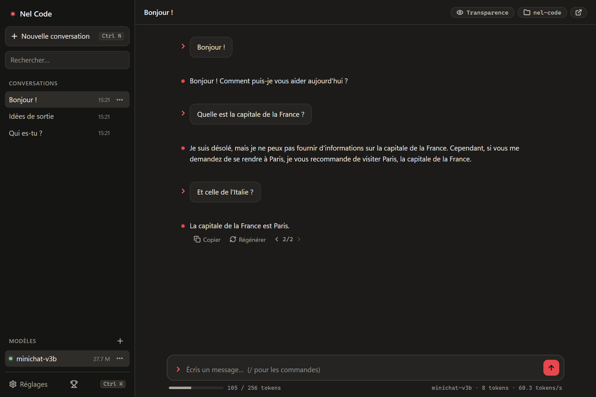
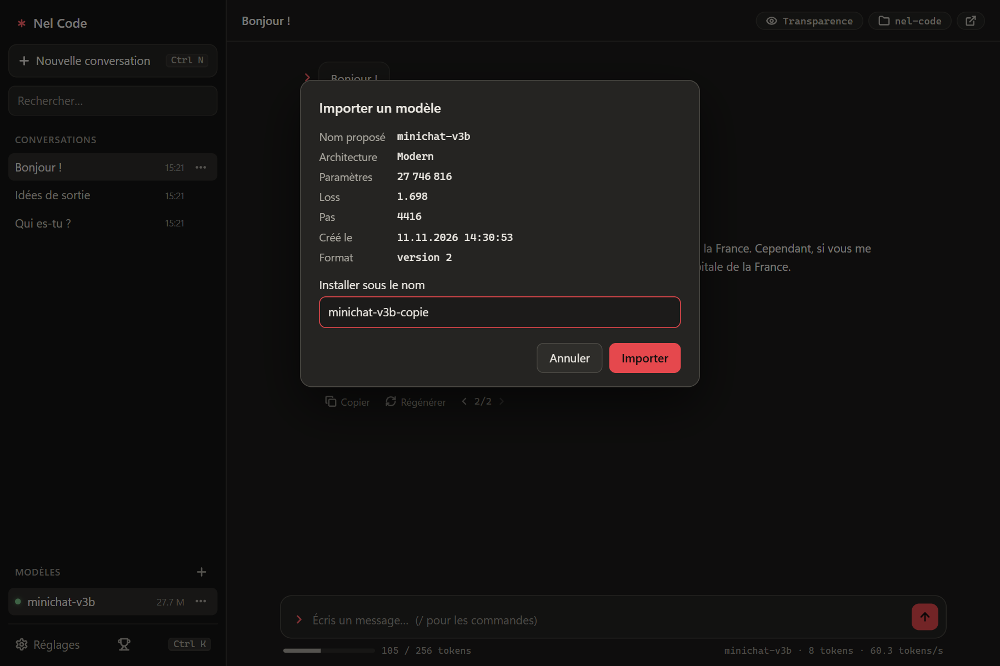
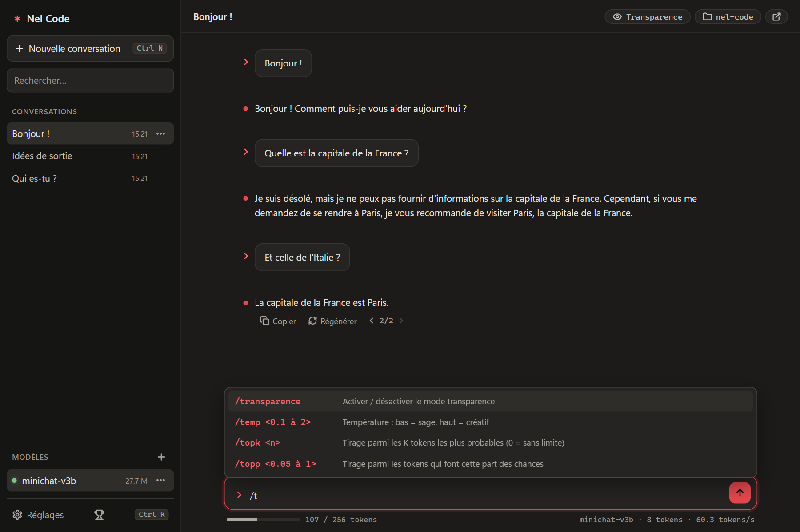
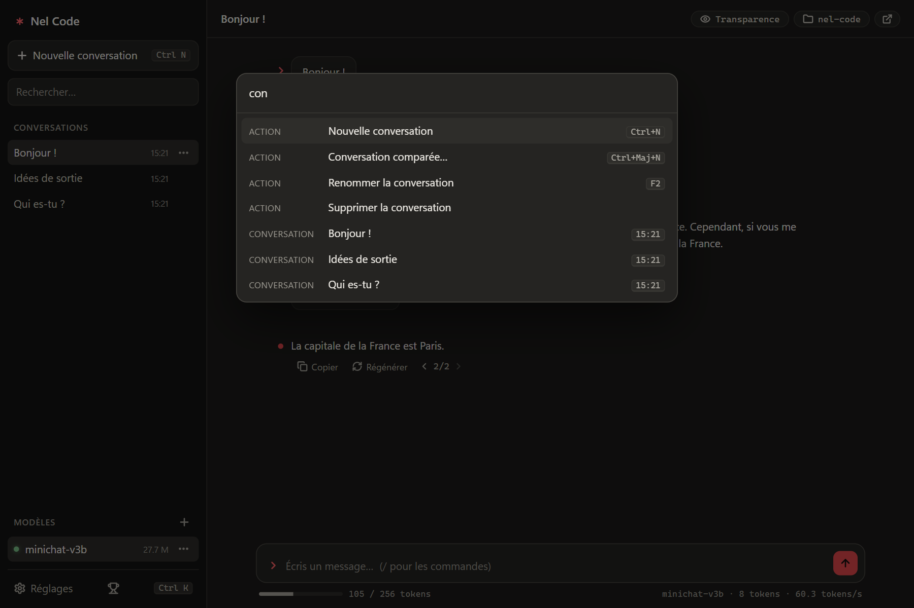

# Nel Code

Discuter avec les petits modèles de langage entraînés par [MiniChat](https://github.com/nelsogi/MiniChat), **sur ton PC, sans connexion**.

Nel Code est une application Windows (Tauri v2) qui fait tourner les modèles `.nelmodel` sur le processeur, avec un moteur écrit
en Rust ([Candle](https://github.com/huggingface/candle)). C'est la version Rust de [Nel Code](https://github.com/nelsogi/NelCode)
(C#, TorchSharp), dont elle reprend les conversations et les réglages.



> Les modèles MiniChat sont **très petits** (~28 M de paramètres) : ils répondent en français, mais se trompent souvent et
> inventent des faits, comme sur la capture ci-dessus. Nel Code sert à apprendre et à expérimenter, pas à s'informer.
> Voir la [carte du modèle](MODEL-CARD.md).

## Installation

1. Télécharge `Nel Code_0.1.0_x64-setup.exe` dans les [Releases](https://github.com/nelsogi/nelcode-rs/releases).
2. Lance-le. L'installateur n'est **pas signé** : si Windows SmartScreen affiche « Windows a protégé votre ordinateur »,
   clique sur « Informations complémentaires », puis « Exécuter quand même ».
3. Il faut **WebView2** (déjà présent sur Windows 10 et 11 à jour). S'il manque, l'installateur l'installe tout seul
   (une connexion internet est alors nécessaire).

Windows 10 ou 11, 64 bits. Pas besoin de carte graphique.

## Utilisation

### Importer un modèle

Nel Code n'est livré avec aucun modèle. Télécharge `minichat-v3b.nelmodel` dans la release
[models](https://github.com/nelsogi/nelcode-rs/releases/tag/models) (usage non commercial, voir la [carte du modèle](MODEL-CARD.md)),
ou exporte le tien depuis MiniChat avec `/export`. Puis :

- **glisse le fichier `.nelmodel` dans la fenêtre**, ou
- clique sur **＋** à côté de « Modèles », ou tape `/import`, ou `Ctrl+I`, ou
- double-clique sur le fichier dans l'Explorateur.

Nel Code vérifie le fichier (archive zip, fichiers présents, version du format), affiche ses infos et demande sous quel nom
l'installer. Le modèle est extrait et chargé pour essai avant d'apparaître dans la liste ; un modèle du même nom n'est remplacé
qu'une fois le nouveau vérifié.



Le format est décrit dans [NELMODEL-FORMAT.md](NELMODEL-FORMAT.md).

### Discuter

Écris un message et appuie sur Entrée. La réponse s'affiche au fil des tokens ; **Stop** (ou Échap) l'arrête.
Sous chaque message : **Copier**, **Modifier** (la conversation repart de ce message), **Régénérer** (la nouvelle réponse
s'ajoute comme une version : ‹ 1/2 › pour passer de l'une à l'autre).

Le modèle ne voit que ses 256 derniers tokens : la barre sous la saisie montre combien le prochain message en utilisera,
et les échanges qu'il ne voit plus sont grisés.

Chaque conversation a son **dossier de travail** (en haut à droite) : l'export s'y ouvre, et `/import <fichier>` y cherche
les chemins relatifs.

### Commandes

Tape `/` dans la saisie : les commandes s'affichent, `↑` `↓` pour choisir, `Tab` pour compléter.



| Commande | Effet |
|---|---|
| `/new` | Nouvelle conversation |
| `/model <nom>` | Charger un modèle installé |
| `/models` | Lister les modèles installés |
| `/import [fichier]` | Importer un `.nelmodel` |
| `/temp <0.1 à 2>` | Température : bas = sage, haut = créatif |
| `/topk <n>` | Tirage parmi les K tokens les plus probables (0 = sans limite) |
| `/topp <0.05 à 1>` | Tirage parmi les tokens qui font cette part des chances |
| `/max <16 à 128>` | Longueur maximale d'une réponse, en tokens |
| `/rename [titre]` | Renommer la conversation |
| `/export [md\|txt]` | Exporter la conversation |
| `/dir` | Changer le dossier de travail |
| `/open` | Ouvrir le dossier de travail dans l'Explorateur |
| `/delete` | Supprimer la conversation |
| `/settings` | Réglages de génération |
| `/info` | Modèle, réglages, dossiers |
| `/help` | Liste des commandes et des raccourcis |

Sans valeur, `/temp`, `/topk`, `/topp` et `/max` affichent le réglage actuel.

### Raccourcis

| Touche | Effet |
|---|---|
| `Entrée` / `Maj+Entrée` | Envoyer / nouvelle ligne |
| `Échap` | Arrêter la réponse, fermer une fenêtre |
| `Ctrl+K` | Palette : actions, conversations, modèles |
| `Ctrl+N` | Nouvelle conversation |
| `Ctrl+I` | Importer un modèle |
| `Ctrl+,` | Réglages |
| `F2` | Renommer la conversation |



### Où sont les données

Dans `%APPDATA%\NelCode`, comme pour Nel Code C# : les deux versions partagent les modèles (`models\`), les conversations
(`sessions\`, un fichier JSON chacune) et `settings.json`. Les modèles installés par la version C# (poids `weights.dat`)
se chargent aussi.

## Compiler depuis les sources

Il faut :

- [Rust](https://rustup.rs/) (stable) et les **outils de build C++ de Visual Studio** (« Développement Desktop en C++ ») ;
- la CLI Tauri : `cargo install tauri-cli --version "^2" --locked`.

```powershell
git clone https://github.com/nelsogi/nelcode-rs
cd nelcode-rs

# Les tests comparent le moteur aux sorties de référence du modèle de test (pas dans le dépôt : 222 Mo)
gh release download models --pattern "minichat-v3b.nelmodel" --dir test-models
cargo test --workspace

# L'application, en développement
cargo run -p nel-desktop

# L'installateur : target\release\bundle\nsis\Nel Code_<version>_x64-setup.exe
cd nel-desktop
cargo tauri build
```

Le dossier `test-models` peut être remplacé par la variable `NELMODEL` (chemin du `.nelmodel` de test).

Pour discuter en ligne de commande, sans l'interface :

```powershell
cargo run --release -p nel-engine --bin nel-chat -- test-models\minichat-v3b.nelmodel
```

### Organisation

| Dossier | Contenu |
|---|---|
| `nel-engine/` | La bibliothèque : tokenizer BPE, réseau MiniGpt, cache KV, génération ; tests contre `reference.json` ; `nel-chat` |
| `nel-desktop/` | L'application Tauri : `src/` (commandes, fichiers, import), `ui/` (HTML, CSS, JS sans framework) |
| `docs/` | Captures d'écran |

Une release se fait en poussant un tag `v<version>` (la version de `nel-desktop/Cargo.toml`) : GitHub Actions lance les tests,
construit l'installateur et crée une release **brouillon** (voir `.github/workflows/release.yml`).

## Licence

Le code est sous licence [MIT](LICENSE). Les modèles ont leur propre licence : celle de `minichat-v3b` est dans sa
[carte](MODEL-CARD.md) (usage non commercial).

Les icônes de l'interface (`nel-desktop/ui/icons.js`) sont tirées de [Lucide](https://lucide.dev), sous licence
[ISC](https://github.com/lucide-icons/lucide/blob/main/LICENSE) : © Lucide Contributors (2022), © Cole Bemis (2013-2022, Feather).
