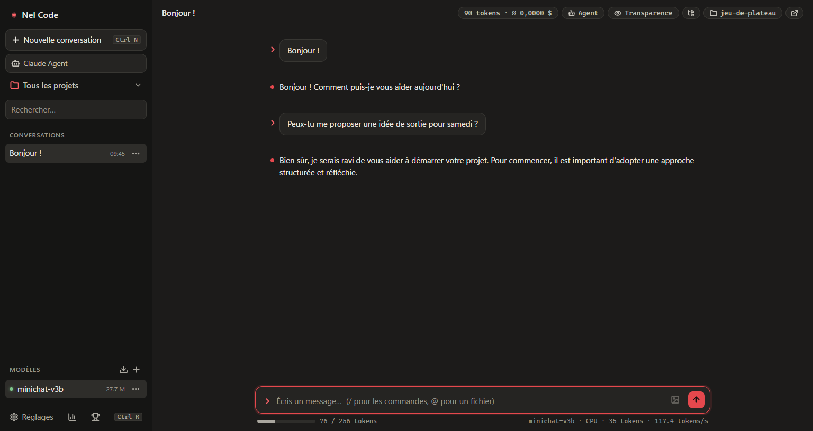
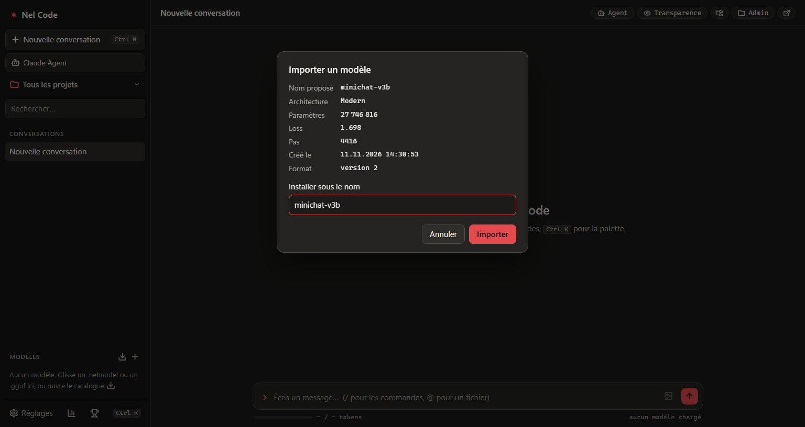

# Nel Code

Discuter avec les petits modèles de langage entraînés par [MiniChat](https://github.com/nelsogi/MiniChat), ou avec des
modèles ouverts (Qwen2.5-Coder…), **sur ton PC, sans connexion**.

Nel Code est une application Windows (Tauri v2) qui fait tourner les modèles `.nelmodel` et les modèles GGUF (Qwen2, Llama)
sur le processeur ou un GPU NVIDIA, avec un moteur écrit en Rust ([Candle](https://github.com/huggingface/candle)). C'est la version Rust de [Nel Code](https://github.com/nelsogi/NelCode)
(C#, TorchSharp), dont elle reprend les conversations et les réglages.



> Les modèles MiniChat sont **très petits** (~28 M de paramètres) : ils répondent en français, mais se trompent souvent et
> inventent des faits, comme sur la capture ci-dessus. Nel Code sert à apprendre et à expérimenter, pas à s'informer.
> Voir la [carte du modèle](MODEL-CARD.md).

## Installation

1. Télécharge `Nel Code_0.9.0_x64-setup.exe` dans les [Releases](https://github.com/nelsogi/nelcode-rs/releases).
2. Lance-le. L'installateur n'est **pas signé** : si Windows SmartScreen affiche « Windows a protégé votre ordinateur »,
   clique sur « Informations complémentaires », puis « Exécuter quand même ».
3. Il faut **WebView2** (déjà présent sur Windows 10 et 11 à jour). S'il manque, l'installateur l'installe tout seul
   (une connexion internet est alors nécessaire).

Windows 10 ou 11, 64 bits. Pas besoin de carte graphique ; avec une carte NVIDIA, le [pack GPU](#calcul-sur-gpu-nvidia)
accélère les réponses.

## Utilisation

### Importer un modèle

Nel Code n'est livré avec aucun modèle. Télécharge `minichat-v3b.nelmodel` dans la release
[models](https://github.com/nelsogi/nelcode-rs/releases/tag/models) (usage non commercial, voir la [carte du modèle](MODEL-CARD.md)),
ou exporte le tien depuis MiniChat avec `/export`. Puis :

- **glisse le fichier `.nelmodel` dans la fenêtre**, ou
- clique sur **＋** à côté de « Modèles », ou tape `/import`, ou `Ctrl+I`, ou
- double-clique sur le fichier dans l'Explorateur.

Nel Code vérifie le fichier (archive zip, fichiers présents, version du format), affiche ses infos et demande sous quel nom
l'installer. Le modèle est extrait et chargé pour essai avant d'apparaître dans la liste ; un modèle du même nom n'est remplacé
qu'une fois le nouveau vérifié.



Le format est décrit dans [NELMODEL-FORMAT.md](NELMODEL-FORMAT.md).

### Modèles ouverts : catalogue et fichiers .gguf

Le **catalogue** (bouton ⤓ à côté de « Modèles », `/catalogue`, palette Ctrl+K) propose des modèles ouverts vérifiés :

| Modèle | Paramètres | Taille | Licence |
|---|---|---|---|
| [Qwen2.5-Coder-0.5B-Instruct](https://huggingface.co/Qwen/Qwen2.5-Coder-0.5B-Instruct-GGUF) (Q4_K_M) | 0,5 milliard | 491 Mo | Apache 2.0 |
| [Qwen2.5-Coder-1.5B-Instruct](https://huggingface.co/Qwen/Qwen2.5-Coder-1.5B-Instruct-GGUF) (Q4_K_M) | 1,5 milliard | 1,1 Go | Apache 2.0 |

La licence est affichée (et acceptée) avant le téléchargement. Le fichier vient de Hugging Face, à une révision fixe, avec
une barre de progression et Annuler ; son empreinte SHA-256, écrite dans le code (`nel-desktop/src/catalog.rs`), est
vérifiée avant l'installation : un fichier faux est effacé. Voir la [carte des modèles](MODEL-CARD.md).

Un autre fichier **`.gguf`** s'importe comme un `.nelmodel` (glisser-déposer, ＋, `/import`) : architectures **Qwen2**
et **Llama**, format de chat **ChatML** ou **Llama 3** (lu dans le modèle). Nel Code affiche l'architecture, les
paramètres, le contexte, le format de chat et la licence déclarée dans le fichier ; vérifie celle-ci avant de t'en servir.
Le tokenizer est reconstruit depuis le fichier (BPE de Qwen2 ou de Llama 3) ; pour un autre, pose son `tokenizer.json`
à côté du `.gguf`.

### Premier lancement

Au premier lancement (ni modèle, ni fournisseur, ni conversation), un assistant en 3 étapes présente Nel Code et sa
couleur, propose d'où vient le modèle (catalogue, fichier `.nelmodel` / `.gguf`, serveur distant ou Claude Agent) et
demande le dossier de travail ; « Commencer » ouvre le choix fait, « Passer » le ferme pour de bon. Il se rouvre depuis
la palette Ctrl+K (« Assistant de démarrage »).

### Projets et panneau Fichiers

Un **projet** est un dossier de travail. Le sélecteur en haut de la barre latérale montre le projet affiché, les projets
récents (12 au plus) et **Ouvrir un dossier…** : avec un projet choisi, la liste ne montre que ses conversations, et une
nouvelle conversation s'y range. **Tous les projets** montre toutes les conversations, regroupées sous le nom de leur
projet quand il y en a plusieurs.

Le **panneau Fichiers** (bouton à droite de l'en-tête, Ctrl+Maj+E) montre l'arborescence du dossier de travail (sans
dossiers cachés ni de compilation), repliable dossier par dossier. Un clic sur un fichier l'affiche, colorié ; un
fichier protégé (`.env`, `*.pem`…) n'est affiché qu'après confirmation. Les fichiers créés (**A**) ou modifiés (**M**) par
l'agent dans la conversation portent un badge, et leurs dossiers un point ; **Diff de la session** montre tout ce qui a
changé depuis avant la première modification de l'agent (pour Claude Agent : les diffs de ses étapes). Le panneau est en
lecture seule.

### Discuter

Écris un message et appuie sur Entrée. La réponse s'affiche au fil des tokens ; **Stop** (ou Échap) l'arrête.
Sous chaque message : **Copier**, **Modifier** (la conversation repart de ce message), **Régénérer** (la nouvelle réponse
s'ajoute comme une version : ‹ 1/2 › pour passer de l'une à l'autre).

Le modèle ne voit qu'une partie de la conversation (256 tokens pour un `.nelmodel` ; pour un modèle GGUF, son contexte,
limité à **8 192 tokens** par défaut, réglable dans les Réglages) : la barre sous la saisie montre combien le prochain message
en utilisera, et les échanges qu'il ne voit plus sont grisés.

Dans les réponses, les blocs de code ```` ``` ```` sont coloriés (C#, Rust, Python, JavaScript, HTML, CSS, JSON) et ont
un bouton **Copier**.

### Modèles distants (llama.cpp, Ollama, LM Studio…)

Nel Code peut aussi discuter avec des modèles qui tournent sur une autre machine, par un serveur compatible avec
l'API OpenAI.

1. **Réglages → Fournisseurs → Ajouter un fournisseur** : un nom, l'adresse de l'API (par exemple
   `http://10.5.33.228:11434/v1` pour Ollama, `http://hôte:8080/v1` pour llama.cpp, `http://hôte:1234/v1` pour
   LM Studio ; `/v1` est ajouté s'il manque) et, si le serveur en demande une, la clé.
2. **Tester** appelle `/v1/models` et liste les modèles du serveur. Ils apparaissent dans la liste des modèles avec le
   badge **réseau** et le nom du fournisseur : un clic les choisit (la barre d'état affiche `modèle · réseau · fournisseur`).

**Ajouter Claude (Anthropic)** préremplit un fournisseur pour l'API d'Anthropic (`https://api.anthropic.com/v1/`, sa
couche compatible OpenAI) : il suffit d'y coller une clé API de la Console Anthropic (rangée, comme les autres, dans le
Gestionnaire d'identification). Pour ce fournisseur, l'option **Ne pas envoyer temperature/top_p** est cochée : les
modèles Claude récents refusent ces réglages (erreur 400). Elle existe pour chaque fournisseur. Le mode Agent marche
avec Claude (ses outils passent par la même API). Anthropic présente cette couche compatible comme un moyen d'essayer
ses modèles plutôt qu'une solution de production : la réflexion de Claude n'y est pas renvoyée.

**Importer depuis Qwen Code** crée les fournisseurs à partir de `~/.qwen/settings.json` (`modelProviders.openai`) : un
par adresse (`baseUrl`), avec les réglages de chaque modèle (`samplingParams` : `temperature`, `top_p`, `max_tokens` ;
`generationConfig.contextWindowSize`). La clé (`envKey`) est cherchée dans `env` de ce fichier, dans `~/.qwen/.env`,
puis dans les variables d'environnement.

Les appels partent de la partie Rust de Nel Code (pas de la page : sa politique de sécurité ne change pas), en
streaming. Si le serveur n'envoie rien pendant 2 minutes, la réponse s'arrête avec « délai dépassé » ; **Stop** ferme la
connexion tout de suite (le début de la réponse est gardé). Un serveur éteint, une clé refusée ou un modèle arrêté donnent
un message clair. La barre de contexte est une estimation (environ 4 caractères par token) ; les échanges les plus anciens
sont retirés s'ils ne tiennent plus dans le contexte du modèle (quand il est connu, par exemple importé de Qwen Code).

**Réflexion** : si le modèle envoie son raisonnement (`reasoning_content` de llama.cpp, `reasoning` d'Ollama, ou des
balises `<think>…</think>` au début du texte), il s'affiche dans un bloc **Réflexion** repliable au-dessus de la
réponse, avec sa durée. Il est gardé dans la conversation, mais jamais renvoyé au modèle avec les messages suivants.

**Sécurité** : la clé d'un fournisseur est rangée dans le **Gestionnaire d'identification de Windows**
(« NelCode:provider:… »), jamais dans `settings.json` ; supprimer le fournisseur la supprime. Une adresse en `http://`
vers une autre machine affiche un avertissement : les messages passent **en clair** sur le réseau, préfère `https://`
si le serveur le permet.

### Claude Agent

**Claude Agent** (bouton sous « Nouvelle conversation », `/claude-agent`, palette Ctrl+K) est un type de conversation
mené par l'outil en ligne de commande `claude` d'Anthropic, installé sur le PC
([installation](https://code.claude.com/docs/en/setup)) : Nel Code le cherche dans le PATH (`claude.exe`, puis
`claude.cmd`), puis dans `%USERPROFILE%\.local\bin`, et l'indique s'il manque. L'outil travaille dans le dossier de
travail de la conversation ; Nel Code affiche son travail dans l'interface habituelle : le texte au fil de l'eau, la
réflexion, chaque outil comme une étape dépliable (lecture, écriture et modification avec leur diff, commande avec sa
sortie), son plan dans le panneau Plan, puis le **coût** (estimé par l'outil) et la **durée** de chaque demande. Le
message suivant reprend la même session (`--resume`).

- **Clé API seulement** : dans **Réglages → Claude Agent**, une clé API de la Console Anthropic, rangée dans le
  Gestionnaire d'identification et passée à l'outil comme `ANTHROPIC_API_KEY`. Pas de connexion à un compte Claude.ai.
  Les autres variables d'environnement qui contiennent `KEY`, `TOKEN` ou `SECRET` ne sont pas transmises.
- **Mode de permission** : par défaut, rien d'automatique (`--permission-mode default` : sans personne pour répondre,
  tout ce qui demande un accord est refusé et l'étape s'affiche « refusée ») ; en option, **accepter les
  modifications de fichiers** (`acceptEdits`). **Outils autorisés** (`--allowedTools`), un par ligne :
  `Read`, `Bash(dotnet build *)`…
- **Stop** envoie Ctrl+C à l'outil (son SIGINT sous Windows), puis attend qu'il finisse proprement (le début de la
  réponse est gardé) ; au-delà de 15 s, il est arrêté avec tous ses processus.
- Le message part sur l'entrée standard de l'outil, jamais en argument. Pas de Régénérer ni de Modifier dans ces
  conversations : la session de l'outil ne se réécrit pas.

### Mode Agent

Avec un modèle distant qui gère les **outils** (tool calling de l'API OpenAI : llama.cpp lancé avec `--jinja`, Ollama
avec Qwen3…), le bouton **Agent** (en haut, ou `/agent`) laisse le modèle travailler dans le **dossier de travail** de
la conversation. Les `.nelmodel` et les modèles GGUF de ce PC n'y ont pas accès.

| Outil | Effet |
|---|---|
| `list_files` | Liste les fichiers (sans dossiers cachés, `node_modules`, `target`…, sans suivre les liens) |
| `read_file` | Lit un fichier texte (100 Ko au plus), avec les numéros de ligne |
| `search` | Cherche un texte dans les fichiers (« chemin:ligne: texte ») |
| `write_file` | Crée un nouveau fichier — **avec ton accord** |
| `edit_file` | Remplace un passage d'un fichier — **avec ton accord** |
| `update_plan` | Donne ou met à jour le plan de la demande (à faire, en cours, fait) |
| `run_command` | Lance un programme, **sans shell** — **avec ton accord** (sauf liste autorisée) |

Le modèle demande un outil, Nel Code l'exécute et lui renvoie le résultat, jusqu'à sa réponse finale (10 tours au plus,
réglable dans les Réglages). Tout s'affiche en direct dans la conversation : la **Réflexion** repliable, puis une ligne
par étape (« Lecture de src/Program.cs », « Recherche de "Player" — 4 résultats »), à déplier pour voir le détail.
**Stop** (ou Échap) arrête tout, à tout moment.

**NELCODE.md** : s'il existe à la racine du dossier de travail, son contenu (20 000 premiers octets) est ajouté au
message système de chaque demande Agent : le projet, ses règles, ses commandes. L'icône **NELCODE.md** de l'en-tête
(en vert) montre qu'il est pris en compte ; sans fichier, le même bouton crée un NELCODE.md modèle (jamais par-dessus un
fichier existant).

**Plan** : pour une demande en plusieurs étapes, le modèle donne un plan (`update_plan`). Il s'affiche dans le panneau
**Plan** à droite de la conversation (repliable), mis à jour en direct (à faire, en cours, fait), et il est gardé avec
la conversation.

**Commandes** : `run_command` lance un programme et ses arguments (`dotnet` avec `build`), **sans shell** : `cmd`,
PowerShell, bash, les scripts `.bat` / `.cmd` / `.ps1` et les opérateurs `|`, `>`, `&&` sont refusés. La commande
tourne dans le dossier de travail, sans fenêtre ; sa sortie s'affiche en direct dans l'étape (limitée : le milieu d'une
très longue sortie est coupé). Chaque commande demande **Lancer** / **Refuser**, sauf celles de **Réglages → Commandes
autorisées sans confirmation** (vide par défaut ; par exemple `dotnet build` et `dotnet test`, qui autorisent aussi
`dotnet build src/App.csproj`). Au-delà de la durée maximale (2 min par défaut, réglable), ou sur **Stop**, la commande
et **tous ses processus enfants** sont tués (Job Object Windows). Les variables d'environnement dont le nom contient
`KEY`, `TOKEN` ou `SECRET` ne lui sont pas transmises.

**Écritures** : avant chaque écriture, Nel Code montre le diff (lignes ajoutées en vert, retirées en rouge) avec
**Accepter**, **Refuser** et **Accepter tout pour cette demande**. Aucun fichier n'est modifié sans accord. Chaque
écriture acceptée est sauvegardée (`%APPDATA%\NelCode\agent-backups`) : **Annuler** sur l'étape, ou **Annuler toute la
demande**, remet les fichiers comme avant (un fichier créé est supprimé). Si le fichier a changé depuis, l'annulation est
refusée, pour ne rien perdre.

**Sécurité** :
- tout reste dans le dossier de travail : chemins relatifs normalisés ; `..`, chemins absolus, noms avec `:` et liens
  (symboliques ou jonctions) qui sortent du dossier sont refusés ; les fichiers trop gros aussi ;
- les noms réservés de Windows (`CON`, `NUL`, `COM1`, `LPT1`…, avec ou sans extension) et les noms qui finissent par un
  point ou une espace sont refusés ;
- les **fichiers protégés** ne sont lus qu'avec ta confirmation explicite, à chaque fois (« Accepter tout » des
  écritures ne compte pas pour eux), et `search` ne les parcourt jamais sans elle. Par défaut : `.env`, `.env.*`,
  `.git/`, `*.pem`, `*.key`, `*.pfx`, `id_rsa`, `*.kdbx`, `appsettings.*.json`, `secrets.json` ; d'autres s'ajoutent
  dans **Réglages → Fichiers protégés** (un motif par ligne : `*.secret`, `privé/` pour un dossier, `config/prod.yml`
  pour un chemin) ;
- ce qui est lu dans un fichier n'est **jamais une instruction pour Nel Code** : c'est renvoyé au modèle comme donnée
  (avec la consigne de ne pas y obéir), et seul le modèle peut demander un outil. Une écriture attend toujours ton accord,
  quoi que dise un fichier.

### Fichiers du dossier de travail (@)

Tape `@` dans la saisie : les fichiers du dossier de travail s'affichent (sans les dossiers cachés, `node_modules`,
`target`…). Le fichier choisi (`@src/main.rs`) est lu et ajouté au message dans un bloc de code ; la barre de contexte le
compte. Un fichier de plus de 100 Ko, binaire, hors du dossier ou au nom réservé de Windows est refusé ; un fichier
protégé (`.env`, `*.pem`… voir le mode Agent) n'est lu qu'après confirmation ; si le message dépasse le contexte du
modèle, Nel Code prévient avant de l'envoyer. **Lecture seule** : Nel Code ne modifie, ne crée et ne supprime jamais un fichier du
dossier de travail.

Chaque conversation a son **dossier de travail** (en haut à droite) : l'export s'y ouvre, et `/import <fichier>` y cherche
les chemins relatifs.

### Commandes

Tape `/` dans la saisie : les commandes s'affichent, `↑` `↓` pour choisir, `Tab` pour compléter.


| Commande | Effet |
|---|---|
| `/new` | Nouvelle conversation |
| `/model <nom>` | Charger un modèle installé |
| `/models` | Lister les modèles installés |
| `/import [fichier]` | Importer un `.nelmodel` ou un `.gguf` |
| `/agent` | Mode Agent (modèle distant qui gère les outils : fichiers, plan, commandes) |
| `/claude-agent` | Nouvelle conversation Claude Agent |
| `/catalogue` | Télécharger un modèle ouvert |
| `/temp <0.1 à 2>` | Température : bas = sage, haut = créatif |
| `/topk <n>` | Tirage parmi les K tokens les plus probables (0 = sans limite) |
| `/topp <0.05 à 1>` | Tirage parmi les tokens qui font cette part des chances |
| `/max <16 à 128>` | Longueur maximale d'une réponse d'un `.nelmodel`, en tokens (un modèle GGUF va jusqu'à 1024) |
| `/rename [titre]` | Renommer la conversation |
| `/export [md\|txt]` | Exporter la conversation |
| `/dir` | Changer le dossier de travail |
| `/open` | Ouvrir le dossier de travail dans l'Explorateur |
| `/delete` | Supprimer la conversation |
| `/settings` | Réglages de génération |
| `/info` | Modèle, réglages, dossiers |
| `/help` | Liste des commandes et des raccourcis |

Sans valeur, `/temp`, `/topk`, `/topp` et `/max` affichent le réglage actuel.

Dans les **Réglages** (Ctrl+,), la **pénalité de répétition** (1 à 2, 1,15 par défaut) rend moins probables les tokens
des 64 derniers : le modèle tourne moins en boucle. 1 la désactive ; trop haute, il évite même les mots utiles.

### Raccourcis

| Touche | Effet |
|---|---|
| `Entrée` / `Maj+Entrée` | Envoyer / nouvelle ligne |
| `@` | Joindre un fichier du dossier de travail |
| `Échap` | Arrêter la réponse, fermer une fenêtre |
| `Ctrl+K` | Palette : actions, conversations, modèles |
| `Ctrl+N` | Nouvelle conversation |
| `Ctrl+I` | Importer un modèle |
| `Ctrl+,` | Réglages |
| `F2` | Renommer la conversation |
| `Ctrl+Maj+E` | Panneau Fichiers |
| `Ctrl+=` / `Ctrl+-` / `Ctrl+0` | Taille du texte (80 à 150 %, aussi dans les Réglages) |
| `?` | Aide des raccourcis (hors d'un champ, ou dans la saisie vide) |

Les notifications sont discrètes : en bas à droite, quatre au plus, fermées toutes seules (un succès après 3 s, une
erreur après 9 s) ou par leur croix.


### Serveur local (API OpenAI) et Continue

Nel Code peut servir ses modèles à d'autres programmes, comme [Continue](https://continue.dev) dans VS Code, par un
serveur compatible avec l'API OpenAI. Il est **désactivé par défaut**.

1. **Réglages → Serveur local** : coche « Activer le serveur », choisis le port (8765 par défaut), **Enregistrer**.
   La barre d'état affiche `API :8765` tant qu'il tourne (`API · répond…` pendant une réponse).
2. Copie la **clé d'accès** (bouton Copier). **Nouvelle clé** la remplace : l'ancienne est refusée tout de suite.

Le serveur n'écoute que sur `127.0.0.1` (jamais sur le réseau), et refuse toute requête sans la clé
(`Authorization: Bearer <clé>`). Il propose :

| Route | Effet |
|---|---|
| `GET /v1/models` | Les modèles installés (`id` = nom du modèle) |
| `POST /v1/chat/completions` | Une réponse, avec `stream: true` (SSE, `data: … [DONE]`) ou sans |

`model` choisit un modèle installé (chargé à côté au besoin) ; un nom inconnu prend le modèle chargé dans Nel Code.
`temperature` (0 = glouton), `top_p` et `max_tokens` sont pris en compte ; le reste vient des réglages. Les messages
`system` sont placés en tête du dernier message. Une seule réponse à la fois, avec Nel Code : pendant une réponse, une
autre requête reçoit `503`.

```powershell
curl.exe http://127.0.0.1:8765/v1/chat/completions -H "Authorization: Bearer nc-..." -H "Content-Type: application/json" `
  -d '{\"model\":\"Qwen2.5-Coder-1.5B-Instruct\",\"messages\":[{\"role\":\"user\",\"content\":\"Bonjour\"}]}'
```

#### Brancher Continue (VS Code)

1. Dans Nel Code : active le serveur, installe un modèle de code (catalogue : Qwen2.5-Coder-1.5B-Instruct) et copie la clé.
2. Dans VS Code, avec l'extension Continue : ouvre la configuration (roue dentée du panneau Continue, ou le fichier
   `%USERPROFILE%\.continue\config.yaml`) et ajoute le modèle :

   ```yaml
   name: Nel Code
   version: 1.0.0
   schema: v1
   models:
     - name: Qwen2.5-Coder (Nel Code)
       provider: openai
       model: Qwen2.5-Coder-1.5B-Instruct   # un id de GET /v1/models
       apiBase: http://127.0.0.1:8765/v1    # le port des réglages
       apiKey: nc-...                       # la clé des réglages de Nel Code
       roles:
         - chat
         - edit
   ```

3. Choisis « Qwen2.5-Coder (Nel Code) » dans la liste des modèles du panneau Continue, et discute.

Nel Code ne fait que le chat (`/v1/chat/completions`) : pas d'autocomplétion (`/v1/completions`) ni d'embeddings,
d'où les rôles `chat` et `edit` seulement. Nel Code doit rester ouvert pendant que Continue s'en sert.

### Mises à jour

À partir de la 0.3.0, Nel Code se met à jour tout seul. Au démarrage (au plus une fois par jour), il regarde s'il y a
une nouvelle version dans les [Releases](https://github.com/nelsogi/nelcode-rs/releases) : si oui, un bandeau
« Nel Code X.Y.Z est disponible » montre les notes de version. **Installer** télécharge la mise à jour, l'installe et
relance Nel Code ; **Plus tard** la laisse de côté jusqu'au prochain démarrage. Si une réponse est en train de s'écrire,
l'installation attend qu'elle soit finie.

- **Rechercher des mises à jour** : dans la palette Ctrl+K, ou dans les Réglages ;
- la vérification automatique se désactive dans les Réglages (« Rechercher les mises à jour au démarrage ») ;
- les mises à jour sont **signées** : Nel Code refuse un fichier dont la signature ne correspond pas à sa clé publique ;
- sans connexion, rien ne bloque : une notification le dit, et Nel Code fonctionne normalement.

Les conversations, réglages et modèles (`%APPDATA%\NelCode`) ne sont pas touchés par une mise à jour.
Depuis la 0.1.0 ou la 0.2.0, il faut installer la 0.3.0 à la main une fois.

### Calcul sur GPU NVIDIA

Nel Code calcule sur le processeur. Avec une carte NVIDIA (Turing ou plus récente : GTX 16xx, RTX 20xx, 30xx, 40xx…,
pilote **576.02** ou plus récent), il peut calculer sur le GPU :

1. **Réglages → Calcul** : la carte et le pilote détectés s'affichent (avec un lien vers les pilotes NVIDIA si le tien est
   trop ancien) ;
2. **Installer le pack GPU (593 Mo)** : les bibliothèques CUDA de NVIDIA, téléchargées une fois dans `%APPDATA%\NelCode\gpu`.
   L'espace disque et l'empreinte SHA-256 sont vérifiés avant l'installation ; Annuler, ou une erreur, ne laisse rien ;
3. le modèle est rechargé sur le GPU : la barre d'état affiche `GPU · <ta carte>`.

**Automatique** (par défaut) prend le GPU s'il est disponible, sinon le CPU, sans erreur ; **CPU** et **GPU** forcent le
choix. **Retirer le pack GPU** l'efface (au prochain démarrage s'il est en cours d'utilisation). L'installateur de Nel Code
ne contient aucune bibliothèque CUDA : elles ne viennent que du pack, et ne sont chargées que depuis son dossier.

**Tester la vitesse** (Réglages, palette Ctrl+K) mesure le modèle chargé sur CPU puis sur GPU : chargement, temps du
prompt, tokens/s sur 200 tokens. Les résultats sont gardés par modèle. Sur une NVIDIA T400 : 348 tokens/s, contre
134 sur le processeur.

### En cas de problème

Nel Code tient un journal dans `%APPDATA%\NelCode\logs` (un fichier par jour, 7 jours gardés) : démarrage, modèles,
erreurs, mises à jour, GPU, jamais le texte des conversations. **Copier un rapport de bug** (Réglages, palette Ctrl+K)
copie la version, Windows, le modèle actif et les 50 dernières lignes du journal : à coller dans une
[issue](https://github.com/nelsogi/nelcode-rs/issues).

### Où sont les données

Dans `%APPDATA%\NelCode`, comme pour Nel Code C# : les deux versions partagent les modèles (`models\`), les conversations
(`sessions\`, un fichier JSON chacune) et `settings.json`. Les modèles installés par la version C# (poids `weights.dat`)
se chargent aussi.

## Compiler depuis les sources

Il faut :

- [Rust](https://rustup.rs/) (stable) et les **outils de build C++ de Visual Studio** (« Développement Desktop en C++ ») ;
- la CLI Tauri : `cargo install tauri-cli --version "^2" --locked`.

```powershell
git clone https://github.com/nelsogi/nelcode-rs
cd nelcode-rs

# Les tests comparent le moteur aux sorties de référence du modèle de test (pas dans le dépôt : 222 Mo)
gh release download models --pattern "minichat-v3b.nelmodel" --dir test-models
# Les tests GGUF (ignorés sans lui) : Qwen2.5-Coder-0.5B, et son tokenizer.json officiel comme référence
curl -L -o test-models/qwen2.5-coder-0.5b-instruct-q4_k_m.gguf https://huggingface.co/Qwen/Qwen2.5-Coder-0.5B-Instruct-GGUF/resolve/ebb2015119c907b064c512bf053e945850b5875f/qwen2.5-coder-0.5b-instruct-q4_k_m.gguf
curl -L -o test-models/qwen-tokenizer.json https://huggingface.co/Qwen/Qwen2.5-Coder-0.5B-Instruct/resolve/ea3f2471cf1b1f0db85067f1ef93848e38e88c25/tokenizer.json
cargo test --workspace

# L'application, en développement
cargo run -p nel-desktop

# L'installateur : target\release\bundle\nsis\Nel Code_<version>_x64-setup.exe
cd nel-desktop
cargo tauri build
```

`cargo tauri build` signe aussi la mise à jour, et demande donc la clé privée (`TAURI_SIGNING_PRIVATE_KEY`). Sans elle,
construire l'installateur sans les fichiers de mise à jour :
`cargo tauri build --config '{\"bundle\":{\"createUpdaterArtifacts\":false}}'`.

Le dossier `test-models` peut être remplacé par les variables `NELMODEL` (chemin du `.nelmodel` de test) et `GGUF`.

### Tests de l'interface

L'application de développement est lancée avec des dossiers de données et WebView2 temporaires (rien ne touche à
`%APPDATA%\NelCode`), puis pilotée par le port de débogage de WebView2 ([Node](https://nodejs.org) 22 ou plus récent) :

```powershell
cargo build -p nel-desktop
node --test --test-concurrency=1 --test-reporter=spec "e2e/*.test.mjs"
```

`e2e/nelcode.test.mjs` couvre le démarrage, l'import, une réponse, Stop, Régénérer et les versions, Modifier, le
changement de modèle, la recherche, renommer et supprimer, les réglages, la transparence, la comparaison et le vote, le
test de vitesse, le rapport de bug, les blocs de code et les fichiers `@`. `e2e/server.test.mjs` couvre le serveur
local : désactivé par défaut, activé dans les réglages, clé obligatoire puis renouvelée, `/v1/models`, chat avec et sans
streaming, erreurs, écoute sur 127.0.0.1 seulement, indicateur de la barre d'état. `e2e/remote.test.mjs` couvre les
modèles distants avec un faux serveur local : fournisseurs, avertissement http, clé hors de `settings.json`, Tester,
badge « réseau », streaming, réflexion (trois formats), Stop, délai maximal, erreurs, import depuis Qwen Code.
`e2e/agent.test.mjs` couvre le mode Agent avec un faux modèle qui appelle les outils : chaque outil, chaque refus (bac à
sable, jonction, fichier trop gros, injection dans un fichier, utilisateur), Accepter / Refuser / Accepter tout, chaque
annulation, Stop, nombre de tours, modèle sans outils, modèles locaux tenus à l'écart, fichiers protégés (lecture et
recherche, motifs des réglages), noms réservés de Windows, NELCODE.md, plan et commandes (shells refusés, sortie en
direct, liste autorisée, variables cachées, délai et Stop qui tuent les processus enfants), et le fournisseur Claude.
`e2e/ux.test.mjs` couvre les projets, le panneau Fichiers (aperçu, fichier protégé, badges et diff de la session avec un
petit faux modèle à outils), l'assistant du premier lancement, les notifications, l'aide « ? » et la taille du texte.
`e2e/claude.test.mjs` couvre Claude Agent avec un faux exécutable `claude` (`e2e/fake-claude/main.rs`, compilé par le
test avec `rustc`) qui rejoue des flux stream-json enregistrés (`e2e/fake-claude/*.jsonl`). Les clés des tests sont
rangées à part dans le Gestionnaire d'identification : les tests ne touchent jamais aux vraies clés. Les fichiers de test se lancent
l'un après l'autre (`--test-concurrency=1`) : une seule fenêtre de Nel Code à la fois. `e2e/gguf.test.mjs` couvre le catalogue
(servi en local : licence, empreinte refusée, téléchargement), une réponse de Qwen2.5-Coder, le contexte réglable et
l'import d'un `.gguf` par glisser-déposer ; il est ignoré sans le `.gguf` de test. `e2e/gpu.test.mjs` (pack GPU, calcul sur GPU) est ignoré sans carte NVIDIA, sans
CUDA ou sans pack. `E2E_VERBOSE=1` affiche la sortie de l'application.

### Avec CUDA

Il faut en plus le [CUDA Toolkit 12.9](https://developer.nvidia.com/cuda-12-9-1-download-archive) et MSVC **v143**
(Visual Studio 2022, ou le composant « MSVC v143 » de Visual Studio 2026 : nvcc 12.9 refuse MSVC 14.5x). Depuis une
« Developer PowerShell » MSVC 14.44 (`vcvars64.bat -vcvars_ver=14.44`) :

```powershell
$env:CUDA_COMPUTE_CAP = "75"   # Turing et plus récent ; sans GPU dans la machine, obligatoire
cargo build --release -p nel-desktop --features cuda
cargo test --release -p nel-engine --features cuda   # reference.json aussi sur GPU, à 1e-3

# Les tests de l'interface sur GPU, avec le pack construit en local
cargo build -p nel-desktop --features cuda --target-dir target\cuda
.\make-gpu-pack.ps1
$env:NELCODE_EXE = "target\cuda\debug\nel-desktop.exe"; node --test --test-reporter=spec e2e/gpu.test.mjs
```

Les DLL CUDA sont chargées en différé (`nel-desktop/build.rs`) : Nel Code démarre sans elles, et les charge depuis le
pack, par chemin complet, avant le premier calcul sur GPU.

`make-gpu-pack.ps1` construit le pack : uniquement les DLL dont Candle a besoin (liste `PACK_DLLS` de
`nel-engine/src/gpu.rs`), prises dans le CUDA Toolkit, chacune vérifiée dans la liste des fichiers redistribuables du
CUDA EULA (Attachment A), plus l'avis de licence de NVIDIA. Il écrit la taille et l'empreinte SHA-256 dans
`nel-desktop/src/gpu.rs` ; `-Publish` l'envoie dans la release `gpu-pack-cuda12` (pre-release), sans jamais remplacer un
pack déjà publié.

Pour discuter en ligne de commande, sans l'interface :

```powershell
cargo run --release -p nel-engine --bin nel-chat -- test-models\minichat-v3b.nelmodel
```

### Organisation

| Dossier | Contenu |
|---|---|
| `nel-engine/` | La bibliothèque : `ChatModel` (l'interface commune), tokenizer BPE, réseau MiniGpt, cache KV, génération, modèles GGUF (`gguf.rs`), GPU (`gpu.rs`) ; tests contre `reference.json` et Qwen2.5-Coder ; `nel-chat` |
| `nel-desktop/` | L'application Tauri : `src/` (commandes, fichiers, import, catalogue, serveur local, modèles distants, mode Agent, Claude Agent, journal, pack GPU), `ui/` (HTML, CSS, et `js/` : modules ES sans framework, voir ci-dessous) |
| `e2e/` | Les tests de l'interface (Node, port de débogage de WebView2) |
| `docs/` | Captures d'écran |

L'interface (`nel-desktop/ui/js/`) est découpée en modules ES, chargés par `index.html` (`js/main.js`) :

| Module | Contenu |
|---|---|
| `util.js` | Appels au Rust, éléments du DOM, notifications, fenêtres et menus, coloration du code |
| `state.js` | L'état partagé : `S` (conversations, modèles, réponse en cours) et `UI` (petits états de l'interface) |
| `conversation.js` | Conversations, modèles, fichiers `@`, génération, réflexion, transparence, comparaison, affichage, saisie |
| `agent.js` | Mode Agent et Claude Agent : étapes, plan, NELCODE.md |
| `settings.js` | Réglages, mises à jour, serveur local, calcul (GPU, test de vitesse), taille du texte |
| `catalog.js` · `providers.js` | Catalogue de modèles ouverts · fournisseurs distants |
| `palette.js` | Commandes `/`, palette Ctrl+K, aide et raccourcis |
| `projects.js` · `files.js` · `onboarding.js` | Projets · panneau Fichiers · assistant du premier lancement |
| `main.js` | Écouteurs (Rust, clavier, boutons) et démarrage |

Une release se fait en poussant un tag `v<version>` (la version de `nel-desktop/Cargo.toml`) : GitHub Actions lance les tests,
construit l'installateur et crée une release **brouillon** (voir `.github/workflows/release.yml`).

Le pack GPU est une release à part (`gpu-pack-cuda12`, pre-release, jamais « latest ») : il ne change qu'avec la version
de CUDA, et son empreinte est écrite dans le code de l'application.

## Licence

Le code est sous licence [MIT](LICENSE). Les modèles ont leur propre licence : celle de `minichat-v3b` (usage non
commercial) et celles des modèles du catalogue (Apache 2.0) sont dans la [carte des modèles](MODEL-CARD.md).

Le pack GPU contient des bibliothèques du NVIDIA CUDA Toolkit, redistribuées sans modification selon le
[CUDA EULA](https://docs.nvidia.com/cuda/eula/index.html) ; l'avis de licence de NVIDIA est dans le pack
(`NVIDIA-LICENSE.txt`).

Les icônes de l'interface (`nel-desktop/ui/icons.js`) sont tirées de [Lucide](https://lucide.dev), sous licence
[ISC](https://github.com/lucide-icons/lucide/blob/main/LICENSE) : © Lucide Contributors (2022), © Cole Bemis (2013-2022, Feather).
